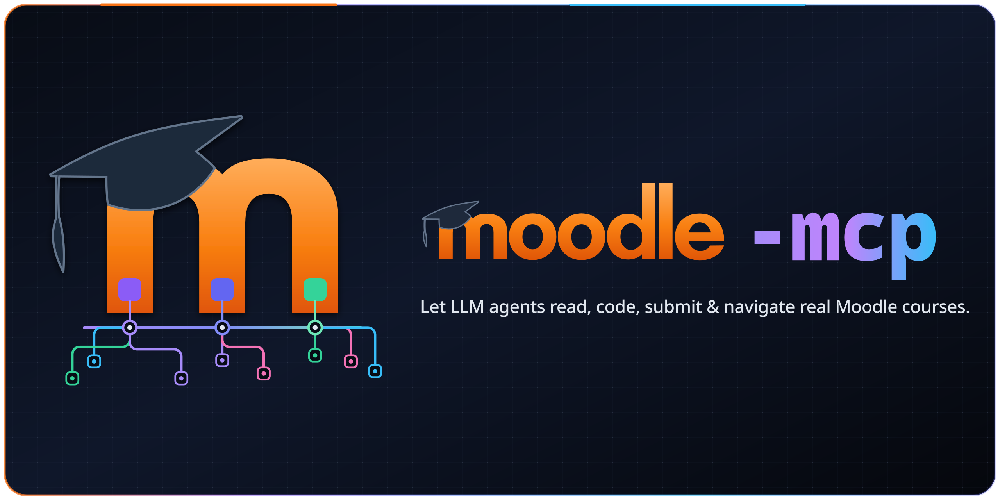
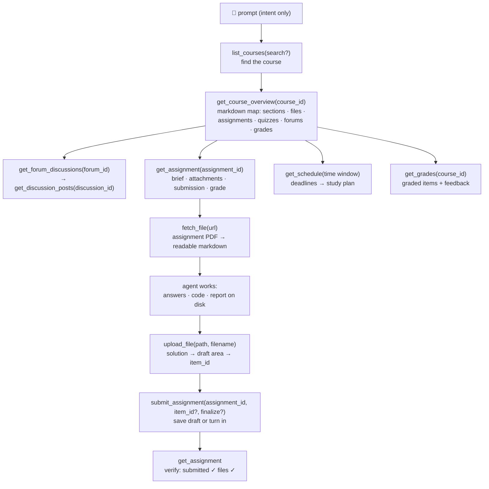

<p align="center">
  
</p>

<p align="center">
  <a href="https://github.com/G36maid/moodle-mcp/actions/workflows/ci.yml"></a>
  <a href="https://codecov.io/gh/G36maid/moodle-mcp"></a>
  <a href="https://github.com/G36maid/moodle-mcp/releases/latest"></a>
  <a href="https://crates.io/crates/moodle-mcp"></a>
  <a href="LICENSE"></a>
  <a href="https://www.rust-lang.org"></a>
  <a href="https://modelcontextprotocol.io"></a>
  <a href="https://github.com/G36maid/moodle-mcp/actions/workflows/release.yml"></a>
</p>

<p align="center">
  <b>English</b> | 
  <a href="i18n/README.zh-TW.md">繁體中文</a> | 
  <a href="i18n/README.zh-CN.md">简体中文</a> | 
  <a href="i18n/README.ja.md">日本語</a> | 
  <a href="i18n/README.es.md">Español</a> | 
  <a href="i18n/README.de.md">Deutsch</a> | 
  <a href="i18n/README.pt-BR.md">Português</a> | 
  <a href="i18n/README.fr.md">Français</a>
</p>

A [Model Context Protocol](https://modelcontextprotocol.io) server that lets
LLM agents **use a real Moodle LMS** — read courses, fetch assignment PDFs,
write code, upload and submit — through a single static binary.

Built in Rust on the official MCP SDK ([`rmcp`](https://crates.io/crates/rmcp)).
Validated live against **Moodle 3.7 → 5.x**.

---

## ❌ Without moodle-mcp

A generic chatbot has no way into your Moodle, so every study task stays manual:

- ❌ Five browser tabs open just to answer *"what's due this week?"*
- ❌ Assignment PDFs downloaded by hand, then re-uploaded into a chat window
- ❌ Forum threads and grades copy-pasted one page at a time

## ✅ With moodle-mcp

The agent signs in as you. 22 typed tools cover the full student journey just like a
real human — from a quick deadline check to fully automated assignment assistance,
without ever opening a browser:

```txt
What's due in the next two weeks? Plan my studying around it.
```

```txt
Finish my Information Security HW1: read the assignment brief and the
attached PDF, work through the problems, and submit a draft.
```

```txt
I missed what happened in Data Communication this week — catch me up.
```

The agent chains the tools itself: course map → assignment brief → PDF →
markdown → solution → upload → draft submission → read-back verification.
Full journeys in [Prompt examples](#-prompt-examples) and
[How the agent works](#-how-the-agent-works).

## ✨ Features

- **Batteries included** — document conversion (anydoc), HTML → markdown
  (htmd), auth CLI and the escape hatch ship in the box: no plugins,
  no helper scripts, no second runtime
- **Agent-native** — tools take and return **local file paths** instead of
  base64; results embed the IDs for the next tool; defaults come with hints
  ("pass course_ids to filter"); errors are plain-language and suggest the fix
- **22 curated tools, human-shaped** — each one mirrors a step you'd
  actually take clicking through Moodle: courses, course map, assignments,
  submission, forums, files (fetch/convert/download/upload), grades,
  schedule, messaging, quiz attempts — not a 1:1 dump of the ~350 raw
  web-service functions; a generic escape hatch (`call_ws_function` +
  `list_functions`) still reaches everything else
- **Course map in one call** — `get_course_overview` merges five Moodle
  endpoints into a single markdown document with every ID and file URL embedded
- **PDF → markdown** — assignment briefs become readable requirements via
  [anydoc](https://crates.io/crates/anydoc); HTML descriptions keep their
  tables via [htmd](https://crates.io/crates/htmd)
- **Version-adaptive** — verified against Moodle 3.7 and designed for 4.x/5.x;
  differences (function names, pagination, response shapes) are absorbed
  automatically
- **Safe by default** — write tools require explicit confirmation; drafts are
  preferred over irreversible submissions; quiz-taking is intentionally not
  provided
- **Single static binary** — no runtime dependencies

## 📋 Requirements

- A **Moodle 3.7 → 5.x** site you have an account on
- Web services enabled site-side: **REST protocol** and the **`moodle_mobile_app`
  service allowed for your account** — the same switches the official Moodle mobile
  app uses, so most sites already qualify
- **HTTPS** strongly recommended — the token travels with every request (see
  [Security notes](#-security-notes))
- Any MCP client — Claude Code, Codex, OpenCode, pi, or anything that speaks MCP
  over stdio
- Rust 1.88+ only for `cargo install` or building from source (prebuilt
  binaries need nothing)

## 📦 Install

### Download a prebuilt binary

No Rust toolchain needed — grab the archive for your platform from the
[latest release](https://github.com/G36maid/moodle-mcp/releases/latest):

| Platform | Archive |
|---|---|
| Linux x86_64 | `moodle-mcp-<version>-x86_64-unknown-linux-gnu.tar.gz` |
| Linux arm64 | `moodle-mcp-<version>-aarch64-unknown-linux-gnu.tar.gz` |
| macOS Apple Silicon | `moodle-mcp-<version>-aarch64-apple-darwin.tar.gz` |
| macOS Intel | `moodle-mcp-<version>-x86_64-apple-darwin.tar.gz` |
| Windows x64 | `moodle-mcp-<version>-x86_64-pc-windows-msvc.zip` |

```bash
tar xzf moodle-mcp-*-aarch64-apple-darwin.tar.gz
sudo mv moodle-mcp-*/moodle-mcp /usr/local/bin/   # or anywhere on PATH
```

### Or install with cargo

```bash
cargo install moodle-mcp   # needs Rust 1.88+
```

### Or build from source

```bash
git clone https://github.com/G36maid/moodle-mcp
cd moodle-mcp
cargo build --release
# binary: target/release/moodle-mcp (~15 MB, static)
```

### Get a token

Use the built-in CLI (same binary):

```bash
moodle-mcp auth
# Moodle URL (e.g. https://moodle.example.com): https://moodle.example.com
# Username: yourname
# Password: ********   (masked as you type)
# → export MOODLE_URL='https://moodle.example.com' MOODLE_TOKEN='…'
```

Anything passed as a flag (`--url`, `--username`, `--password`) skips the
matching prompt, so scripts work non-interactively too.

With SSO (no password), open the Security keys page in a browser instead:

```bash
moodle-mcp auth --url https://moodle.example.com --open
```

If the token request fails, the site is missing something from
[Requirements](#-requirements) — ask your admin to enable web services.

### Connect a client

All four clients read the same stdio server: launch `/path/to/moodle-mcp` with
`MOODLE_URL` / `MOODLE_TOKEN` in its environment. Claude Code can also be
wired up with a single command:

```bash
claude mcp add moodle \
  --env MOODLE_URL=https://moodle.example.com \
  --env MOODLE_TOKEN=your-token \
  -- /path/to/moodle-mcp
```

Otherwise, pick your client:

<details open>
<summary><b>Claude Code</b> — <code>.mcp.json</code> (project) or <code>~/.claude.json</code> (global)</summary>

```json
{
  "mcpServers": {
    "moodle": {
      "command": "/path/to/moodle-mcp",
      "env": {
        "MOODLE_URL": "https://moodle.example.com",
        "MOODLE_TOKEN": "your-token"
      }
    }
  }
}
```

</details>

<details>
<summary><b>Codex</b> — <code>~/.codex/config.toml</code> (global)</summary>

```toml
[mcp_servers.moodle]
command = "/path/to/moodle-mcp"
env = { "MOODLE_URL" = "https://moodle.example.com", "MOODLE_TOKEN" = "your-token" }
```

</details>

<details>
<summary><b>OpenCode</b> — <code>opencode.json</code> (project) or <code>~/.config/opencode/opencode.json</code> (global)</summary>

```json
{
  "mcp": {
    "moodle": {
      "type": "local",
      "command": ["/path/to/moodle-mcp"],
      "environment": {
        "MOODLE_URL": "https://moodle.example.com",
        "MOODLE_TOKEN": "your-token"
      }
    }
  }
}
```

</details>

<details>
<summary><b>pi</b> — <code>.pi/mcp.json</code> (project) or <code>~/.pi/agent/mcp.json</code> (global)</summary>

```json
{
  "mcpServers": {
    "moodle": {
      "command": "/path/to/moodle-mcp",
      "env": {
        "MOODLE_URL": "https://moodle.example.com",
        "MOODLE_TOKEN": "your-token"
      }
    }
  }
}
```

</details>

| Env var | Required | Default | Description |
|---|:---:|---|---|
| `MOODLE_URL` | ✔ | — | Site base URL, no trailing slash |
| `MOODLE_TOKEN` | ✔ | — | Web service token |
| `MOODLE_TIMEOUT_SECS` | — | `60` | Per-request timeout |
| `MOODLE_TIMEZONE` | — | auto / `UTC` | IANA name (`Asia/Taipei`) for rendering timestamps; default auto-detects the Moodle user's timezone preference and falls back to UTC |
| `MOODLE_ALLOW_EXTERNAL_FETCH` | — | off | Lets `fetch_file`/`download_file` fetch URLs outside the configured site (off: only same-site Moodle file URLs) |
| `MOODLE_ALLOW_HTTP` | — | off | `1` allows a plain-http `MOODLE_URL` (loopback hosts are always exempt) — otherwise http is rejected to protect the token |
| `MOODLE_READ_ONLY` | — | off | `1` hides all write/upload tools (`create_forum_discussion`, `reply_to_discussion`, `submit_assignment`, `send_message`, `upload_file`, `call_ws_function`) from the tool list — read-only LLM access |
| `MOODLE_DISABLE_TOOLS` | — | — | Comma-separated tool names to hide on top (e.g. `send_message,upload_file`); unknown names warn at startup |
| `MOODLE_LOG_LEVEL` | — | `info` | Log verbosity: `error`/`warn`/`info`/`debug`/`trace` (invalid values fall back to `info`); `trace` logs response-body snippets — avoid on shared machines |
| `MOODLE_UA` | — | `moodle-mcp/{version}` | User-Agent override for institutional-filtering edge cases |
| `RUST_LOG` | — | `info` | Log filter (logs → stderr; stdout is the MCP stream) |

## 💬 Prompt examples

All of these work with no further setup — the agent discovers the tools from
their descriptions and chains them itself:

### Full-auto (one prompt, whole journey)

| You say | The agent chains |
|---|---|
| *"Finish my Information Security HW1: read the assignment brief and the attached PDF, work through the problems, and submit a draft."* | `get_assignment` (brief + attachments) → `fetch_file` (PDF → markdown, math included) → solves it → writes the answer file → `upload_file` → `submit_assignment` → `get_assignment` (verify submitted ✓) |
| *"Based on upcoming deadlines and course materials, build me a complete study plan for the next two weeks."* | `get_schedule` (all deadlines) → `get_course_overview` per course (materials & reading list) → day-by-day plan balanced against due dates |
| *"I missed what happened in Data Communication this week — catch me up, including the announcements forum."* | `get_notifications` + `get_forum_discussions` → `get_discussion_posts` → synthesized weekly digest |
| *"Prep me for the Software Engineering quiz: what did the teacher post about it?"* | `get_course_overview` (quiz entry) → `get_assignment` (requirements) → related forum threads |

### Quick queries

| You say | The agent chains |
|---|---|
| *"What's due in the next two weeks?"* | `get_schedule` → merged timeline of due dates, quiz closes, events |
| *"What's the HW1 assignment about? Read the brief."* | `get_assignment` → `fetch_file` converts the attached PDF to markdown |
| *"How did I do on the Data Communication labs?"* | `list_courses` → `get_grades(course_id)` → items, feedback, weights |
| *"Which of my courses have graded items?"* | `get_grades()` → cross-course summary |
| *"Summarize every announcement in the Data Communication forum."* | `get_course_overview` → `get_forum_discussions` → `get_discussion_posts` |
| *"Upload my solution.pdf for Quiz1 and save it as a draft."* | `upload_file` → `submit_assignment(item_id, finalize=false)` |
| *"What's on the agenda for the Software Engineering course?"* | `get_course_overview` → sections, files, forums |
| *"Can I message my teacher about an extension?"* | `get_user` / `get_conversations` → draft → confirms → `send_message` |

## 🔄 How the agent works

The tools mirror how you navigate Moodle — each level's output embeds the IDs
for the next. Every journey starts from the course list and the course map;
from there the agent drills down or runs a full workflow on its own:



The same building blocks compose into larger flows — a study plan is
`get_schedule` (deadlines) plus `get_course_overview` per course (materials);
a weekly digest is `get_notifications` plus the forum read chain.

Everything the 20 dedicated tools don't cover is reachable through the
`call_ws_function` + `list_functions` escape hatch — full coverage of the
~350 functions a typical token can call (20 + 2 = 22 in total).

## 🛠 Tool reference

RW — what a call does to your Moodle: 📖 read-only · ✍️ write. Write tools act
as the token owner; the server's instructions tell the agent to confirm with you
first, and uploads land in your private draft area, not with your teacher.

### Identity & courses
| Tool | Signature | RW | Purpose |
|---|---|:-:|---|
| `whoami` | `()` | 📖 | Token owner identity + site/release |
| `list_courses` | `(search?)` | 📖 | Enrolled courses; optional name filter |
| `get_course_overview` | `(course_id)` | 📖 | Whole-course markdown map |

### Assignments
| Tool | Signature | RW | Purpose |
|---|---|:-:|---|
| `get_assignment` | `(assignment_id)` | 📖 | Full document: times, state, description, attachments, submission, grade & feedback |
| `submit_assignment` | `(assignment_id, text?, item_id?, finalize?)` | ✍️ | The single write: online text and/or draft files, optionally finalizing |

### Forums
| Tool | Signature | RW | Purpose |
|---|---|:-:|---|
| `get_forum_discussions` | `(forum_id)` | 📖 | Thread list with opening-post previews |
| `get_discussion_posts` | `(discussion_id)` | 📖 | Whole thread, converted to markdown, attachments included |
| `create_forum_discussion` | `(forum_id, subject, message)` | ✍️ | Start a thread |
| `reply_to_discussion` | `(post_id, subject, message)` | ✍️ | Reply (to the opening post = reply to the thread) |

### Files
| Tool | Signature | RW | Purpose |
|---|---|:-:|---|
| `fetch_file` | `(url)` | 📖 | PDF/DOCX/PPTX/XLSX/ODT/RTF/EPUB/CSV → markdown (anydoc); 100k-char cap |
| `download_file` | `(url, save_to)` | 📖 | Raw bytes → local path (metadata only) |
| `upload_file` | `(path, item_id?)` | ✍️ | Local file → draft area |

### Grades, schedule, messaging
| Tool | Signature | RW | Purpose |
|---|---|:-:|---|
| `get_grades` | `(course_id?)` | 📖 | Cross-course summary, or every grade item of one course |
| `get_schedule` | `(time_from?, time_to?, course_ids?)` | 📖 | Merged timeline (default: next 30 days) |
| `get_notifications` | `(read?, limit?)` | 📖 | Recent notifications |
| `get_conversations` | `(limit?)` | 📖 | Conversations with member ids |
| `send_message` | `(user_id, text)` | ✍️ | Direct message |
| `get_quiz_attempts` | `(quiz_id)` | 📖 | Attempt records (read-only) |
| `get_user` / `search_users` | `(field, value)` / `(search?, limit?)` | 📖 | Profile lookup / user search |

### Escape hatch
| Tool | Signature | RW | Purpose |
|---|---|:-:|---|
| `call_ws_function` | `(wsfunction, params?)` | 📖/✍️ | Call any enabled WS function (PHP bracket notation handled) |
| `list_functions` | `(query?)` | 📖 | Discover callable functions by keyword |

## 🔐 Security notes

- Use **HTTPS** — the token travels with every request.
- The token is a credential: never commit it, never send it to hosts other
  than your Moodle site (the server only injects it into same-site
  `pluginfile.php` URLs, and redirects leaving the Moodle host are stopped).
- The token never appears in tool output or errors: any `token=…` in a
  rendered error message is redacted to `token=[REDACTED]`.
- Transfers are bounded: inline fetches cap at 100 MB, streamed downloads at
  500 MB, uploads at 100 MB. Downloads stream to disk (never buffered whole
  in memory) and are limited by a read-timeout rather than a total timeout,
  so large files finish while stalled connections still die.
- Write tools act **as the token owner**. The server's instructions tell the
  agent to confirm with you before submitting or sending.
- Quiz-taking is intentionally **not** provided.

## 🧰 Development

```bash
cargo test                 # 39 tests: unit + wiremock integration + MCP protocol
cargo clippy --all-targets
cargo fmt -- --check
cargo build --release
```

ID flow between tools:

| ID | Produced by | Consumed by |
|---|---|---|
| course_id | list_courses / get_course_overview | overview / grades / schedule / assignments |
| forum_id | get_course_overview | get_forum_discussions / create_forum_discussion |
| discussion_id | get_forum_discussions | get_discussion_posts |
| post_id | get_discussion_posts | reply_to_discussion |
| assignment_id | get_course_overview / get_assignment | get_assignment / submit_assignment |
| item_id (draft) | upload_file | submit_assignment |
| user_id | conversations members / notifications / get_user | send_message / get_user |

## 📄 License

MIT — see [LICENSE](LICENSE).
