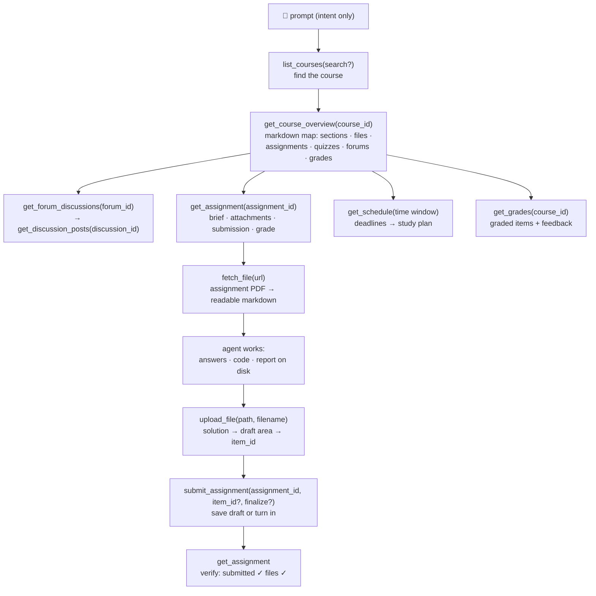

<p align="center">
  
</p>

<p align="center">
  <a href="https://github.com/G36maid/moodle-mcp/actions/workflows/ci.yml"></a>
  <a href="https://codecov.io/gh/G36maid/moodle-mcp"></a>
  <a href="https://github.com/G36maid/moodle-mcp/releases/latest"></a>
  <a href="https://crates.io/crates/moodle-mcp"></a>
  <a href="LICENSE"></a>
  <a href="https://www.rust-lang.org"></a>
  <a href="https://modelcontextprotocol.io"></a>
  <a href="https://github.com/G36maid/moodle-mcp/actions/workflows/release.yml"></a>
</p>

<p align="center">
  <b>English</b> | 
  <a href="i18n/README.zh-TW.md">繁體中文</a> | 
  <a href="i18n/README.zh-CN.md">简体中文</a> | 
  <a href="i18n/README.ja.md">日本語</a> | 
  <a href="i18n/README.es.md">Español</a> | 
  <a href="i18n/README.de.md">Deutsch</a> | 
  <a href="i18n/README.pt-BR.md">Português</a> | 
  <a href="i18n/README.fr.md">Français</a>
</p>

A [Model Context Protocol](https://modelcontextprotocol.io) server that lets
LLM agents **use a real Moodle LMS** — read courses, fetch assignment PDFs,
write code, upload and submit — through a single static binary.

Built in Rust on the official MCP SDK ([`rmcp`](https://crates.io/crates/rmcp)).
Validated live against **Moodle 3.7 → 5.x**.

## ✅ Why

A generic chatbot has no way into your Moodle, so every study task stays
manual — five browser tabs to answer *"what's due this week?"*, PDFs
re-uploaded by hand, forums and grades copy-pasted one page at a time.

moodle-mcp signs the agent in as you. 20 typed tools cover the full student
journey, and the agent chains them by itself — without ever opening a
browser:

- **Batteries included** — document conversion, HTML → markdown, an auth CLI
  and an opt-in escape hatch in one binary: no plugins, no helper scripts,
  no second runtime
- **Agent-native** — tools take and return local file paths instead of
  base64; every result embeds the IDs for the next call; errors are
  plain-language and suggest the fix
- **Safe by default** — write tools confirm with you first, submissions stay
  drafts until you say so; quiz-taking is intentionally not provided
- **Version-adaptive** — verified against Moodle 3.7 and designed for
  4.x/5.x; response differences between versions are absorbed automatically
- **One static binary** — no runtime dependencies

## 🚀 Quick start

Needs a Moodle 3.7 → 5.x account on a site that allows the mobile-app web
service (most do — see
[prerequisites](docs/src/getting-started.md#prerequisites)).

```bash
# 1. Install
cargo install moodle-mcp        # or grab a prebuilt binary — no Rust needed

# 2. Log in once — prints MOODLE_URL and MOODLE_TOKEN
moodle-mcp auth

# 3. Connect your client (Claude Code shown; Codex/OpenCode/pi below)
claude mcp add moodle \
  --env MOODLE_URL=https://moodle.example.com \
  --env MOODLE_TOKEN=your-token \
  -- /path/to/moodle-mcp

# 4. Open a chat and ask:
#    "What's due in the next two weeks? Plan my studying around it."
```

Prebuilt binaries, SSO login, config snippets for every client, and the
full environment-variable reference:
[Installation](docs/src/installation.md) ·
[Getting Started](docs/src/getting-started.md) ·
[Configuration](docs/src/configuration.md)

## 💬 What the agent can do

All of these work with no further setup — the agent discovers the tools
from their descriptions and chains them itself:

| You say | The agent chains |
|---|---|
| *"Finish my Information Security HW1: read the assignment brief and the attached PDF, work through the problems, and submit a draft."* | `get_assignment` (brief + attachments) → `fetch_file` (PDF → markdown, math included) → solves it → writes the answer file → `upload_file` → `submit_assignment` → `get_assignment` (verify submitted ✓) |
| *"Based on upcoming deadlines and course materials, build me a complete study plan for the next two weeks."* | `get_schedule` (all deadlines) → `get_course_overview` per course → day-by-day plan balanced against due dates |
| *"I missed what happened in Data Communication this week — catch me up, including the announcements forum."* | `get_notifications` + `get_forum_discussions` → `get_discussion_posts` → synthesized weekly digest |
| *"Prep me for the Software Engineering quiz: what did the teacher post about it?"* | `get_course_overview` (quiz entry) → `get_assignment` (requirements) → related forum threads |

## 🔄 How the agent works

The tools mirror how you navigate Moodle — each level's output embeds the
IDs for the next:



Everything the dedicated tools don't cover is reachable through the
`call_ws_function` + `list_ws_functions` escape hatch — full coverage of the
~350 functions a typical token can call (20 + 2 = 22 in total; the escape
hatch is opt-in via `MOODLE_ENABLE_WS_FUNCTION=true`).

## 📚 Documentation

Full documentation lives in [`docs/`](docs/src/SUMMARY.md) (mdBook —
`mdbook serve docs` to read locally):

| Page | Contents |
|---|---|
| [Getting Started](docs/src/getting-started.md) | from zero to the first prompt; no MCP experience assumed |
| [Installation](docs/src/installation.md) | prebuilt binaries, cargo, from source |
| [Configuration](docs/src/configuration.md) | every environment variable; config snippets for Claude Code, Codex, OpenCode, and pi |
| [Tools](docs/src/tools.md) | the full 22-tool reference and the ID flow between them |
| [Security & Authentication](docs/src/security.md) | token lifecycle, transport and write safety |
| [Changelog](docs/src/changelog.md) | release notes, version by version |
| [Development](docs/src/development.md) | architecture tour, tests, release process |
| [About](docs/src/about.md) | what moodle-mcp, MCP, and Moodle are |

## 🧰 Development

```bash
cargo test                 # unit + wiremock integration + MCP protocol tests
cargo clippy --all-targets
cargo fmt -- --check
cargo build --release
```

Project documentation lives in [`docs/`](docs/src/SUMMARY.md) — mdBook,
formatted with Prettier (see `docs/README.md`); preview with
`mdbook serve docs`.

The landing page lives in [`site/`](site/) — Astro 7 + TypeScript
(`cd site && npm install && npm run dev`, build with `npm run build`).

## 🔐 Security

Use **HTTPS** — the token travels with every request. It never appears in
tool output or errors, is only injected into same-site Moodle URLs, and
write tools confirm with you before they act. Full details:
[Security & Authentication](docs/src/security.md).

## 📄 License

MIT — see [LICENSE](LICENSE).
