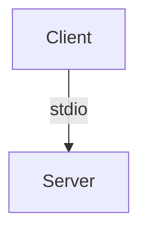

# Documentation Guidelines

This file governs changes to the documentation under `docs/`. It follows
the Zed docs conventions (mdBook + Prettier).

## Documentation System

The docs use **mdBook**, kept at the latest release — currently **0.5.x**
— together with the **mdbook-mermaid** plugin, currently **0.17.x**. The
pair must move in lockstep: mermaid 0.17+ speaks mdBook 0.5's preprocessor
protocol and fails with `Unable to parse the input` against 0.4.x. mdBook
0.5 removed the `multilingual` key from `book.toml`.

### Key Files

- **`docs/src/SUMMARY.md`** — table of contents, mdBook format
  (https://rust-lang.github.io/mdBook/format/summary.html)
- **`docs/book.toml`** — mdBook configuration
- **`docs/.prettierrc`** — Prettier config (80 char line width)

### SUMMARY.md Format

Chapter titles are links, nesting via indentation (2 spaces per level),
parts are `#` headings separated by `---`:

```markdown
# Part Title

- [Chapter](./chapter.md)
  - [Nested Chapter](./nested.md)

---

# Another Part
```

### Page Structure

Pages start with a single H1 title, then 1–3 paragraphs of overview, then
`##` sections ordered most-common-task-first, and end with a "What's Next"
section linking related pages.

> Zed's pages carry `title:`/`description:` YAML frontmatter, but plain
> mdBook renders frontmatter as visible body text (their setup needs a
> custom postprocessor we don't use). Do not add frontmatter here.

### Formatting Requirements

All documentation must pass Prettier:

```sh
cd docs && pnpm dlx prettier@3.5.0 . --check
```

Before any documentation change is considered complete:

1. Format: `cd docs && pnpm dlx prettier@3.5.0 . --write`
2. Verify: `cd docs && pnpm dlx prettier@3.5.0 . --check`
3. Build: `mdbook build docs` and check for warnings

### Blockquote Formatting

Use bold labels for callouts:

```markdown
> **Note:** Information the reader should know.

> **Tip:** Helpful advice that saves time.

> **Warn:** Caution about potential issues.
```

### Diagrams

Architecture and flow diagrams use **mermaid** fenced blocks — never ASCII
art. The `mdbook-mermaid` plugin renders them (configured in `book.toml`;
its vendored assets `mermaid.min.js` and `mermaid-init.js` sit next to
`book.toml`, are gitignored from Prettier, and must be committed):

````markdown

````

Keep node labels short — a few words per line (`<br/>` to wrap); put the
detail in the surrounding prose.

### Cross-Linking

- Relative links, same directory: `[Tools](./tools.md)`
- Prefer linking to a page over duplicating its content

## Voice and Tone

- **Second person** ("you"), **present tense** ("the server rejects").
- **Direct and concise.** Short sentences; readers scan.
- **Practical over promotional.** No superlatives, no marketing language.
- **Honest about limitations.** State what the server does not do and pair
  it with the workaround — e.g. quiz-taking is intentionally not provided.
- **No hedging.** Avoid "simply", "just", "easily" — if something is
  simple, the instructions show it.
- **Factual, not competitive.** No disparaging other tools.

## Accuracy Rules

- Environment variables, limits, tool names, and Moodle version support
  must match `AGENTS.md`, `README.md`, and `CHANGELOG.md` in the repo
  root. Verify against the source in `src/` when unsure.
- Never document unreleased features. `docs/` lives in-repo, so "current"
  means `main`.
- The binary has no `--version` flag: document `moodle-mcp help` or the
  startup log line for version checks.

## Scope

### In Scope

- All Markdown files under `docs/src/`, `docs/src/SUMMARY.md`,
  `docs/README.md`, and this file.

### Out of Scope

- `README.md`, `CHANGELOG.md`, `AGENTS.md`, and `i18n/` at the repo root
- Code comments and rustdoc
- Build configuration (`book.toml`, `.prettierrc`)

## Safety Constraints

### Must Not

- Delete existing documentation or remove sections documenting existing
  functionality
- Break SUMMARY.md structure without corresponding content
- Add speculative documentation for unreleased features
- Put tokens or credential examples with real-looking values in pages

### Must

- Preserve existing structure when updating content
- Keep the tool tables in `tools.md` in sync with `src/tools/`
- Keep the release summaries in `changelog.md` in sync with `CHANGELOG.md`
  when tagging a release
- Flag uncertainty explicitly rather than guessing
