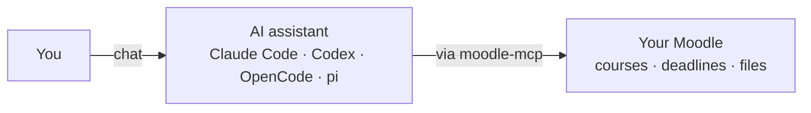

# Getting Started

moodle-mcp connects your AI assistant to your Moodle. Set it up once and
you can ask things like _"what's due this week?"_ or _"read the HW1 brief,
work through the problems, and submit a draft"_ — and your assistant does
the clicking through Moodle for you.

This guide takes about five minutes and needs no programming. By the end,
your assistant will be reading your real courses, deadlines, files, and
forums inside a normal chat.

## Prerequisites

- A **Moodle account** on a site running Moodle 3.7 → 5.x — the same site
  you already open in the browser
- An **AI assistant that supports MCP** — Claude Code, Codex, OpenCode,
  pi, or any other MCP client
- Five minutes

> **Note:** moodle-mcp connects through the same web-service channel as
> Moodle's official mobile app, so most school sites already allow it. If
> the login in step 2 fails, your site has it switched off — see
> [Security & Authentication](./security.md) for what to ask your
> administrator.

## One-Prompt Install

If your assistant can run commands (Claude Code, Codex, Cursor, OpenCode,
pi…), it can set the whole thing up for you. Paste this into the chat:

```text
Set up moodle-mcp (github.com/G36maid/moodle-mcp): read docs/src/installation.md
and docs/src/configuration.md from the repo's main branch first. Then install
the binary for my platform, run `moodle-mcp auth` in the terminal so I can
type my school credentials when it prompts, and register the server in your
own MCP config using the snippet for your harness. Never store or repeat my
credentials; ask before anything global.
```

The assistant installs the binary, walks you through the login in its own
terminal (that's where you type your username and password — not into the
chat), and writes its own client config. The steps below are what it does,
in case you ever need them by hand.

## What You'll Set Up

One small helper program sits between your assistant and your school's
Moodle:



moodle-mcp teaches your assistant 20 ready-made Moodle actions: check
deadlines, download assignment PDFs, upload and submit drafts, catch up on
forums, read grades, and more. You stay in control — anything that could
change your Moodle asks you first, and submissions stay drafts until you
say otherwise.

## Step 1: Install moodle-mcp

Download a ready-made program for your platform from the
[latest release](https://github.com/G36maid/moodle-mcp/releases/latest) and
put it somewhere on your `PATH` — or, if you have Rust installed:

```sh
cargo install moodle-mcp
```

Every install option is on the [Installation](./installation.md) page.

## Step 2: Connect It to Your Moodle (One-Time Login)

Moodle apps don't send your password with every request — they log in once
and receive a personal key (a _token_), the same way Moodle's mobile app
works. The included `auth` command does this login for you:

```sh
moodle-mcp auth
# Moodle URL (e.g. https://moodle.example.com): https://moodle.example.com
# Username: yourname
# Password: ********
# → export MOODLE_URL='https://moodle.example.com' MOODLE_TOKEN='…'
```

Keep the two values it prints (`MOODLE_URL` and `MOODLE_TOKEN`) — you'll
paste them in the next step.

> **Tip:** Schools with a maintained SSO driver (see
> [Security & Authentication](./security.md)) get their portal replayed
> by `auth` with the same credentials — no separate Moodle password
> needed. Every other school uses the credentials mode; if that answers
> `invalidlogin`, ask your Moodle admin for a token.

## Step 3: Add It to Your Assistant

Tell your assistant where the program lives and which Moodle to use. For
Claude Code, one command does it:

```sh
claude mcp add moodle \
  --env MOODLE_URL=https://moodle.example.com \
  --env MOODLE_TOKEN=your-token \
  -- /path/to/moodle-mcp
```

Or add it to your project's `.mcp.json`:

```json
{
  "mcpServers": {
    "moodle": {
      "command": "/path/to/moodle-mcp",
      "env": {
        "MOODLE_URL": "https://moodle.example.com",
        "MOODLE_TOKEN": "your-token"
      }
    }
  }
}
```

Use the full path to the program from step 1, and paste the URL and token
from step 2.

Any other MCP client takes the same two values in its own config format:
Codex uses `~/.codex/config.toml`, OpenCode uses `opencode.json`, and pi
uses `pi mcp add` or `.pi/mcp.json`. Ready-made snippets for each are on
the [Configuration](./configuration.md) page.

> **Warn:** The token is your personal key — treat it like a password and
> never commit it to a shared repository.

Then **restart your assistant** so it picks up the new connection.

## Step 4: Try It

Open a chat with your assistant and ask:

```txt
What's due in the next two weeks? Plan my studying around it.
```

```txt
Finish my Information Security HW1: read the assignment brief and the
attached PDF, work through the problems, and submit a draft.
```

```txt
I missed what happened in Data Communication this week — catch me up,
including the announcements forum.
```

When the answers mention your real courses and dates, you're done. The
assistant chains the actions by itself; see [Tools](./tools.md) for the
full list.

## If Something Goes Wrong

- **Your assistant starts without Moodle tools** — restart it after
  editing the config, and check that the config file is the one your
  assistant actually reads.
- **`moodle-mcp: command not found`** — the assistant can't find the
  program; put its full path in the config.
- **Login in step 2 fails** — your site has web services switched off,
  or your account signs in through single sign-on and has no Moodle
  password; ask your administrator — details in
  [Security & Authentication](./security.md).
- **The assistant reports "unauthorized"** — the token is wrong or was
  revoked. Run `moodle-mcp auth` again and update the config.

## What's Next

- [Tools](./tools.md) — everything your assistant can now do in Moodle
- [Configuration](./configuration.md) — timeouts, read-only mode, and
  other options
- [Security & Authentication](./security.md) — how the token is protected
- [Changelog](./changelog.md) — release notes and how to update
