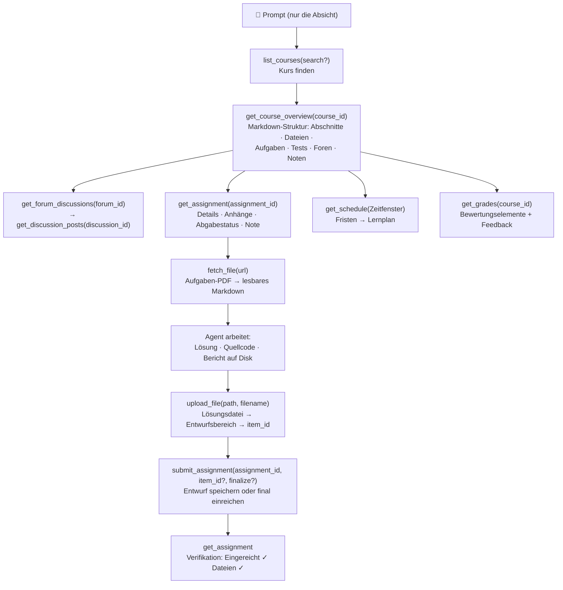

<p align="center">
  
</p>

# moodle-mcp

<p align="center">
  <a href="../README.md">English</a> | 
  <a href="README.zh-TW.md">繁體中文</a> | 
  <a href="README.zh-CN.md">简体中文</a> | 
  <a href="README.ja.md">日本語</a> | 
  <a href="README.es.md">Español</a> | 
  <b>Deutsch</b> | 
  <a href="README.pt-BR.md">Português</a> | 
  <a href="README.fr.md">Français</a>
</p>

[](https://github.com/G36maid/moodle-mcp/actions/workflows/ci.yml)
[](https://codecov.io/gh/G36maid/moodle-mcp)
[](https://github.com/G36maid/moodle-mcp/releases/latest)
[](https://crates.io/crates/moodle-mcp)
[](../LICENSE)
[](https://www.rust-lang.org)
[](https://modelcontextprotocol.io)
[](https://github.com/G36maid/moodle-mcp/actions/workflows/release.yml)

Ein [Model Context Protocol (MCP)](https://modelcontextprotocol.io) Server, der LLM-Agenten die **Nutzung eines echten Moodle LMS** ermöglicht — Kurse lesen, Aufgaben-PDFs abrufen, Code schreiben, Dateien hochladen und abgeben — alles über eine einzige, eigenständige statische Binärdatei.

Entwickelt in Rust auf Basis des offiziellen MCP-SDKs ([`rmcp`](https://crates.io/crates/rmcp)). Live validiert mit **Moodle 3.7 → 5.x**.

---

## ❌ Ohne moodle-mcp

Ein generischer Chatbot hat keinen Zugriff auf dein Moodle, sodass alle Studienaufgaben manuell bleiben:

- ❌ Fünf Browser-Tabs geöffnet, nur um zu sehen: *„Was ist diese Woche fällig?“*
- ❌ Aufgaben-PDFs manuell herunterladen und in das Chatfenster ziehen
- ❌ Forenbeiträge und Noten mühsam Seite für Seite kopieren und einfügen

## ✅ Mit moodle-mcp

Der Agent meldet sich als dein Benutzer an. 22 typisierte Werkzeuge decken den gesamten Studienablauf wie ein echter Mensch ab — vom schnellen Prüfen von Fristen bis zur vollautomatischen Unterstützung bei Aufgabenabgaben, ganz ohne Browser:

```txt
Was ist in den nächsten zwei Wochen fällig? Plane mein Lernen darum herum.
```

```txt
Erledige mein Informationssicherheit Übungsblatt 1: Lies die Aufgabenstellung und das angehängte PDF, löse die Aufgaben und reiche einen Entwurf ein.
```

```txt
Ich habe verpasst, was diese Woche in Datenkommunikation passiert ist — bring mich auf den neuesten Stand inklusive Ankündigungsforum.
```

Der Agent verknüpft die Werkzeuge eigenständig: Kursübersicht → Aufgabenstellung → PDF → Markdown → Lösung → Datei-Upload → Entwurfsabgabe → Überprüfung.
Vollständige Abläufe unter [Prompt-Beispiele](#-prompt-beispiele) und [Funktionsweise des Agenten](#-funktionsweise-des-agenten).

## ✨ Funktionen & Highlights

- **Batteries included** — Dokumentenkonvertierung (anydoc), HTML → Markdown (htmd), Auth-CLI und Notfall-Fallback direkt integriert: keine Plugins, keine Hilfsskripte, keine zusätzliche Laufzeitumgebung.
- **Agent-native** — Werkzeuge akzeptieren und liefern **lokale Dateipfade** statt Base64; Antworten enthalten direkt die IDs für den nächsten Schritt; Standardwerte bieten Hilfestellungen (z. B. "pass course_ids to filter"); Fehlermeldungen sind verständlich und schlagen Lösungen vor.
- **22 maßgeschneiderte Werkzeuge** — Jedes Werkzeug spiegelt einen realen Schritt in Moodle wider: Kurse, Kursübersicht, Aufgaben, Abgaben, Foren, Dateien (Abrufen/Konvertieren/Herunterladen/Hochladen), Noten, Zeitplan, Nachrichten, Quiz-Versuche. Kein 1:1-Dump von ~350 rohen Web-Service-Funktionen; ein generischer Escape-Hatch (`call_ws_function` + `list_functions`) erreicht dennoch alles Weitere.
- **Vollständige Kurskarte in einem Aufruf** — `get_course_overview` bündelt fünf Moodle-Endpunkte in ein einziges Markdown-Dokument mit allen IDs und Dateilinks.
- **PDF → Markdown** — Aufgabenstellungen werden über [anydoc](https://crates.io/crates/anydoc) in lesbare Anforderungen umgewandelt; HTML-Beschreibungen behalten Tabellen via [htmd](https://crates.io/crates/htmd).
- **Versionsadaptiv** — Gegen Moodle 3.7 verifiziert und für 4.x/5.x optimiert; Unterschiede (Funktionsnamen, Paginierung, Antwortstrukturen) werden automatisch ausgeglichen.
- **Sicher per Standard** — Schreiboperationen erfordern explizite Bestätigung; Entwürfe werden unwiderruflichen Abgaben vorgezogen; automatisches Lösen von Online-Tests ist absichtlich **nicht** implementiert.
- **Einzelne statische Binärdatei** — Keine Laufzeitabhängigkeiten.

## 📋 Anforderungen

- Eine **Moodle 3.7 → 5.x** Instanz, auf der du ein Benutzerkonto hast
- Webdienste serverseitig aktiviert: **REST-Protokoll** und Dienst **`moodle_mobile_app`** für dein Konto freigegeben (dieselben Einstellungen, die die offizielle Moodle-App nutzt; meist bereits aktiv)
- **HTTPS** dringend empfohlen — das Token wird bei jeder Anfrage übertragen (siehe [Sicherheitshinweise](#-sicherheitshinweise))
- Ein beliebiger MCP-Client — Claude Code, Codex, OpenCode, pi oder jeder Client, der MCP über Stdio unterstützt
- Rust 1.88+ nur für `cargo install` oder beim Bauen aus dem Quellcode (vorkompilierte Binärdateien benötigen nichts)

## 📦 Installation

### Vorkompilierte Binärdatei herunterladen

Keine Rust-Installation erforderlich — lade das Archiv für deine Plattform aus den [neuesten Releases](https://github.com/G36maid/moodle-mcp/releases/latest) herunter:

| Plattform | Archiv |
|---|---|
| Linux x86_64 | `moodle-mcp-<version>-x86_64-unknown-linux-gnu.tar.gz` |
| Linux arm64 | `moodle-mcp-<version>-aarch64-unknown-linux-gnu.tar.gz` |
| macOS Apple Silicon | `moodle-mcp-<version>-aarch64-apple-darwin.tar.gz` |
| macOS Intel | `moodle-mcp-<version>-x86_64-apple-darwin.tar.gz` |
| Windows x64 | `moodle-mcp-<version>-x86_64-pc-windows-msvc.zip` |

```bash
tar xzf moodle-mcp-*-aarch64-apple-darwin.tar.gz
sudo mv moodle-mcp-*/moodle-mcp /usr/local/bin/   # oder ein Verzeichnis in PATH
```

### Oder mit cargo installieren

```bash
cargo install moodle-mcp   # benötigt Rust 1.88+
```

### Oder aus dem Quellcode bauen

```bash
git clone https://github.com/G36maid/moodle-mcp
cd moodle-mcp
cargo build --release
# Binärdatei: target/release/moodle-mcp (~15 MB, statisch)
```

### Token abrufen

Verwende das integrierte CLI-Tool:

```bash
moodle-mcp auth
# Moodle URL (e.g. https://moodle.example.com): https://moodle.example.com
# Username: deinbenutzer
# Password: ********   (Eingabe wird maskiert)
# → export MOODLE_URL='https://moodle.example.com' MOODLE_TOKEN='…'
```

Werte, die als Flag übergeben werden (`--url`, `--username`, `--password`), überspringen die jeweilige Abfrage — so funktionieren auch Skripte ohne Interaktion.

Bei SSO (ohne Direktpasswort) öffne stattdessen die Moodle-Sicherheitsschlüsselseite im Browser:

```bash
moodle-mcp auth --url https://moodle.example.com --open
```

Falls der Token-Abruf fehlschlägt, fehlen der Moodle-Instanz Einstellungen aus den [Anforderungen](#-anforderungen) — wende dich an deinen Moodle-Administrator.

### Client anbinden

Alle Clients sprechen denselben Stdio-Server an: Starte `/path/to/moodle-mcp` mit den Umgebungsvariablen `MOODLE_URL` und `MOODLE_TOKEN`. In Claude Code reicht ein einziger Befehl:

```bash
claude mcp add moodle \
  --env MOODLE_URL=https://moodle.example.com \
  --env MOODLE_TOKEN=dein-token \
  -- /path/to/moodle-mcp
```

Weitere Client-Konfigurationen:

<details open>
<summary><b>Claude Code</b> — <code>.mcp.json</code> (Projekt) oder <code>~/.claude.json</code> (Global)</summary>

```json
{
  "mcpServers": {
    "moodle": {
      "command": "/path/to/moodle-mcp",
      "env": {
        "MOODLE_URL": "https://moodle.example.com",
        "MOODLE_TOKEN": "dein-token"
      }
    }
  }
}
```

</details>

<details>
<summary><b>Codex</b> — <code>~/.codex/config.toml</code> (Global)</summary>

```toml
[mcp_servers.moodle]
command = "/path/to/moodle-mcp"
env = { "MOODLE_URL" = "https://moodle.example.com", "MOODLE_TOKEN" = "dein-token" }
```

</details>

<details>
<summary><b>OpenCode</b> — <code>opencode.json</code> (Projekt) oder <code>~/.config/opencode/opencode.json</code> (Global)</summary>

```json
{
  "mcp": {
    "moodle": {
      "type": "local",
      "command": ["/path/to/moodle-mcp"],
      "environment": {
        "MOODLE_URL": "https://moodle.example.com",
        "MOODLE_TOKEN": "dein-token"
      }
    }
  }
}
```

</details>

<details>
<summary><b>pi</b> — <code>.pi/mcp.json</code> (Projekt) oder <code>~/.pi/agent/mcp.json</code> (Global)</summary>

```json
{
  "mcpServers": {
    "moodle": {
      "command": "/path/to/moodle-mcp",
      "env": {
        "MOODLE_URL": "https://moodle.example.com",
        "MOODLE_TOKEN": "dein-token"
      }
    }
  }
}
```

</details>

| Umgebungsvariable | Erforderlich | Standard | Beschreibung |
|---|:---:|---|---|
| `MOODLE_URL` | ✔ | — | Basis-URL der Moodle-Instanz ohne abschließenden Schrägstrich |
| `MOODLE_TOKEN` | ✔ | — | Web-Service-Token |
| `MOODLE_TIMEOUT_SECS` | — | `60` | Timeout pro Anfrage in Sekunden |
| `RUST_LOG` | — | `info` | Log-Filter (Logs gehen an stderr; stdout dient dem MCP-Protokoll) |

## 💬 Prompt-Beispiele

Alle Befehle funktionieren sofort ohne weitere Konfiguration — der Agent erkennt die Werkzeuge anhand ihrer Beschreibungen und verknüpft sie selbstständig:

### Vollautomatisch (ein Prompt, vollständiger Ablauf)

| Deine Eingabe | Werkzeugkette des Agenten |
|---|---|
| *„Erledige mein Informationssicherheit Übungsblatt 1: Lies die Aufgabenstellung und das angehängte PDF, löse die Aufgaben und reiche einen Entwurf ein.“* | `get_assignment` (Aufgabe & Anhänge) → `fetch_file` (PDF zu Markdown mit Formeln) → Aufgaben lösen → Lösungsdatei erstellen → `upload_file` → `submit_assignment` → `get_assignment` (Abgabestatus überprüfen ✓) |
| *„Erstelle mir basierend auf anstehenden Fristen und Kursmaterialien einen vollständigen Lernplan für die nächsten zwei Wochen.“* | `get_schedule` (alle Abgabefristen) → `get_course_overview` pro Kurs (Materialien & Leseliste) → tagesgenauer Lernplan abgestimmt auf Fälligkeiten |
| *„Ich habe verpasst, was diese Woche in Datenkommunikation passiert ist — fasse mir alles zusammen inklusive Ankündigungsforum.“* | `get_notifications` + `get_forum_discussions` → `get_discussion_posts` → strukturierte Wochenzusammenfassung |
| *„Bereite mich auf das Software Engineering Quiz vor: Was hat der Dozent dazu angekündigt?“* | `get_course_overview` (Quiz-Eintrag) → `get_assignment` (Anforderungen) → relevante Forenbeiträge |

### Schnelle Abfragen

| Deine Eingabe | Werkzeugkette des Agenten |
|---|---|
| *„Was ist in den nächsten zwei Wochen fällig?“* | `get_schedule` → kombinierte Zeitleiste aus Fristen, Quiz-Schließungen und Terminen |
| *„Worum geht es bei Übungsblatt 1? Lies die Angaben.“* | `get_assignment` → `fetch_file` wandelt das angehängte PDF in Markdown um |
| *„Wie habe ich im Datenkommunikation-Praktikum abgeschnitten?“* | `list_courses` → `get_grades(course_id)` → Bewertungselemente, Feedback und Gewichtungen |
| *„In welchen meiner Kurse gibt es bereits bewertete Aufgaben?“* | `get_grades()` → kursübergreifende Notenübersicht |
| *„Fasse alle Ankündigungen im Datenkommunikation-Forum zusammen.“* | `get_course_overview` → `get_forum_discussions` → `get_discussion_posts` |
| *„Lade meine Lösung solution.pdf für Quiz 1 hoch und speichere sie als Entwurf.“* | `upload_file` → `submit_assignment(item_id, finalize=false)` |
| *„Was steht als Nächstes im Kurs Software Engineering an?“* | `get_course_overview` → Abschnitte, Dokumente, Foren |
| *„Kann ich dem Dozenten eine Nachricht bezüglich einer Fristverlängerung senden?“* | `get_user` / `get_conversations` → Nachrichtenentwurf verfassen → Bestätigung einholen → `send_message` |

## 🔄 Funktionsweise des Agenten

Die Werkzeuge spiegeln die menschliche Navigation in Moodle wider — jede Ausgabe liefert direkt die IDs für den nachfolgenden Schritt. Jeder Ablauf beginnt bei der Kursliste und der Kursübersicht:



Alle Spezialfälle, die von den 20 dedizierten Werkzeugen nicht abgedeckt werden, sind über die Escape-Hatch-Funktionen `call_ws_function` + `list_functions` erreichbar — volle Abdeckung aller ~350 Moodle-API-Funktionen (20 + 2 = 22 Werkzeuge insgesamt).

## 🛠 Werkzeug-Referenz

RW kennzeichnet den Modus: 📖 Nur-Lesen · ✍️ Schreiben. Schreibwerkzeuge agieren im Namen des Token-Inhabers; die Serverinstruktionen verpflichten den Agenten, vor der Ausführung eine Bestätigung einzuholen. Hochgeladene Dateien landen im privaten Entwurfsbereich.

### Identität & Kurse
| Werkzeug | Signatur | RW | Zweck |
|---|---|:-:|---|
| `whoami` | `()` | 📖 | Token-Inhaber-Identität sowie Site- und Versionsinformationen |
| `list_courses` | `(search?)` | 📖 | Eingeschriebene Kurse (optional mit Namensfilter) |
| `get_course_overview` | `(course_id)` | 📖 | Vollständige Markdown-Kursübersichtskarte |

### Aufgaben & Abgaben
| Werkzeug | Signatur | RW | Zweck |
|---|---|:-:|---|
| `get_assignment` | `(assignment_id)` | 📖 | Vollständiges Dokument: Fristen, Status, Beschreibung, Anhänge, Abgabe, Note & Feedback |
| `submit_assignment` | `(assignment_id, text?, item_id?, finalize?)` | ✍️ | Einzige Aufgaben-Schreiboperation: Online-Text und/oder Entwurfsdateien |

### Foren
| Werkzeug | Signatur | RW | Zweck |
|---|---|:-:|---|
| `get_forum_discussions` | `(forum_id)` | 📖 | Thread-Liste mit Vorschau des Eröffnungsbeitrags |
| `get_discussion_posts` | `(discussion_id)` | 📖 | Vollständiger Diskussionsstrang in Markdown inklusive Anhängen |
| `create_forum_discussion` | `(forum_id, subject, message)` | ✍️ | Neues Diskussionsthema eröffnen |
| `reply_to_discussion` | `(post_id, subject, message)` | ✍️ | Auf Beitrag antworten |

### Dateien
| Werkzeug | Signatur | RW | Zweck |
|---|---|:-:|---|
| `fetch_file` | `(url)` | 📖 | PDF/DOCX/PPTX/XLSX/ODT/RTF/EPUB/CSV in Markdown konvertieren (anydoc; 100k Zeichenlimit) |
| `download_file` | `(url, save_to)` | 📖 | Binärdatei auf lokalen Pfad herunterladen (nur Metadaten) |
| `upload_file` | `(path, item_id?)` | ✍️ | Lokale Datei in den Entwurfsbereich hochladen |

### Noten, Zeitplan, Nachrichten
| Werkzeug | Signatur | RW | Zweck |
|---|---|:-:|---|
| `get_grades` | `(course_id?)` | 📖 | Kursübergreifende Notenübersicht oder alle Bewertungselemente eines Kurses |
| `get_schedule` | `(time_from?, time_to?, course_ids?)` | 📖 | Zusammengeführte Zeitleiste (Standard: nächste 30 Tage) |
| `get_notifications` | `(read?, limit?)` | 📖 | Aktuelle Benachrichtigungen |
| `get_conversations` | `(limit?)` | 📖 | Unterhaltungsliste mit Mitglieds-IDs |
| `send_message` | `(user_id, text)` | ✍️ | Direkte Nachricht senden |
| `get_quiz_attempts` | `(quiz_id)` | 📖 | Quiz-Versuchsverlauf (Nur-Lesen) |
| `get_user` / `search_users` | `(field, value)` / `(search?, limit?)` | 📖 | Profilabfrage / Benutzersuche |

### Notfall-Escape-Hatch
| Werkzeug | Signatur | RW | Zweck |
|---|---|:-:|---|
| `call_ws_function` | `(wsfunction, params?)` | 📖/✍️ | Beliebige aktivierte Web-Service-Funktion direkt aufrufen (PHP-Array-Notation automatisch) |
| `list_functions` | `(query?)` | 📖 | Verfügbare Funktionen nach Stichwort durchsuchen |

## 🔐 Sicherheitshinweise

- Verwende stets **HTTPS** — das Token wird bei jeder HTTP-Anfrage mitgeschickt.
- Das Token ist ein sensibles Geheimnis: Niemals in Versionsverwaltung einchecken und niemals an andere Hosts als deine Moodle-Instanz senden (der Server fügt es nur in domänengleiche `pluginfile.php`-URLs ein und stoppt Weiterleitungen auf externe Hosts).
- Tokens erscheinen niemals in Werkzeugausgaben oder Fehlermeldungen: Alle Vorkommnisse wie `token=…` werden automatisch als `token=[REDACTED]` maskiert.
- Übertragungslimits: Inline-Textextraktion max. 100 MB, Streaming-Downloads max. 500 MB, Uploads max. 100 MB. Downloads werden direkt auf die Festplatte gestreamt (niemals komplett im RAM gehalten) und über Lese-Timeouts überwacht.
- Schreibwerkzeuge handeln im Namen des **Token-Inhabers**. Serveranweisungen fordern den Agenten auf, vor dem Absenden eine Bestätigung einzuholen.
- Automatisches Absolvieren von Tests ist **absichtlich nicht implementiert**.

## 🧰 Entwicklung & Tests

```bash
cargo test                 # 39 Tests: Unit-Tests + WireMock-Integration + MCP-Protokoll
cargo clippy --all-targets
cargo fmt -- --check
cargo build --release
```

ID-Fluss zwischen Werkzeugen:

| ID | Erzeugt durch | Verwendet von |
|---|---|---|
| `course_id` | `list_courses` / `get_course_overview` | `overview` / `grades` / `schedule` / `assignments` |
| `forum_id` | `get_course_overview` | `get_forum_discussions` / `create_forum_discussion` |
| `discussion_id` | `get_forum_discussions` | `get_discussion_posts` |
| `post_id` | `get_discussion_posts` | `reply_to_discussion` |
| `assignment_id` | `get_course_overview` / `get_assignment` | `get_assignment` / `submit_assignment` |
| `item_id` (Entwurf) | `upload_file` | `submit_assignment` |
| `user_id` | `conversations members` / `notifications` / `get_user` | `send_message` / `get_user` |

## 📄 Lizenz

MIT — siehe [LICENSE](../LICENSE).
