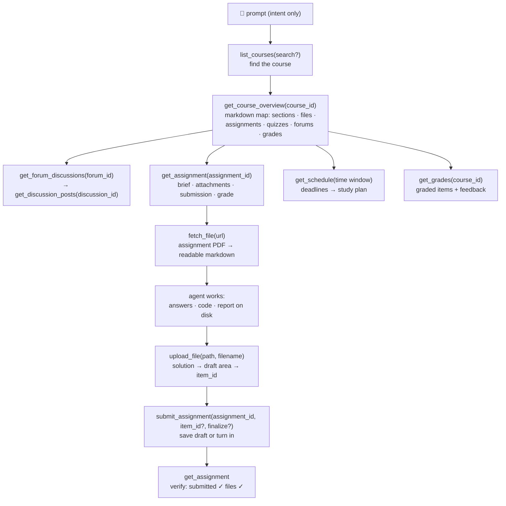

<p align="center">
  
</p>

# moodle-mcp

<p align="center">
  <a href="../README.md">English</a> |
  <a href="README.zh-TW.md">繁體中文</a> |
  <a href="README.zh-CN.md">简体中文</a> |
  <a href="README.ja.md">日本語</a> |
  <a href="README.es.md">Español</a> |
  <b>Deutsch</b> |
  <a href="README.pt-BR.md">Português</a> |
  <a href="README.fr.md">Français</a>
</p>

[](https://github.com/G36maid/moodle-mcp/actions/workflows/ci.yml)
[](https://codecov.io/gh/G36maid/moodle-mcp)
[](https://github.com/G36maid/moodle-mcp/releases/latest)
[](https://crates.io/crates/moodle-mcp)
[](../LICENSE)
[](https://www.rust-lang.org)
[](https://modelcontextprotocol.io)
[](https://github.com/G36maid/moodle-mcp/actions/workflows/release.yml)

Ein [Model Context Protocol](https://modelcontextprotocol.io)-Server, der LLM-Agenten die **Nutzung eines echten Moodle LMS** ermöglicht — Kurse lesen, Aufgaben-PDFs abrufen, Code schreiben, Dateien hochladen und Abgaben einreichen — alles über eine einzige statische Binärdatei.

Entwickelt in Rust auf dem offiziellen MCP-SDK ([`rmcp`](https://crates.io/crates/rmcp)). Live validiert gegen Moodle 3.7, 4.5 und 5.2; ausgelegt für **3.7 → 5.x**.

## ✅ Warum

Ein generischer Chatbot hat keinen Weg in dein Moodle, also bleibt jede Studienaufgabe manuell — fünf Browser-Tabs nur für die Antwort auf *„Was ist diese Woche fällig?“*, PDFs, die von Hand hochgeladen werden, Foren und Noten, Seite für Seite kopiert und eingefügt.

moodle-mcp meldet den Agenten unter deinem Namen an. 20 typisierte Werkzeuge decken den gesamten Studienablauf ab, und der Agent verknüpft sie eigenständig — ganz ohne Browser:

- **Batteries included** — Dokumentkonvertierung, HTML → Markdown, eine Auth-CLI und ein Opt-in-Escape-Hatch in einer einzigen Binärdatei: keine Plugins, keine Hilfsskripte, keine zweite Laufzeitumgebung
- **Agent-nativ** — Werkzeuge erwarten und liefern lokale Dateipfade statt Base64; jedes Ergebnis enthält die IDs für den nächsten Aufruf; Fehlermeldungen sind klar formuliert und schlagen die Lösung vor
- **Sicher von Anfang an** — Schreibwerkzeuge holen zuerst deine Bestätigung ein, Abgaben bleiben Entwürfe, bis du es sagst; das automatische Lösen von Quiz ist bewusst nicht vorgesehen
- **Versionsadaptiv** — gegen Moodle 3.7 verifiziert und für 4.x/5.x ausgelegt; Antwortunterschiede zwischen den Versionen werden automatisch ausgeglichen
- **Eine einzige statische Binärdatei** — keine Laufzeitabhängigkeiten

## 🚀 Schnellstart

Benötigt wird ein Konto auf einer Moodle-Instanz 3.7 → 5.x, die den Webdienst der mobilen App erlaubt (die meisten tun das — siehe [Voraussetzungen](https://moodle.ntnu.cc/docs/getting-started.html#prerequisites)).

```bash
# 1. Install
cargo install moodle-mcp        # or grab a prebuilt binary — no Rust needed

# 2. Log in once — prints MOODLE_URL and MOODLE_TOKEN
moodle-mcp auth

# 3. Connect your client (Claude Code shown; Codex/OpenCode/pi below)
claude mcp add moodle \
  --env MOODLE_URL=https://moodle.example.com \
  --env MOODLE_TOKEN=your-token \
  -- /path/to/moodle-mcp

# 4. Open a chat and ask:
#    "What's due in the next two weeks? Plan my studying around it."
```

Oder füge das in deinen Agenten ein und lass ihn jeden Schritt erledigen (er öffnet `moodle-mcp auth` in seinem Terminal — gib deine Zugangsdaten dort ein, nicht im Chat):

```text
Set up moodle-mcp (github.com/G36maid/moodle-mcp): read docs/src/installation.md
and docs/src/configuration.md from the repo's main branch first. Then install
the binary for my platform, run `moodle-mcp auth` in the terminal so I can
type my school credentials when it prompts, and register the server in your
own MCP config using the snippet for your harness. Never store or repeat my
credentials; ask before anything global.
```

Vorkompilierte Binärdateien, SSO-Login, Konfigurationsbeispiele für jeden Client und die vollständige Referenz der Umgebungsvariablen: [Installation](https://moodle.ntnu.cc/docs/installation.html) · [Erste Schritte](https://moodle.ntnu.cc/docs/getting-started.html) · [Konfiguration](https://moodle.ntnu.cc/docs/configuration.html)

## 💬 Was der Agent kann

All das funktioniert ohne weitere Einrichtung — der Agent entdeckt die Werkzeuge über ihre Beschreibungen und verknüpft sie selbstständig:

| Deine Eingabe | Werkzeugkette des Agenten |
|---|---|
| *„Erledige Übungsblatt 1 in Informationssicherheit: Lies die Aufgabenstellung und das angehängte PDF, löse die Aufgaben und reiche einen Entwurf ein.“* | `get_assignment` (brief + attachments) → `fetch_file` (PDF → markdown, math included) → solves it → writes the answer file → `upload_file` → `submit_assignment` → `get_assignment` (verify submitted ✓) |
| *„Erstelle mir basierend auf anstehenden Fristen und Kursmaterialien einen vollständigen Lernplan für die nächsten zwei Wochen.“* | `get_schedule` (all deadlines) → `get_course_overview` per course → day-by-day plan balanced against due dates |
| *„Ich habe verpasst, was diese Woche in Datenkommunikation passiert ist — bring mich auf den neuesten Stand, inklusive Ankündigungsforum.“* | `get_notifications` + `get_forum_discussions` → `get_discussion_posts` → synthesized weekly digest |
| *„Bereite mich auf das Software Engineering Quiz vor: Was hat der Dozent dazu gepostet?“* | `get_course_overview` (quiz entry) → `get_assignment` (requirements) → related forum threads |

## 🔄 Wie der Agent arbeitet

Die Werkzeuge spiegeln wider, wie du dich in Moodle bewegst — die Ausgabe jeder Stufe enthält bereits die IDs für die nächste:



Alles, was die dedizierten Werkzeuge nicht abdecken, ist über den Escape-Hatch `call_ws_function` + `list_ws_functions` erreichbar — vollständige Abdeckung der ~350 Funktionen, die ein typischer Token aufrufen kann (insgesamt 20 + 2 = 22; der Escape-Hatch ist Opt-in und wird per `MOODLE_ENABLE_WS_FUNCTION=true` aktiviert).

## 📚 Dokumentation

Die vollständige Dokumentation liegt in [`docs/`](https://moodle.ntnu.cc/docs/) (mdBook — zum lokalen Lesen `mdbook serve docs`):

| Seite | Inhalt |
|---|---|
| [Erste Schritte](https://moodle.ntnu.cc/docs/getting-started.html) | von null bis zum ersten Prompt; ohne MCP-Vorkenntnisse |
| [Installation](https://moodle.ntnu.cc/docs/installation.html) | vorkompilierte Binärdateien, cargo, aus dem Quellcode |
| [Konfiguration](https://moodle.ntnu.cc/docs/configuration.html) | jede Umgebungsvariable; Konfigurationsbeispiele für Claude Code, Codex, OpenCode und pi |
| [Werkzeuge](https://moodle.ntnu.cc/docs/tools.html) | die vollständige Referenz aller 22 Werkzeuge und der ID-Fluss zwischen ihnen |
| [Sicherheit & Authentifizierung](https://moodle.ntnu.cc/docs/security.html) | Token-Lebenszyklus, Transport- und Schreibsicherheit |
| [Änderungsprotokoll](https://moodle.ntnu.cc/docs/changelog.html) | Release-Notizen, Version für Version |
| [Entwicklung](https://moodle.ntnu.cc/docs/development.html) | Architekturrundgang, Tests, Release-Prozess |
| [Über](https://moodle.ntnu.cc/docs/about.html) | was moodle-mcp, MCP und Moodle sind |

## 🧰 Entwicklung

```bash
cargo test                 # unit + wiremock integration + MCP protocol tests
cargo clippy --all-targets
cargo fmt -- --check
cargo build --release
```

Die Projektdokumentation liegt in [`docs/`](https://moodle.ntnu.cc/docs/) — mdBook, formatiert mit Prettier (siehe `docs/README.md`); Vorschau mit `mdbook serve docs`.

Die Landingpage liegt in [`site/`](../site/) — Astro 7 + TypeScript (`cd site && npm install && npm run dev`, Build mit `npm run build`).

## 🔐 Sicherheit

Verwende **HTTPS** — der Token wird bei jeder Anfrage mitgesendet. Er erscheint nie in Werkzeugausgaben oder Fehlermeldungen, wird nur in Moodle-URLs derselben Site eingefügt, und Schreibwerkzeuge holen vor jeder Aktion deine Bestätigung ein. Alle Details: [Sicherheit & Authentifizierung](https://moodle.ntnu.cc/docs/security.html).

## 📄 Lizenz

MIT — siehe [LICENSE](../LICENSE).
