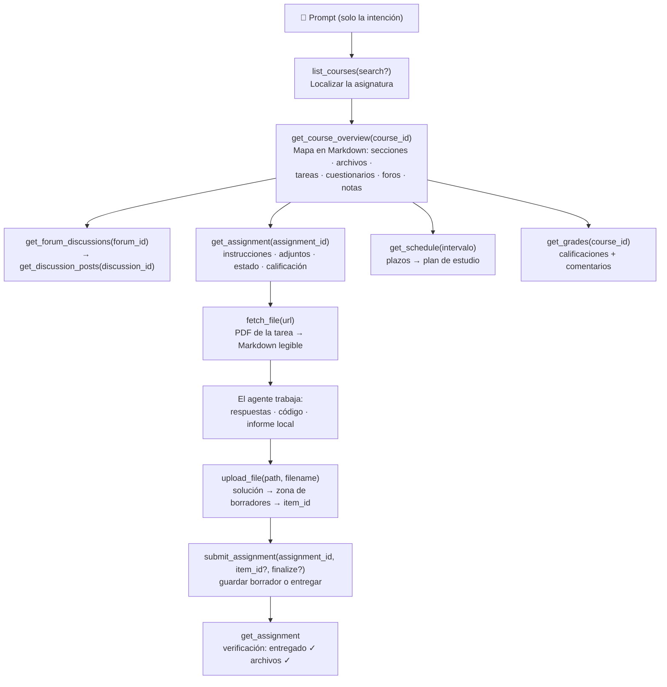

<p align="center">
  
</p>

# moodle-mcp

<p align="center">
  <a href="../README.md">English</a> | 
  <a href="README.zh-TW.md">繁體中文</a> | 
  <a href="README.zh-CN.md">简体中文</a> | 
  <a href="README.ja.md">日本語</a> | 
  <b>Español</b> | 
  <a href="README.de.md">Deutsch</a> | 
  <a href="README.pt-BR.md">Português</a> | 
  <a href="README.fr.md">Français</a>
</p>

[](https://github.com/G36maid/moodle-mcp/actions/workflows/ci.yml)
[](https://codecov.io/gh/G36maid/moodle-mcp)
[](https://github.com/G36maid/moodle-mcp/releases/latest)
[](https://crates.io/crates/moodle-mcp)
[](../LICENSE)
[](https://www.rust-lang.org)
[](https://modelcontextprotocol.io)
[](https://github.com/G36maid/moodle-mcp/actions/workflows/release.yml)

Un servidor [Model Context Protocol (MCP)](https://modelcontextprotocol.io) que permite a los agentes LLM **usar un Moodle LMS real** — consultar cursos, extraer PDFs de tareas, escribir código, subir archivos y entregar tareas — todo a través de un único binario estático.

Construido en Rust sobre el SDK oficial de MCP ([`rmcp`](https://crates.io/crates/rmcp)). Validado en entornos reales con **Moodle 3.7 → 5.x**.

---

## ❌ Sin moodle-mcp

Un chatbot genérico no tiene acceso a tu Moodle, por lo que cada tarea de estudio sigue siendo manual:

- ❌ Abrir cinco pestañas del navegador solo para ver *«¿qué entregas vencen esta semana?»*
- ❌ Descargar PDFs de tareas manualmente y subirlos a la ventana de chat
- ❌ Copiar y pegar hilos de foros y calificaciones página por página

## ✅ Con moodle-mcp

El agente inicia sesión como tú. 22 herramientas tipadas cubren todo el flujo estudiantil como un humano real — desde comprobar plazos hasta la asistencia completa en entregas, sin abrir el navegador:

```txt
¿Qué entregas vencen en las próximas dos semanas? Planifica mi estudio en función de eso.
```

```txt
Termina mi tarea 1 de Seguridad Informática: lee las instrucciones y el PDF adjunto, resuelve los problemas y entrega un borrador.
```

```txt
Me perdí lo que pasó en Comunicación de Datos esta semana — ponme al día con los avisos.
```

El agente encadena las herramientas por sí mismo: mapa del curso → instrucciones de tarea → PDF → Markdown → solución → subida → entrega de borrador → verificación de entrega.
Más detalles en [Ejemplos de prompts](#-ejemplos-de-prompts) y [Cómo funciona el agente](#-cómo-funciona-el-agente).

## ✨ Características destacadas

- **Todo incluido (Batteries included)** — Conversión de documentos (anydoc), HTML → Markdown (htmd), CLI para tokens y función de escape genérica integrados: sin plugins, sin scripts auxiliares, sin entornos secundarios.
- **Nativo para agentes (Agent-native)** — Las herramientas aceptan y devuelven **rutas de archivos locales** en lugar de base64; las respuestas incluyen los IDs necesarios para la siguiente llamada; los argumentos por defecto incluyen pistas ("pass course_ids to filter"); los mensajes de error son claros y sugieren soluciones.
- **22 herramientas adaptadas al flujo humano** — Cada una refleja una acción real en Moodle: cursos, resumen del curso, tareas, entregas, foros, archivos (obtener/convertir/descargar/subir), calificaciones, calendario, mensajería y cuestionarios — sin volcar mecánicamente las ~350 APIs sin procesar; con una vía de escape genérica (`call_ws_function` + `list_functions`) para todo lo demás.
- **Mapa completo del curso en una llamada** — `get_course_overview` combina cinco endpoints de Moodle en un único documento Markdown con cada ID y enlace a archivo incrustado.
- **PDF → Markdown** — Las instrucciones de tareas se convierten en requisitos legibles mediante [anydoc](https://crates.io/crates/anydoc); las descripciones en HTML conservan sus tablas mediante [htmd](https://crates.io/crates/htmd).
- **Adaptable a versiones** — Verificado en Moodle 3.7 y preparado para 4.x/5.x; absorbe automáticamente diferencias de funciones, paginación y estructuras de respuesta.
- **Seguro por defecto** — Las herramientas de escritura requieren confirmación explícita; se priorizan los borradores frente a entregas definitivas; la resolución automática de cuestionarios no está implementada de forma intencionada.
- **Binario estático único** — Sin dependencias de tiempo de ejecución.

## 📋 Requisitos

- Un sitio **Moodle 3.7 → 5.x** en el que tengas una cuenta de usuario
- Servicios web habilitados en el sitio: **protocolo REST** y servicio **`moodle_mobile_app`** permitido para tu cuenta (la misma configuración que usa la app oficial de Moodle, habilitada en la mayoría de instituciones)
- Se recomienda encarecidamente **HTTPS** — el token viaja en cada petición (ver [Notas de seguridad](#-notas-de-seguridad))
- Cualquier cliente compatible con MCP — Claude Code, Codex, OpenCode, pi, o cualquier cliente vía stdio
- Rust 1.88+ solo para `cargo install` o si compilas desde el código fuente (los binarios precompilados no lo necesitan)

## 📦 Instalación

### Descargar binario precompilado

No necesitas instalar Rust — descarga el archivo comprimido para tu plataforma desde la [última versión](https://github.com/G36maid/moodle-mcp/releases/latest):

| Plataforma | Archivo |
|---|---|
| Linux x86_64 | `moodle-mcp-<version>-x86_64-unknown-linux-gnu.tar.gz` |
| Linux arm64 | `moodle-mcp-<version>-aarch64-unknown-linux-gnu.tar.gz` |
| macOS Apple Silicon | `moodle-mcp-<version>-aarch64-apple-darwin.tar.gz` |
| macOS Intel | `moodle-mcp-<version>-x86_64-apple-darwin.tar.gz` |
| Windows x64 | `moodle-mcp-<version>-x86_64-pc-windows-msvc.zip` |

```bash
tar xzf moodle-mcp-*-aarch64-apple-darwin.tar.gz
sudo mv moodle-mcp-*/moodle-mcp /usr/local/bin/   # o cualquier directorio en PATH
```

### O instalar con cargo

```bash
cargo install moodle-mcp   # requiere Rust 1.88+
```

### O compilar desde el código fuente

```bash
git clone https://github.com/G36maid/moodle-mcp
cd moodle-mcp
cargo build --release
# Binario resultante: target/release/moodle-mcp (~15 MB, estático)
```

### Obtener un token

Usa la CLI integrada en el binario:

```bash
moodle-mcp auth
# Moodle URL (e.g. https://moodle.example.com): https://moodle.example.com
# Username: tu_usuario
# Password: ********   (enmascarada al escribir)
# → export MOODLE_URL='https://moodle.example.com' MOODLE_TOKEN='…'
```

Los valores pasados como flags (`--url`, `--username`, `--password`) omiten el aviso correspondiente, así los scripts también funcionan sin interacción.

Si tu institución usa SSO (sin contraseña directa), abre la página de claves de seguridad en el navegador:

```bash
moodle-mcp auth --url https://moodle.example.com --open
```

Si la solicitud de token falla, el sitio carece de algún ajuste en los [Requisitos](#-requisitos) — solicita al administrador activar los servicios web.

### Conectar un cliente

Todos los clientes ejecutan el mismo servidor stdio: lanza `/path/to/moodle-mcp` con `MOODLE_URL` y `MOODLE_TOKEN` en las variables de entorno. En Claude Code se puede configurar con un solo comando:

```bash
claude mcp add moodle \
  --env MOODLE_URL=https://moodle.example.com \
  --env MOODLE_TOKEN=tu-token \
  -- /path/to/moodle-mcp
```

Otras configuraciones de clientes:

<details open>
<summary><b>Claude Code</b> — <code>.mcp.json</code> (proyecto) o <code>~/.claude.json</code> (global)</summary>

```json
{
  "mcpServers": {
    "moodle": {
      "command": "/path/to/moodle-mcp",
      "env": {
        "MOODLE_URL": "https://moodle.example.com",
        "MOODLE_TOKEN": "tu-token"
      }
    }
  }
}
```

</details>

<details>
<summary><b>Codex</b> — <code>~/.codex/config.toml</code> (global)</summary>

```toml
[mcp_servers.moodle]
command = "/path/to/moodle-mcp"
env = { "MOODLE_URL" = "https://moodle.example.com", "MOODLE_TOKEN" = "tu-token" }
```

</details>

<details>
<summary><b>OpenCode</b> — <code>opencode.json</code> (proyecto) o <code>~/.config/opencode/opencode.json</code> (global)</summary>

```json
{
  "mcp": {
    "moodle": {
      "type": "local",
      "command": ["/path/to/moodle-mcp"],
      "environment": {
        "MOODLE_URL": "https://moodle.example.com",
        "MOODLE_TOKEN": "tu-token"
      }
    }
  }
}
```

</details>

<details>
<summary><b>pi</b> — <code>.pi/mcp.json</code> (proyecto) o <code>~/.pi/agent/mcp.json</code> (global)</summary>

```json
{
  "mcpServers": {
    "moodle": {
      "command": "/path/to/moodle-mcp",
      "env": {
        "MOODLE_URL": "https://moodle.example.com",
        "MOODLE_TOKEN": "tu-token"
      }
    }
  }
}
```

</details>

| Variable de entorno | Obligatoria | Valor por defecto | Descripción |
|---|:---:|---|---|
| `MOODLE_URL` | ✔ | — | URL base del sitio, sin barra final |
| `MOODLE_TOKEN` | ✔ | — | Token de servicio web |
| `MOODLE_TIMEOUT_SECS` | — | `60` | Tiempo de espera por petición en segundos; también es el tiempo total para detectar la zona horaria al iniciar |
| `MOODLE_TIMEZONE` | — | auto / `UTC` | Zona horaria IANA (`Asia/Taipei`) para mostrar las marcas de tiempo; por defecto se detecta la zona que Moodle usa para el usuario: la zona forzada del sitio, después la del perfil (si el sitio no la oculta) y, por último, la zona por defecto del sitio (estos dos ajustes del sitio requieren Moodle 4.2+); si no, se usa UTC |
| `MOODLE_ALLOW_EXTERNAL_FETCH` | — | desactivado | Permite que `fetch_file`/`download_file` obtengan URLs fuera del sitio configurado (desactivado: solo URL de archivos Moodle del mismo sitio) |
| `MOODLE_ALLOW_HTTP` | — | desactivado | `1` permite `MOODLE_URL` en http plano (los hosts de loopback siempre están exentos); de lo contrario se rechaza http para proteger el token |
| `MOODLE_READ_ONLY` | — | desactivado | `1` oculta de la lista de herramientas todas las de escritura/subida (`create_forum_discussion`, `reply_to_discussion`, `submit_assignment`, `send_message`, `upload_file`, `call_ws_function`) — acceso LLM de solo lectura |
| `MOODLE_DISABLE_TOOLS` | — | — | Nombres de herramientas separados por comas para ocultar además (p. ej. `send_message,upload_file`); los nombres desconocidos generan un aviso al iniciar |
| `MOODLE_LOG_LEVEL` | — | `info` | Nivel de registro: `error`/`warn`/`info`/`debug`/`trace` (los valores no válidos vuelven a `info`); `trace` incluye fragmentos del cuerpo de la respuesta — evítalo en máquinas compartidas |
| `MOODLE_UA` | — | `moodle-mcp/{version}` | Anulación del User-Agent para casos de filtrado institucional |
| `RUST_LOG` | — | `info` | Filtro de logs (los logs van a stderr; stdout es el canal MCP) |

## 💬 Ejemplos de prompts

Todos estos ejemplos funcionan sin pasos adicionales — el agente comprende las herramientas por sus descripciones y las encadena por sí mismo:

### Modo automático (un prompt, flujo completo)

| Solicitud | Cadena ejecutada por el agente |
|---|---|
| *«Termina mi tarea 1 de Seguridad Informática: lee las instrucciones y el PDF adjunto, resuelve los problemas y entrega un borrador.»* | `get_assignment` (instrucciones + adjuntos) → `fetch_file` (PDF a Markdown con fórmulas) → resolución → escritura del archivo de solución → `upload_file` → `submit_assignment` → `get_assignment` (verificar entrega ✓) |
| *«Con base en las fechas límite y los materiales, elabora un plan de estudio completo para las próximas dos semanas.»* | `get_schedule` (todas las fechas de entrega) → `get_course_overview` por curso (materiales y lecturas) → planificación día a día equilibrada con los plazos |
| *«Me perdí la clase de Comunicación de Datos esta semana — hazme un resumen que incluya el foro de avisos.»* | `get_notifications` + `get_forum_discussions` → `get_discussion_posts` → resumen semanal consolidado |
| *«Prepárame para el cuestionario de Ingeniería de Software: ¿qué publicó el profesor al respecto?»* | `get_course_overview` (entrada del cuestionario) → `get_assignment` (requisitos) → hilos de foros relacionados |

### Consultas rápidas

| Solicitud | Cadena ejecutada por el agente |
|---|---|
| *«¿Qué entregas vencen en las próximas dos semanas?»* | `get_schedule` → cronograma combinado de entregas, cierre de cuestionarios y eventos |
| *«¿De qué trata la Tarea 1? Lee las instrucciones.»* | `get_assignment` → `fetch_file` convierte el PDF adjunto a Markdown |
| *«¿Qué notas saqué en las prácticas de Comunicación de Datos?»* | `list_courses` → `get_grades(course_id)` → calificaciones, comentarios y ponderaciones |
| *«¿En cuáles de mis cursos ya tengo notas publicadas?»* | `get_grades()` → resumen entre cursos |
| *«Resume todos los anuncios del foro de Comunicación de Datos.»* | `get_course_overview` → `get_forum_discussions` → `get_discussion_posts` |
| *«Sube mi solución solution.pdf para el Quiz1 y guárdala como borrador.»* | `upload_file` → `submit_assignment(item_id, finalize=false)` |
| *«¿Qué temas hay programados para la asignatura de Ingeniería del Software?»* | `get_course_overview` → secciones, archivos, foros |
| *«¿Puedo enviar un mensaje al profesor solicitando una prórroga?»* | `get_user` / `get_conversations` → redacción de borrador → confirmación del usuario → `send_message` |

## 🔄 Cómo funciona el agente

Las herramientas replican la forma en que navegas por Moodle — la salida de cada nivel incluye los identificadores para el siguiente. Todo recorrido comienza con la lista y el mapa del curso:



Los componentes básicos se combinan de forma modular. Las funcionalidades no cubiertas por las 20 herramientas específicas son accesibles mediante la vía de escape `call_ws_function` + `list_functions`, con cobertura completa de las ~350 funciones disponibles (20 + 2 = 22 herramientas en total).

## 🛠 Referencia de herramientas

RW indica el impacto en Moodle: 📖 solo lectura · ✍️ escritura. Las herramientas de escritura actúan como el propietario del token; las instrucciones del servidor ordenan al agente pedir confirmación previa, y las subidas se guardan en el área privada de borradores.

### Identidad y cursos
| Herramienta | Firma | RW | Propósito |
|---|---|:-:|---|
| `whoami` | `()` | 📖 | Identidad del propietario del token e información del sitio/versión |
| `list_courses` | `(search?)` | 📖 | Cursos matriculados; filtro opcional por nombre |
| `get_course_overview` | `(course_id)` | 📖 | Mapa completo del curso en formato Markdown |

### Tareas
| Herramienta | Firma | RW | Propósito |
|---|---|:-:|---|
| `get_assignment` | `(assignment_id)` | 📖 | Documento completo: fechas, estado, descripción, adjuntos, entrega y calificación |
| `submit_assignment` | `(assignment_id, text?, item_id?, finalize?)` | ✍️ | Única herramienta de escritura en tareas: texto online y/o archivos de borrador |

### Foros
| Herramienta | Firma | RW | Propósito |
|---|---|:-:|---|
| `get_forum_discussions` | `(forum_id)` | 📖 | Lista de hilos con vista previa del mensaje inicial |
| `get_discussion_posts` | `(discussion_id)` | 📖 | Hilo completo convertido a Markdown con adjuntos |
| `create_forum_discussion` | `(forum_id, subject, message)` | ✍️ | Iniciar un nuevo hilo |
| `reply_to_discussion` | `(post_id, subject, message)` | ✍️ | Responder a un mensaje (responder al inicial = responder al hilo) |

### Archivos
| Herramienta | Firma | RW | Propósito |
|---|---|:-:|---|
| `fetch_file` | `(url)` | 📖 | PDF/DOCX/PPTX/XLSX/ODT/RTF/EPUB/CSV a Markdown (anydoc); límite 100k caracteres |
| `download_file` | `(url, save_to)` | 📖 | Descarga binaria a ruta local (solo metadatos) |
| `upload_file` | `(path, item_id?)` | ✍️ | Subir archivo local al área de borradores |

### Calificaciones, calendario y mensajería
| Herramienta | Firma | RW | Propósito |
|---|---|:-:|---|
| `get_grades` | `(course_id?)` | 📖 | Resumen de todos los cursos, o detalles de una asignatura |
| `get_schedule` | `(time_from?, time_to?, course_ids?)` | 📖 | Cronograma unificado (por defecto: próximos 30 días) |
| `get_notifications` | `(read?, limit?)` | 📖 | Notificaciones recientes |
| `get_conversations` | `(limit?)` | 📖 | Conversaciones directas con identificadores de miembros |
| `send_message` | `(user_id, text)` | ✍️ | Enviar mensaje privado directo |
| `get_quiz_attempts` | `(quiz_id)` | 📖 | Historial de intentos de cuestionario (solo lectura) |
| `get_user` / `search_users` | `(field, value)` / `(search?, limit?)` | 📖 | Consulta de perfil / búsqueda de usuarios |

### Vía de escape genérica
| Herramienta | Firma | RW | Propósito |
|---|---|:-:|---|
| `call_ws_function` | `(wsfunction, params?)` | 📖/✍️ | Llamar a cualquier función de Web Service activa (notación PHP bracket automática) |
| `list_functions` | `(query?)` | 📖 | Buscar funciones disponibles por palabra clave |

## 🔐 Notas de seguridad

- Utiliza siempre **HTTPS** — el token viaja en cada petición.
- El token es una credencial privada: no lo subas al repositorio ni lo envíes a hosts distintos de tu Moodle (el servidor solo lo inserta en URLs `pluginfile.php` del mismo dominio y bloquea redirecciones externas).
- El token nunca aparece en las salidas ni en los errores de las herramientas: cualquier cadena `token=…` en mensajes de error se ofusca como `token=[REDACTED]`.
- Transferencias acotadas: extracción en línea limitada a 100 MB, descargas en streaming a 500 MB y subidas a 100 MB. Las descargas se transmiten directamente al disco (sin almacenarse completas en RAM) y están controladas por un tiempo de espera de lectura para cerrar conexiones inactivas.
- Las herramientas de escritura actúan en nombre del **propietario del token**. Las instrucciones del servidor exigen confirmación previa del usuario.
- La realización automática de cuestionarios está **deshabilitada por diseño**.

## 🧰 Desarrollo y pruebas

```bash
cargo test                 # 39 pruebas: unitarias + integración wiremock + protocolo MCP
cargo clippy --all-targets
cargo fmt -- --check
cargo build --release
```

Flujo de identificadores entre herramientas:

| ID | Producido por | Consumido por |
|---|---|---|
| `course_id` | `list_courses` / `get_course_overview` | `overview` / `grades` / `schedule` / `assignments` |
| `forum_id` | `get_course_overview` | `get_forum_discussions` / `create_forum_discussion` |
| `discussion_id` | `get_forum_discussions` | `get_discussion_posts` |
| `post_id` | `get_discussion_posts` | `reply_to_discussion` |
| `assignment_id` | `get_course_overview` / `get_assignment` | `get_assignment` / `submit_assignment` |
| `item_id` (borrador) | `upload_file` | `submit_assignment` |
| `user_id` | `conversations members` / `notifications` / `get_user` | `send_message` / `get_user` |

## 📄 Licencia

MIT — ver [LICENSE](../LICENSE).
