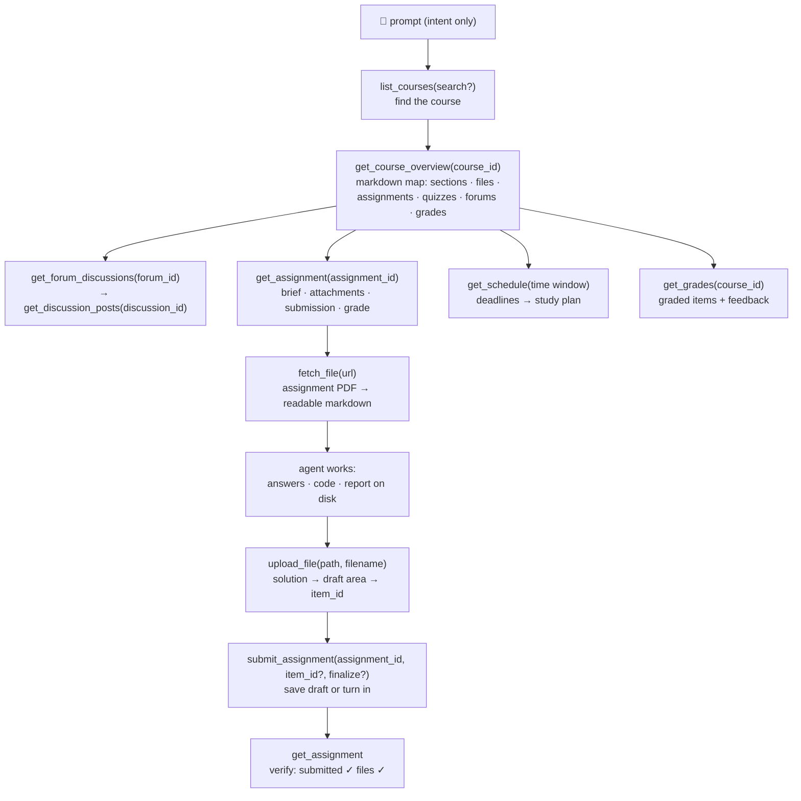

<p align="center">
  
</p>

# moodle-mcp

<p align="center">
  <a href="../README.md">English</a> | 
  <a href="README.zh-TW.md">繁體中文</a> | 
  <a href="README.zh-CN.md">简体中文</a> | 
  <a href="README.ja.md">日本語</a> | 
  <b>Español</b> | 
  <a href="README.de.md">Deutsch</a> | 
  <a href="README.pt-BR.md">Português</a> | 
  <a href="README.fr.md">Français</a>
</p>

[](https://github.com/G36maid/moodle-mcp/actions/workflows/ci.yml)
[](https://codecov.io/gh/G36maid/moodle-mcp)
[](https://github.com/G36maid/moodle-mcp/releases/latest)
[](https://crates.io/crates/moodle-mcp)
[](../LICENSE)
[](https://www.rust-lang.org)
[](https://modelcontextprotocol.io)
[](https://github.com/G36maid/moodle-mcp/actions/workflows/release.yml)

Un servidor [Model Context Protocol](https://modelcontextprotocol.io) que permite a los agentes LLM **usar un Moodle LMS real** — consultar cursos, extraer PDFs de tareas, escribir código, subir archivos y entregar — todo a través de un único binario estático.

Construido en Rust sobre el SDK oficial de MCP ([`rmcp`](https://crates.io/crates/rmcp)). Verificado en entornos reales con Moodle 3.7, 4.5 y 5.2; diseñado para **3.7 → 5.x**.

## ✅ Por qué moodle-mcp

Un chatbot genérico no tiene forma de entrar en tu Moodle, así que cada tarea de estudio sigue siendo manual — cinco pestañas del navegador solo para responder *«¿qué vence esta semana?»*, PDFs que vuelves a subir a mano, foros y calificaciones copiados y pegados página por página.

moodle-mcp inicia sesión con el agente como tú. 20 herramientas tipadas cubren todo el recorrido estudiantil, y el agente las encadena por sí mismo — sin abrir nunca un navegador:

- **Todo incluido** — conversión de documentos, HTML → markdown, una CLI de autenticación y una vía de escape opcional en un solo binario: sin plugins, sin scripts auxiliares, sin un segundo entorno de ejecución
- **Nativo para agentes** — las herramientas aceptan y devuelven rutas de archivos locales en lugar de base64; cada resultado incrusta los IDs para la siguiente llamada; los errores son claros y sugieren la solución
- **Seguro por defecto** — las herramientas de escritura te piden confirmación antes de actuar, las entregas quedan como borradores hasta que tú lo digas; resolver cuestionarios está intencionadamente sin implementar
- **Adaptable a versiones** — verificado contra Moodle 3.7 y diseñado para 4.x/5.x; las diferencias de respuesta entre versiones se absorben automáticamente
- **Un único binario estático** — sin dependencias de ejecución

## 🚀 Inicio rápido

Necesita una cuenta de **Moodle 3.7 → 5.x** en un sitio que permita el servicio web de la app móvil (la mayoría lo permiten — ver [requisitos previos](https://moodle.ntnu.cc/docs/getting-started.html#prerequisites)).

```bash
# 1. Install
cargo install moodle-mcp        # or grab a prebuilt binary — no Rust needed

# 2. Log in once — prints MOODLE_URL and MOODLE_TOKEN
moodle-mcp auth

# 3. Connect your client (Claude Code shown; Codex/OpenCode/pi below)
claude mcp add moodle \
  --env MOODLE_URL=https://moodle.example.com \
  --env MOODLE_TOKEN=your-token \
  -- /path/to/moodle-mcp

# 4. Open a chat and ask:
#    "What's due in the next two weeks? Plan my studying around it."
```

O pega esto en tu agente y deja que haga todos los pasos (abrirá `moodle-mcp auth` en su terminal — escribe ahí tus credenciales, no en el chat):

```text
Set up moodle-mcp for me. First read https://moodle.ntnu.cc/docs/installation.html
and https://moodle.ntnu.cc/docs/configuration.html. Then install the binary
for my platform (prefer the prebuilt archive from the latest GitHub release;
`cargo install moodle-mcp` as the fallback), run `moodle-mcp auth` in the
terminal so I can type my school credentials when it prompts, and register
the server in your own MCP config — name "moodle", stdio command
`moodle-mcp`, env MOODLE_URL and MOODLE_TOKEN from auth's output. Do not
store or repeat my credentials anywhere.
```

Binarios precompilados, inicio de sesión SSO, fragmentos de configuración para cada cliente y la referencia completa de variables de entorno: [Instalación](https://moodle.ntnu.cc/docs/installation.html) · [Primeros pasos](https://moodle.ntnu.cc/docs/getting-started.html) · [Configuración](https://moodle.ntnu.cc/docs/configuration.html)

## 💬 Qué puede hacer el agente

Todo esto funciona sin configuración adicional — el agente descubre las herramientas a partir de sus descripciones y las encadena por sí mismo:

| Tú dices | El agente encadena |
|---|---|
| *«Termina mi tarea 1 de Seguridad Informática: lee las instrucciones y el PDF adjunto, resuelve los problemas y entrega un borrador.»* | `get_assignment` (brief + attachments) → `fetch_file` (PDF → markdown, math included) → solves it → writes the answer file → `upload_file` → `submit_assignment` → `get_assignment` (verify submitted ✓) |
| *«Basándote en los plazos próximos y los materiales del curso, prepárame un plan de estudio completo para las próximas dos semanas.»* | `get_schedule` (all deadlines) → `get_course_overview` per course → day-by-day plan balanced against due dates |
| *«Me perdí lo que pasó en Comunicación de Datos esta semana — ponme al día, incluido el foro de avisos.»* | `get_notifications` + `get_forum_discussions` → `get_discussion_posts` → synthesized weekly digest |
| *«Prepárame para el quiz de Ingeniería de Software: ¿qué publicó el profesor al respecto?»* | `get_course_overview` (quiz entry) → `get_assignment` (requirements) → related forum threads |

## 🔄 Cómo funciona el agente

Las herramientas reflejan cómo navegas por Moodle — la salida de cada nivel incrusta los IDs para el siguiente:


Todo lo que las herramientas dedicadas no cubren está disponible a través de la vía de escape `call_ws_function` + `list_ws_functions` — cobertura completa de las ~350 funciones que un token típico puede llamar (20 + 2 = 22 en total; la vía de escape es opcional y se activa con `MOODLE_ENABLE_WS_FUNCTION=true`).

## 📚 Documentación

La documentación completa vive en [`docs/`](https://moodle.ntnu.cc/docs/) (mdBook — `mdbook serve docs` para leerla en local):

| Página | Contenido |
|---|---|
| [Primeros pasos](https://moodle.ntnu.cc/docs/getting-started.html) | de cero al primer prompt; no se asume experiencia con MCP |
| [Instalación](https://moodle.ntnu.cc/docs/installation.html) | binarios precompilados, cargo, desde el código fuente |
| [Configuración](https://moodle.ntnu.cc/docs/configuration.html) | todas las variables de entorno; fragmentos de configuración para Claude Code, Codex, OpenCode y pi |
| [Herramientas](https://moodle.ntnu.cc/docs/tools.html) | la referencia completa de las 22 herramientas y el flujo de IDs entre ellas |
| [Seguridad y autenticación](https://moodle.ntnu.cc/docs/security.html) | ciclo de vida del token, seguridad de transporte y de escritura |
| [Changelog](https://moodle.ntnu.cc/docs/changelog.html) | notas de versión, versión por versión |
| [Desarrollo](https://moodle.ntnu.cc/docs/development.html) | recorrido por la arquitectura, tests, proceso de publicación |
| [Acerca de](https://moodle.ntnu.cc/docs/about.html) | qué son moodle-mcp, MCP y Moodle |

## 🧰 Desarrollo

```bash
cargo test                 # unit + wiremock integration + MCP protocol tests
cargo clippy --all-targets
cargo fmt -- --check
cargo build --release
```

La documentación del proyecto vive en [`docs/`](https://moodle.ntnu.cc/docs/) — mdBook, formateado con Prettier (ver `docs/README.md`); vista previa con `mdbook serve docs`.

La landing page vive en [`site/`](../site/) — Astro 7 + TypeScript (`cd site && npm install && npm run dev`, compilar con `npm run build`).

## 🔐 Seguridad

Usa **HTTPS** — el token viaja con cada petición. Nunca aparece en la salida de las herramientas ni en los errores, solo se inyecta en URLs de Moodle del mismo sitio, y las herramientas de escritura te piden confirmación antes de actuar. Detalles completos: [Seguridad y autenticación](https://moodle.ntnu.cc/docs/security.html).

## 📄 Licencia

MIT — ver [LICENSE](../LICENSE).
