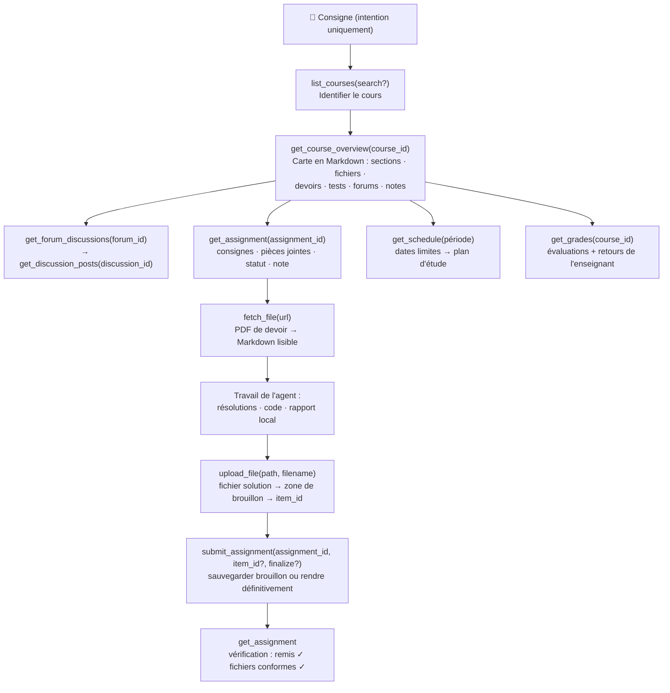

<p align="center">
  
</p>

# moodle-mcp

<p align="center">
  <a href="../README.md">English</a> | 
  <a href="README.zh-TW.md">繁體中文</a> | 
  <a href="README.zh-CN.md">简体中文</a> | 
  <a href="README.ja.md">日本語</a> | 
  <a href="README.es.md">Español</a> | 
  <a href="README.de.md">Deutsch</a> | 
  <a href="README.pt-BR.md">Português</a> | 
  <b>Français</b>
</p>

[](https://github.com/G36maid/moodle-mcp/actions/workflows/ci.yml)
[](https://codecov.io/gh/G36maid/moodle-mcp)
[](https://github.com/G36maid/moodle-mcp/releases/latest)
[](https://crates.io/crates/moodle-mcp)
[](../LICENSE)
[](https://www.rust-lang.org)
[](https://modelcontextprotocol.io)
[](https://github.com/G36maid/moodle-mcp/actions/workflows/release.yml)

Un serveur [Model Context Protocol (MCP)](https://modelcontextprotocol.io) permettant aux agents LLM **d'interagir avec une véritable plateforme Moodle LMS** — consulter les cours, extraire les énoncés PDF de devoirs, rédiger du code, téléverser des fichiers et remettre des devoirs — le tout via un unique binaire statique autonome.

Développé en Rust avec le SDK officiel MCP ([`rmcp`](https://crates.io/crates/rmcp)). Validé en conditions réelles avec **Moodle 3.7 → 5.x**.

---

## ❌ Sans moodle-mcp

Un chatbot ordinaire ne dispose d'aucun accès à votre Moodle, ce qui oblige à effectuer chaque action manuellement :

- ❌ Cinq onglets ouverts dans le navigateur simplement pour savoir : *« Quels devoirs sont à rendre cette semaine ? »*
- ❌ Téléchargement manuel des PDF de devoirs puis glisser-déposer dans la fenêtre de chat
- ❌ Copier-coller fastidieux des fils de discussion de forums et des notes page par page

## ✅ Avec moodle-mcp

L'agent se connecte avec votre compte. 22 outils typés couvrent l'ensemble du parcours étudiant exactement comme un humain — de la vérification rapide des dates limites à l'assistance complète lors des remises de devoirs, sans ouvrir de navigateur :

```txt
Quels devoirs sont à rendre dans les deux prochaines semaines ? Planifie mon travail en conséquence.
```

```txt
Termine mon TP 1 de Sécurité Informatique : lis l'énoncé et le PDF joint, résous les exercices et soumets un brouillon.
```

```txt
J'ai manqué le cours de Réseaux de cette semaine — fais-moi un résumé complet incluant le forum des annonces.
```

L'agent enchaîne les outils de manière autonome : plan du cours → énoncé du devoir → PDF → Markdown → résolution → téléversement de fichier → remise de brouillon → vérification.
Retrouvez les parcours complets dans [Exemples de requêtes](#-exemples-de-requêtes) et [Fonctionnement de l'agent](#-fonctionnement-de-lagent).

## ✨ Fonctionnalités & Points forts

- **Prêt à l'emploi (Batteries included)** — Conversion de documents (anydoc), HTML → Markdown (htmd), CLI de gestion des jetons et échappatoire générique intégrés : aucun plugin requis, aucun script auxiliaire, aucun environnement d'exécution supplémentaire.
- **Conçu pour les agents (Agent-native)** — Les outils acceptent et renvoient des **chemins de fichiers locaux** plutôt que du base64 ; les résultats intègrent directement les identifiants pour l'étape suivante ; les paramètres par défaut incluent des conseils ("pass course_ids to filter") ; les messages d'erreur sont explicites et proposent des solutions.
- **22 outils calqués sur les usages réels** — Chaque outil reflète une action concrète dans Moodle : cours, plan d'ensemble, devoirs, remises, forums, fichiers (récupérer/convertir/télécharger/téléverser), notes, calendrier, messagerie, tentatives de tests. Pas de déversement brut des ~350 fonctions web services ; avec une passerelle générique (`call_ws_function` + `list_functions`) pour couvrir tout le reste.
- **Cartographie complète du cours en un seul appel** — `get_course_overview` regroupe cinq points d'accès Moodle en un document Markdown unique avec l'ensemble des identifiants et des liens vers les fichiers.
- **PDF → Markdown** — Les énoncés de devoirs deviennent des spécifications lisibles via [anydoc](https://crates.io/crates/anydoc) ; les descriptions HTML conservent leurs tableaux via [htmd](https://crates.io/crates/htmd).
- **Adaptabilité multi-versions** — Vérifié avec Moodle 3.7 et optimisé pour 4.x/5.x ; compense automatiquement les différences de noms de fonctions, de pagination et de structures de réponse.
- **Sécurisé par défaut** — Les opérations d'écriture requièrent une confirmation explicite ; les brouillons sont privilégiés par rapport aux remises définitives ; la passation automatique de tests en ligne n'est volontairement **pas** proposée.
- **Binaire statique unique** — Aucune dépendance d'exécution externe.

## 📋 Prérequis

- Un site **Moodle 3.7 → 5.x** sur lequel vous possédez un compte utilisateur
- Services web activés côté plateforme : **protocole REST** et service **`moodle_mobile_app`** autorisés pour votre compte (identique à la configuration de l'application mobile Moodle officielle)
- **HTTPS** fortement recommandé — le jeton d'accès circule avec chaque requête (voir [Notes de sécurité](#-notes-de-sécurité))
- N'importe quel client compatible MCP — Claude Code, Codex, OpenCode, pi ou tout client MCP via stdio
- Rust 1.88+ uniquement pour `cargo install` ou la compilation depuis les sources (les binaires précompilés ne requièrent aucun outil)

## 📦 Installation

### Télécharger un binaire précompilé

Aucun environnement Rust n'est requis — téléchargez l'archive adaptée à votre plateforme depuis la [dernière version (Release)](https://github.com/G36maid/moodle-mcp/releases/latest) :

| Plateforme | Archive |
|---|---|
| Linux x86_64 | `moodle-mcp-<version>-x86_64-unknown-linux-gnu.tar.gz` |
| Linux arm64 | `moodle-mcp-<version>-aarch64-unknown-linux-gnu.tar.gz` |
| macOS Apple Silicon | `moodle-mcp-<version>-aarch64-apple-darwin.tar.gz` |
| macOS Intel | `moodle-mcp-<version>-x86_64-apple-darwin.tar.gz` |
| Windows x64 | `moodle-mcp-<version>-x86_64-pc-windows-msvc.zip` |

```bash
tar xzf moodle-mcp-*-aarch64-apple-darwin.tar.gz
sudo mv moodle-mcp-*/moodle-mcp /usr/local/bin/   # ou tout dossier présent dans le PATH
```

### Ou installer avec cargo

```bash
cargo install moodle-mcp   # nécessite Rust 1.88+
```

### Ou compiler depuis les sources

```bash
git clone https://github.com/G36maid/moodle-mcp
cd moodle-mcp
cargo build --release
# Binaire produit : target/release/moodle-mcp (~15 Mo, statique)
```

### Obtenir un jeton (Token)

Utilisez la commande CLI intégrée (même binaire) :

```bash
moodle-mcp auth
# Moodle URL (e.g. https://moodle.example.com): https://moodle.example.com
# Username: votre_identifiant
# Password: ********   (masqué pendant la saisie)
# → export MOODLE_URL='https://moodle.example.com' MOODLE_TOKEN='…'
```

Toute valeur passée en option (`--url`, `--username`, `--password`) évite l'invite correspondante — les scripts fonctionnent donc aussi sans interaction.

En cas d'authentification unique (SSO institutionnel sans mot de passe direct), ouvrez la page des clés de sécurité dans votre navigateur :

```bash
moodle-mcp auth --url https://moodle.example.com --open
```

Si l'obtention du jeton échoue, la plateforme ne dispose pas des options requises dans les [Prérequis](#-prérequis) — demandez à votre administrateur d'activer les services web.

### Raccorder un client

Tous les clients communiquent avec le même serveur stdio : démarrez `/path/to/moodle-mcp` avec les variables d'environnement `MOODLE_URL` et `MOODLE_TOKEN`. Avec Claude Code, une seule commande suffit :

```bash
claude mcp add moodle \
  --env MOODLE_URL=https://moodle.example.com \
  --env MOODLE_TOKEN=votre-token \
  -- /path/to/moodle-mcp
```

Exemples de configuration pour d'autres clients :

<details open>
<summary><b>Claude Code</b> — <code>.mcp.json</code> (projet) ou <code>~/.claude.json</code> (global)</summary>

```json
{
  "mcpServers": {
    "moodle": {
      "command": "/path/to/moodle-mcp",
      "env": {
        "MOODLE_URL": "https://moodle.example.com",
        "MOODLE_TOKEN": "votre-token"
      }
    }
  }
}
```

</details>

<details>
<summary><b>Codex</b> — <code>~/.codex/config.toml</code> (global)</summary>

```toml
[mcp_servers.moodle]
command = "/path/to/moodle-mcp"
env = { "MOODLE_URL" = "https://moodle.example.com", "MOODLE_TOKEN" = "votre-token" }
```

</details>

<details>
<summary><b>OpenCode</b> — <code>opencode.json</code> (projet) ou <code>~/.config/opencode/opencode.json</code> (global)</summary>

```json
{
  "mcp": {
    "moodle": {
      "type": "local",
      "command": ["/path/to/moodle-mcp"],
      "environment": {
        "MOODLE_URL": "https://moodle.example.com",
        "MOODLE_TOKEN": "votre-token"
      }
    }
  }
}
```

</details>

<details>
<summary><b>pi</b> — <code>.pi/mcp.json</code> (projet) ou <code>~/.pi/agent/mcp.json</code> (global)</summary>

```json
{
  "mcpServers": {
    "moodle": {
      "command": "/path/to/moodle-mcp",
      "env": {
        "MOODLE_URL": "https://moodle.example.com",
        "MOODLE_TOKEN": "votre-token"
      }
    }
  }
}
```

</details>

| Variable d'environnement | Obligatoire | Valeur par défaut | Description |
|---|:---:|---|---|
| `MOODLE_URL` | ✔ | — | URL de base de la plateforme Moodle, sans barre oblique finale |
| `MOODLE_TOKEN` | ✔ | — | Jeton d'accès de service web |
| `MOODLE_TIMEOUT_SECS` | — | `60` | Délai d'attente par requête en secondes ; c'est aussi la durée totale accordée à la détection du fuseau horaire au démarrage |
| `MOODLE_TIMEZONE` | — | auto / `UTC` | Fuseau horaire IANA (`Asia/Taipei`) pour l'affichage des horodatages ; par défaut, détecte le fuseau que Moodle utilise pour l'utilisateur : le fuseau imposé par le site, puis celui du profil (si le site ne le masque pas), puis le fuseau par défaut du site (ces deux réglages du site nécessitent Moodle 4.2+) ; à défaut, utilise UTC |
| `MOODLE_ALLOW_EXTERNAL_FETCH` | — | désactivé | Permet à `fetch_file`/`download_file` de récupérer des URL hors du site configuré (désactivé : uniquement les URL de fichiers Moodle du même site) |
| `MOODLE_ALLOW_HTTP` | — | désactivé | `1` autorise `MOODLE_URL` en http clair (les hôtes loopback sont toujours exemptés) — sinon http est refusé pour protéger le token |
| `MOODLE_READ_ONLY` | — | désactivé | `1` masque de la liste d'outils tous les outils d'écriture/téléversement (`create_forum_discussion`, `reply_to_discussion`, `submit_assignment`, `send_message`, `upload_file`, `call_ws_function`) — accès LLM en lecture seule |
| `MOODLE_DISABLE_TOOLS` | — | — | Noms d'outils séparés par des virgules à masquer en plus (p. ex. `send_message,upload_file`) ; les noms inconnus déclenchent un avertissement au démarrage |
| `MOODLE_LOG_LEVEL` | — | `info` | Niveau de journalisation : `error`/`warn`/`info`/`debug`/`trace` (les valeurs invalides retombent sur `info`) ; `trace` journalise des extraits de corps de réponse — à éviter sur une machine partagée |
| `MOODLE_UA` | — | `moodle-mcp/{version}` | Substitution du User-Agent pour les cas de filtrage institutionnel |
| `RUST_LOG` | — | `info` | Niveau de journalisation (logs vers stderr ; stdout réservé au protocole MCP) |

## 💬 Exemples de requêtes

Ces exemples fonctionnent immédiatement sans configuration additionnelle — l'agent analyse les descriptions des outils et les enchaîne de manière autonome :

### Mode tout-automatique (une consigne, parcours complet)

| Vous demandez | Enchaînement exécuté par l'agent |
|---|---|
| *« Termine mon TP 1 de Sécurité Informatique : lis l'énoncé et le PDF joint, résous les exercices et soumets un brouillon. »* | `get_assignment` (énoncé et pièces jointes) → `fetch_file` (PDF vers Markdown avec formules) → résolution → enregistrement de la solution → `upload_file` → `submit_assignment` → `get_assignment` (vérifier le statut de remise ✓) |
| *« En fonction de mes échéances et des supports de cours, prépare un planning de révision complet pour les deux semaines à venir. »* | `get_schedule` (toutes les dates limites) → `get_course_overview` par cours (supports et lectures recommandées) → planification quotidienne équilibrée |
| *« J'ai raté le cours de Réseaux cette semaine — fais-moi un récapitulatif complet incluant le forum des annonces. »* | `get_notifications` + `get_forum_discussions` → `get_discussion_posts` → synthèse hebdomadaire structurée |
| *« Aide-moi à réviser le quiz de Génie Logiciel : qu'a publié l'enseignant à ce sujet ? »* | `get_course_overview` (élément de test) → `get_assignment` (consignes) → discussions connexes sur le forum |

### Requêtes rapides

| Vous demandez | Enchaînement exécuté par l'agent |
|---|---|
| *« Quelles échéances arrivent dans les deux prochaines semaines ? »* | `get_schedule` → chronologie unifiée des devoirs, des fermetures de tests et des événements |
| *« Quel est le sujet du TP 1 ? Lis les consignes. »* | `get_assignment` → `fetch_file` convertit le PDF joint en Markdown |
| *« Quelles sont mes notes en travaux pratiques de Réseaux ? »* | `list_courses` → `get_grades(course_id)` → éléments d'évaluation, commentaires et pondérations |
| *« Dans quels cours ai-je déjà des notes publiées ? »* | `get_grades()` → synthèse transversale des résultats |
| *« Résume toutes les annonces publiées sur le forum de Réseaux. »* | `get_course_overview` → `get_forum_discussions` → `get_discussion_posts` |
| *« Téléverse ma solution solution.pdf pour le Quiz 1 et enregistre-la comme brouillon. »* | `upload_file` → `submit_assignment(item_id, finalize=false)` |
| *« Quel est le programme à venir pour le cours de Génie Logiciel ? »* | `get_course_overview` → sections, fichiers, forums |
| *« Puis-je envoyer un message à mon enseignant pour demander un délai ? »* | `get_user` / `get_conversations` → rédaction d'un brouillon → confirmation utilisateur → `send_message` |

## 🔄 Fonctionnement de l'agent

Les outils reflètent fidèlement la manière dont un étudiant navigue sur Moodle — chaque niveau fournit les identifiants nécessaires pour le niveau suivant :



Les besoins spécifiques non couverts par les 20 outils dédiés sont directement accessibles via l'échappatoire générique `call_ws_function` + `list_functions`, assurant une couverture intégrale des ~350 fonctions web services associées au jeton (20 + 2 = 22 outils au total).

## 🛠 Référentiel des outils

RW précise la nature de l'opération : 📖 lecture seule · ✍️ écriture. Les outils d'écriture agissent au nom du propriétaire du jeton ; les consignes du serveur imposent à l'agent de demander confirmation avant exécution, et les téléversements sont isolés dans votre zone privée de brouillons.

### Identité & Cours
| Outil | Signature | RW | Usage |
|---|---|:-:|---|
| `whoami` | `()` | 📖 | Identité du propriétaire du jeton et informations de version Moodle |
| `list_courses` | `(search?)` | 📖 | Liste des cours inscrits avec filtre optionnel par nom |
| `get_course_overview` | `(course_id)` | 📖 | Cartographie complète du cours au format Markdown |

### Devoirs & Remises
| Outil | Signature | RW | Usage |
|---|---|:-:|---|
| `get_assignment` | `(assignment_id)` | 📖 | Document complet : dates, statut, consignes, pièces jointes, remise, note et retours |
| `submit_assignment` | `(assignment_id, text?, item_id?, finalize?)` | ✍️ | Seul outil d'écriture pour les devoirs : texte en ligne et/ou fichiers brouillons |

### Forums
| Outil | Signature | RW | Usage |
|---|---|:-:|---|
| `get_forum_discussions` | `(forum_id)` | 📖 | Liste des fils de discussion avec aperçu du message initial |
| `get_discussion_posts` | `(discussion_id)` | 📖 | Fil de discussion complet converti en Markdown avec pièces jointes |
| `create_forum_discussion` | `(forum_id, subject, message)` | ✍️ | Ouvrir un nouveau fil de discussion |
| `reply_to_discussion` | `(post_id, subject, message)` | ✍️ | Répondre à un message |

### Fichiers
| Outil | Signature | RW | Usage |
|---|---|:-:|---|
| `fetch_file` | `(url)` | 📖 | Convertit PDF/DOCX/PPTX/XLSX/ODT/RTF/EPUB/CSV en Markdown (anydoc ; limite 100k caractères) |
| `download_file` | `(url, save_to)` | 📖 | Téléchargement brut vers un chemin local (métadonnées uniquement) |
| `upload_file` | `(path, item_id?)` | ✍️ | Téléverser un fichier local vers la zone de brouillons |

### Notes, Planning & Messagerie
| Outil | Signature | RW | Usage |
|---|---|:-:|---|
| `get_grades` | `(course_id?)` | 📖 | Synthèse de notes inter-cours ou détail des évaluations d'un cours |
| `get_schedule` | `(time_from?, time_to?, course_ids?)` | 📖 | Chronologie unifiée (par défaut : 30 prochains jours) |
| `get_notifications` | `(read?, limit?)` | 📖 | Notifications système récentes |
| `get_conversations` | `(limit?)` | 📖 | Liste des conversations directes avec identifiants des membres |
| `send_message` | `(user_id, text)` | ✍️ | Envoyer un message privé direct |
| `get_quiz_attempts` | `(quiz_id)` | 📖 | Historique des tentatives de tests (lecture seule) |
| `get_user` / `search_users` | `(field, value)` / `(search?, limit?)` | 📖 | Consultation de profil / recherche d'utilisateurs |

### Passerelle générique
| Outil | Signature | RW | Usage |
|---|---|:-:|---|
| `call_ws_function` | `(wsfunction, params?)` | 📖/✍️ | Appeler n'importe quelle fonction Web Service active (format PHP bracket géré automatiquement) |
| `list_functions` | `(query?)` | 📖 | Découvrir les fonctions disponibles par mots-clés |

## 🔐 Notes de sécurité

- Utilisez impérativement **HTTPS** — le jeton est transmis avec chaque requête.
- Le jeton est un secret confidentiel : ne le validez jamais dans Git et ne l'envoyez jamais à d'autres hôtes que votre Moodle (le serveur ne l'injecte que dans les URL `pluginfile.php` du même domaine et bloque les redirections sortantes).
- Les jetons n'apparaissent jamais en clair dans les réponses ou les messages d'erreur : toute chaîne `token=…` est masquée sous la forme `token=[REDACTED]`.
- Limites de transfert strictes : extraction en ligne limitée à 100 Mo, téléchargements en flux continu à 500 Mo, téléversements à 100 Mo. Les téléchargements sont diffusés directement sur le disque (jamais stockés intégralement en mémoire vive) et surveillés par un délai d'inactivité de lecture.
- Les outils d'écriture agissent au nom du **propriétaire du jeton**. Les instructions du serveur obligent l'agent à demander confirmation avant toute action irréversible.
- La réalisation automatique des tests en ligne est **volontairement non supportée**.

## 🧰 Développement & Tests

```bash
cargo test                 # 39 tests : tests unitaires + intégration wiremock + protocole MCP
cargo clippy --all-targets
cargo fmt -- --check
cargo build --release
```

Circulation des identifiants entre outils :

| Identifiant | Produit par | Consommé par |
|---|---|---|
| `course_id` | `list_courses` / `get_course_overview` | `overview` / `grades` / `schedule` / `assignments` |
| `forum_id` | `get_course_overview` | `get_forum_discussions` / `create_forum_discussion` |
| `discussion_id` | `get_forum_discussions` | `get_discussion_posts` |
| `post_id` | `get_discussion_posts` | `reply_to_discussion` |
| `assignment_id` | `get_course_overview` / `get_assignment` | `get_assignment` / `submit_assignment` |
| `item_id` (brouillon) | `upload_file` | `submit_assignment` |
| `user_id` | `conversations members` / `notifications` / `get_user` | `send_message` / `get_user` |

## 📄 Licence

MIT — consulter le fichier [LICENSE](../LICENSE).
