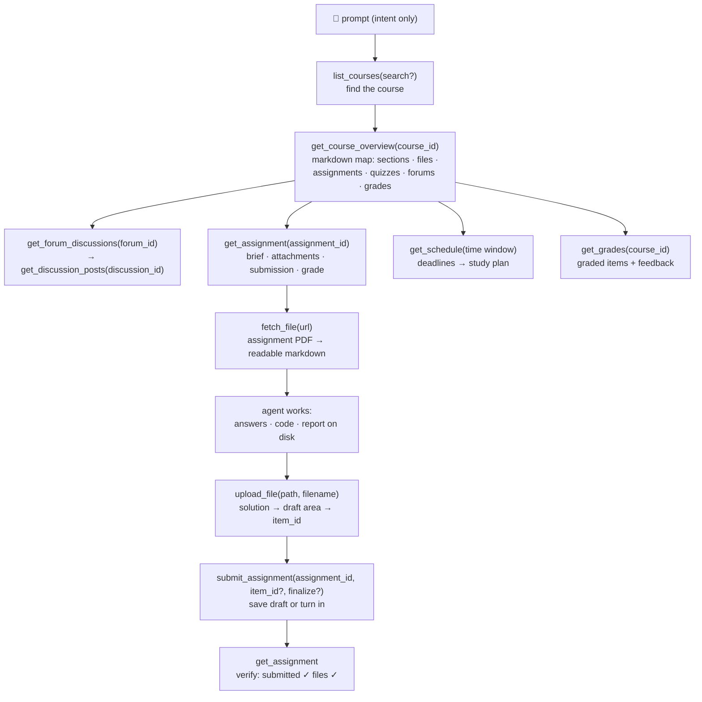

<p align="center">
  
</p>

# moodle-mcp

<p align="center">
  <a href="../README.md">English</a> |
  <a href="README.zh-TW.md">繁體中文</a> |
  <a href="README.zh-CN.md">简体中文</a> |
  <a href="README.ja.md">日本語</a> |
  <a href="README.es.md">Español</a> |
  <a href="README.de.md">Deutsch</a> |
  <a href="README.pt-BR.md">Português</a> |
  <b>Français</b>
</p>

[](https://github.com/G36maid/moodle-mcp/actions/workflows/ci.yml)
[](https://codecov.io/gh/G36maid/moodle-mcp)
[](https://github.com/G36maid/moodle-mcp/releases/latest)
[](https://crates.io/crates/moodle-mcp)
[](../LICENSE)
[](https://www.rust-lang.org)
[](https://modelcontextprotocol.io)
[](https://github.com/G36maid/moodle-mcp/actions/workflows/release.yml)

Un serveur [Model Context Protocol](https://modelcontextprotocol.io) qui permet aux agents LLM **d'utiliser un véritable Moodle LMS** — consulter les cours, récupérer les énoncés PDF des devoirs, écrire du code, téléverser et remettre — le tout via un unique binaire statique.

Écrit en Rust sur le SDK MCP officiel ([`rmcp`](https://crates.io/crates/rmcp)). Vérifié en conditions réelles sur Moodle 3.7, 4.5 et 5.2 ; conçu pour **3.7 → 5.x**.

## ✅ Pourquoi

Un chatbot générique n'a aucun accès à votre Moodle, donc chaque tâche d'étude reste manuelle — cinq onglets de navigateur juste pour répondre à *« Quels devoirs sont à rendre cette semaine ? »*, des PDF téléversés à la main, des forums et des notes recopiés page par page.

moodle-mcp connecte l'agent sous votre identité. 20 outils typés couvrent l'ensemble du parcours étudiant, et l'agent les enchaîne tout seul — sans jamais ouvrir un navigateur :

- **Batteries included** — conversion de documents, HTML → Markdown, une CLI d'authentification et une échappatoire à activer dans un seul binaire : aucun plugin, aucun script auxiliaire, aucun second runtime
- **Conçu pour les agents** — les outils prennent et renvoient des chemins de fichiers locaux plutôt que du base64 ; chaque résultat embarque les identifiants de l'appel suivant ; les messages d'erreur sont explicites et proposent la solution
- **Sûr par défaut** — les outils d'écriture demandent d'abord votre confirmation, les remises restent des brouillons tant que vous ne le décidez pas ; la passation automatique des quiz est volontairement non proposée
- **Adapté à chaque version** — vérifié avec Moodle 3.7 et conçu pour 4.x/5.x ; les différences de réponses entre versions sont absorbées automatiquement
- **Un seul binaire statique** — aucune dépendance d'exécution

## 🚀 Démarrage rapide

Un compte Moodle 3.7 → 5.x est nécessaire, sur un site qui autorise le service web de l'application mobile (c'est le cas de la plupart — voir [Prérequis](https://moodle.ntnu.cc/docs/getting-started.html#prerequisites)).

```bash
# 1. Install
cargo install moodle-mcp        # or grab a prebuilt binary — no Rust needed

# 2. Log in once — prints MOODLE_URL and MOODLE_TOKEN
moodle-mcp auth

# 3. Connect your client (Claude Code shown; Codex/OpenCode/pi below)
claude mcp add moodle \
  --env MOODLE_URL=https://moodle.example.com \
  --env MOODLE_TOKEN=your-token \
  -- /path/to/moodle-mcp

# 4. Open a chat and ask:
#    "What's due in the next two weeks? Plan my studying around it."
```

Ou collez ceci dans votre agent et laissez-le tout faire (il ouvrira `moodle-mcp auth` dans son terminal — saisissez vos identifiants là, pas dans le chat) :

```text
Set up moodle-mcp (github.com/G36maid/moodle-mcp): read docs/src/installation.md
and docs/src/configuration.md from the repo's main branch first. Then install
the binary for my platform, run `moodle-mcp auth` in the terminal so I can
type my school credentials when it prompts, and register the server in your
own MCP config using the snippet for your harness. Never store or repeat my
credentials; ask before anything global.
```

Binaires précompilés, connexion SSO, extraits de configuration pour chaque client et référence complète des variables d'environnement : [Installation](https://moodle.ntnu.cc/docs/installation.html) · [Premiers pas](https://moodle.ntnu.cc/docs/getting-started.html) · [Configuration](https://moodle.ntnu.cc/docs/configuration.html)

## 💬 Ce que l'agent peut faire

Tout cela fonctionne sans configuration supplémentaire — l'agent découvre les outils dans leurs descriptions et les enchaîne de lui-même :

| Vous demandez | Enchaînement de l'agent |
|---|---|
| *« Termine mon TP 1 de Sécurité Informatique : lis l'énoncé et le PDF joint, résous les exercices et soumets un brouillon. »* | `get_assignment` (brief + attachments) → `fetch_file` (PDF → markdown, math included) → solves it → writes the answer file → `upload_file` → `submit_assignment` → `get_assignment` (verify submitted ✓) |
| *« En fonction des échéances à venir et des supports de cours, prépare-moi un planning de révision complet pour les deux prochaines semaines. »* | `get_schedule` (all deadlines) → `get_course_overview` per course → day-by-day plan balanced against due dates |
| *« J'ai raté ce qui s'est passé en Réseaux cette semaine — mets-moi à jour, y compris le forum des annonces. »* | `get_notifications` + `get_forum_discussions` → `get_discussion_posts` → synthesized weekly digest |
| *« Prépare-moi au quiz de Génie Logiciel : qu'est-ce que l'enseignant a publié à ce sujet ? »* | `get_course_overview` (quiz entry) → `get_assignment` (requirements) → related forum threads |

## 🔄 Fonctionnement de l'agent

Les outils reflètent votre navigation naturelle dans Moodle — la sortie de chaque niveau embarque les identifiants du suivant :



Tout ce que les outils dédiés ne couvrent pas reste accessible via l'échappatoire `call_ws_function` + `list_ws_functions` — couverture complète des ~350 fonctions qu'un token typique peut appeler (20 + 2 = 22 au total ; l'échappatoire est optionnelle et s'active via `MOODLE_ENABLE_WS_FUNCTION=true`).

## 📚 Documentation

La documentation complète se trouve dans [`docs/`](https://moodle.ntnu.cc/docs/) (mdBook — `mdbook serve docs` pour la consulter en local) :

| Page | Contenu |
|---|---|
| [Premiers pas](https://moodle.ntnu.cc/docs/getting-started.html) | de zéro jusqu'au premier prompt ; aucune expérience de MCP requise |
| [Installation](https://moodle.ntnu.cc/docs/installation.html) | binaires précompilés, cargo, compilation depuis les sources |
| [Configuration](https://moodle.ntnu.cc/docs/configuration.html) | toutes les variables d'environnement ; extraits de configuration pour Claude Code, Codex, OpenCode et pi |
| [Outils](https://moodle.ntnu.cc/docs/tools.html) | la référence complète des 22 outils et le flux d'identifiants entre eux |
| [Sécurité & Authentification](https://moodle.ntnu.cc/docs/security.html) | cycle de vie du token, sécurité des transports et des écritures |
| [Journal des modifications](https://moodle.ntnu.cc/docs/changelog.html) | notes de publication, version par version |
| [Développement](https://moodle.ntnu.cc/docs/development.html) | visite guidée de l'architecture, tests, processus de publication |
| [À propos](https://moodle.ntnu.cc/docs/about.html) | ce que sont moodle-mcp, MCP et Moodle |

## 🧰 Développement

```bash
cargo test                 # unit + wiremock integration + MCP protocol tests
cargo clippy --all-targets
cargo fmt -- --check
cargo build --release
```

La documentation du projet se trouve dans [`docs/`](https://moodle.ntnu.cc/docs/) — mdBook, formaté avec Prettier (voir `docs/README.md`) ; prévisualisation avec `mdbook serve docs`.

La page d'accueil se trouve dans [`site/`](../site/) — Astro 7 + TypeScript (`cd site && npm install && npm run dev`, compilation avec `npm run build`).

## 🔐 Sécurité

Utilisez **HTTPS** — le token voyage avec chaque requête. Il n'apparaît jamais dans les sorties d'outils ni dans les messages d'erreur, n'est injecté que dans les URL Moodle du même site, et les outils d'écriture demandent votre confirmation avant d'agir. Tous les détails : [Sécurité & Authentification](https://moodle.ntnu.cc/docs/security.html).

## 📄 Licence

MIT — voir [LICENSE](../LICENSE).
