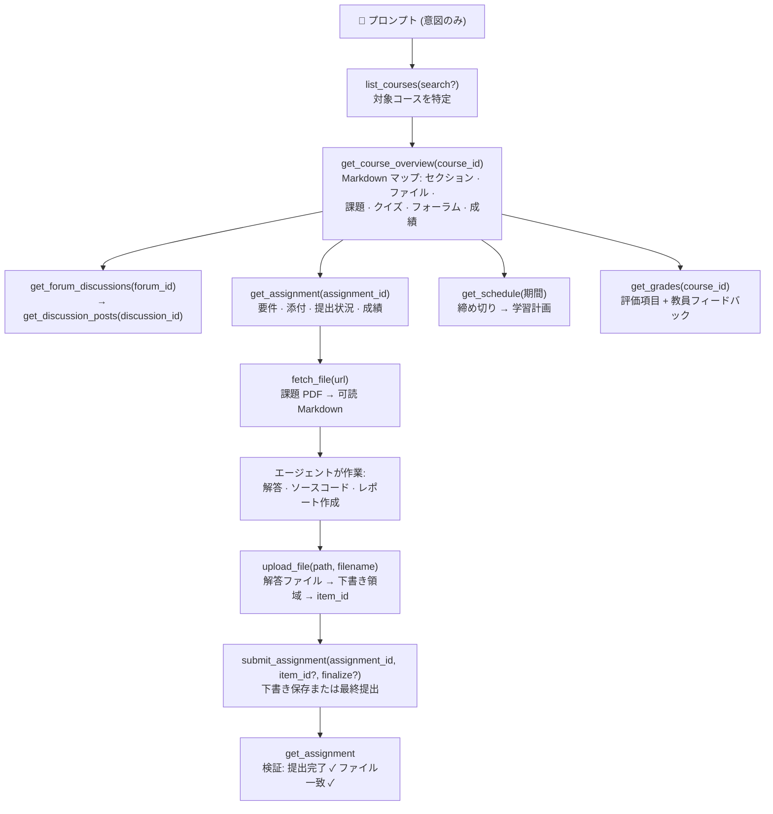

<p align="center">
  
</p>

# moodle-mcp

<p align="center">
  <a href="../README.md">English</a> | 
  <a href="README.zh-TW.md">繁體中文</a> | 
  <a href="README.zh-CN.md">简体中文</a> | 
  <b>日本語</b> | 
  <a href="README.es.md">Español</a> | 
  <a href="README.de.md">Deutsch</a> | 
  <a href="README.pt-BR.md">Português</a> | 
  <a href="README.fr.md">Français</a>
</p>

[](https://github.com/G36maid/moodle-mcp/actions/workflows/ci.yml)
[](https://codecov.io/gh/G36maid/moodle-mcp)
[](https://github.com/G36maid/moodle-mcp/releases/latest)
[](https://crates.io/crates/moodle-mcp)
[](../LICENSE)
[](https://www.rust-lang.org)
[](https://modelcontextprotocol.io)
[](https://github.com/G36maid/moodle-mcp/actions/workflows/release.yml)

LLM エージェントが**本物の Moodle LMS を直接操作**できるようにする [Model Context Protocol (MCP)](https://modelcontextprotocol.io) サーバーです。コース閲覧、課題 PDF の取得、コード記述、課題のアップロードや下書き提出まで、単一の静的バイナリのみで完結します。

公式 Rust MCP SDK ([`rmcp`](https://crates.io/crates/rmcp)) をベースに構築され、**Moodle 3.7 〜 5.x** の実環境で動作検証済みです。

---

## ❌ moodle-mcp がない場合

通常のチャットボットは Moodle にアクセスできないため、学習作業はすべて手動で行う必要があります：

- ❌ 「今週の締め切りは何がある？」を確認するだけで 5 つのタブを開く必要がある
- ❌ 課題 PDF を手動でダウンロードし、チャット画面にドラッグ＆ドロップする手間
- ❌ フォーラムの投稿や成績を 1 ページずつコピー＆ペースト

## ✅ moodle-mcp がある場合

エージェントがあなたのアカウントとしてサインインします。人間が行う操作をそのまま再現した 22 個の型付けツールにより、締め切りの素早い確認から課題提出の自動支援まで、ブラウザを一度も開くことなく実行できます：

```txt
今後2週間の課題の締め切りを教えて。それに合わせた学習計画を立ててほしい。
```

```txt
情報セキュリティの課題1を完了させて：課題要件と添付PDFを読み、問題を解いて下書きとして提出して。
```

```txt
今週のデータ通信の講義内容を見逃してしまった — お知らせフォーラムも含めて要約して。
```

エージェント自身がツールを自動連携します：コースマップ → 課題要件 → PDF 解析 → Markdown 変換 → 解答作成 → ファイルアップロード → 下書き提出 → 提出確認。
詳細は [プロンプト例](#-プロンプト例) および [エージェントの動作の仕組み](#-エージェントの動作の仕組み) を参照してください。

## ✨ 主な特徴

- **オールインワン（Batteries included）** — ドキュメント変換（anydoc）、HTML → Markdown（htmd）、トークン取得 CLI、汎用エスケープハッチを標準搭載。プラグインや補助スクリプト、追加ランタイムは一切不要です。
- **エージェントネイティブ設計（Agent-native）** — base64 ではなく**ローカルファイルパス**を入出力に使用。検索結果には次のツールで必要な ID が自動埋め込まれ、デフォルト引数にはヒント（例: "pass course_ids to filter"）が付属し、エラーメッセージは分かりやすく解決策を提示します。
- **人間中心に設計された 22 個の厳選ツール** — Moodle の実際の操作ステップをそのまま反映：コース、コース全貌、課題、提出、フォーラム、ファイル（取得/変換/ダウンロード/アップロード）、成績、予定表、メッセージ、クイズ履歴。350 以上の生 API を機械的に並べるのではなく、実用的な単位に整理（特殊な操作も汎用エスケープハッチ `call_ws_function` + `list_functions` で利用可能）。
- **1 回の呼び出しでコースマップ全体を取得** — `get_course_overview` は 5 つの Moodle エンドポイントを統合し、全セクション、リソース、課題 ID、ファイルリンクを含む単一の Markdown ドキュメントを生成します。
- **PDF → Markdown 自動変換** — [anydoc](https://crates.io/crates/anydoc) により課題 PDF を可読性の高い要件テキストに変換し、[htmd](https://crates.io/crates/htmd) により HTML の表組み構造を保持します。
- **バージョン自動適応** — Moodle 3.7 で検証済み、4.x/5.x を想定したアーキテクチャ設計。API 名やページネーション、レスポンス構造の差分を自動吸収します。
- **安全第一の設計** — 書き込みツールは事前の確認を要求。不可逆な最終提出ではなく下書き保存を優先し、クイズの自動受験機能は意図的に**非搭載**としています。
- **単一の静的バイナリ** — 外部依存関係なしで動作します。

## 📋 必要条件

- アカウントを所有している **Moodle 3.7 〜 5.x** サイト
- サイト側で Web サービスが有効化されていること：**REST プロトコル** および **`moodle_mobile_app`** サービスがあなたのアカウントに許可されていること（公式 Moodle モバイルアプリと同じ設定のため、多くの大学・学校で既に有効です）
- **HTTPS** の使用を強く推奨 — トークンはリクエスト毎に送信されます（詳細は [セキュリティに関する注意](#-セキュリティに関する注意) を参照）
- 任意の MCP クライアント — Claude Code、Codex、OpenCode、pi など、stdio 経由で MCP をサポートする環境
- `cargo install` またはソースからビルドする場合のみ Rust 1.88+ が必要（事前ビルド済みバイナリを使用する場合は不要）

## 📦 インストール

### 事前ビルド済みバイナリのダウンロード

Rust 環境は不要です — [最新リリース](https://github.com/G36maid/moodle-mcp/releases/latest) からプラットフォームに合ったアーカイブを取得してください：

| プラットフォーム | アーカイブ |
|---|---|
| Linux x86_64 | `moodle-mcp-<version>-x86_64-unknown-linux-gnu.tar.gz` |
| Linux arm64 | `moodle-mcp-<version>-aarch64-unknown-linux-gnu.tar.gz` |
| macOS Apple Silicon | `moodle-mcp-<version>-aarch64-apple-darwin.tar.gz` |
| macOS Intel | `moodle-mcp-<version>-x86_64-apple-darwin.tar.gz` |
| Windows x64 | `moodle-mcp-<version>-x86_64-pc-windows-msvc.zip` |

```bash
tar xzf moodle-mcp-*-aarch64-apple-darwin.tar.gz
sudo mv moodle-mcp-*/moodle-mcp /usr/local/bin/   # または PATH の通ったディレクトリ
```

### または cargo でインストール

```bash
cargo install moodle-mcp   # Rust 1.88+ が必要
```

### またはソースからビルド

```bash
git clone https://github.com/G36maid/moodle-mcp
cd moodle-mcp
cargo build --release
# 生成バイナリ: target/release/moodle-mcp (~15 MB, 静的リンク)
```

### トークンの取得

内蔵の CLI サブコマンドを使用します（同一バイナリ）：

```bash
moodle-mcp auth
# Moodle URL (e.g. https://moodle.example.com): https://moodle.example.com
# Username: yourname
# Password: ********   （入力はマスク表示）
# → export MOODLE_URL='https://moodle.example.com' MOODLE_TOKEN='…'
```

フラグ（`--url`、`--username`、`--password`）で渡した値は対応するプロンプトをスキップするため、スクリプトからも非対話で利用できます。

SSO 連携などで直接のパスワードがない場合は、ブラウザでセキュリティキートークンページを開きます：

```bash
moodle-mcp auth --url https://moodle.example.com --open
```

トークンの取得に失敗する場合は、[必要条件](#-必要条件) の設定が不足しています — サイト管理者にお問い合わせください。

### クライアントへの接続

すべてのクライアントは同一の stdio サーバーを起動します：環境変数 `MOODLE_URL` と `MOODLE_TOKEN` を設定して `/path/to/moodle-mcp` を実行します。Claude Code は以下の 1 コマンドで設定可能です：

```bash
claude mcp add moodle \
  --env MOODLE_URL=https://moodle.example.com \
  --env MOODLE_TOKEN=your-token \
  -- /path/to/moodle-mcp
```

その他のクライアントの設定例：

<details open>
<summary><b>Claude Code</b> — <code>.mcp.json</code> (プロジェクト) または <code>~/.claude.json</code> (グローバル)</summary>

```json
{
  "mcpServers": {
    "moodle": {
      "command": "/path/to/moodle-mcp",
      "env": {
        "MOODLE_URL": "https://moodle.example.com",
        "MOODLE_TOKEN": "your-token"
      }
    }
  }
}
```

</details>

<details>
<summary><b>Codex</b> — <code>~/.codex/config.toml</code> (グローバル)</summary>

```toml
[mcp_servers.moodle]
command = "/path/to/moodle-mcp"
env = { "MOODLE_URL" = "https://moodle.example.com", "MOODLE_TOKEN" = "your-token" }
```

</details>

<details>
<summary><b>OpenCode</b> — <code>opencode.json</code> (プロジェクト) または <code>~/.config/opencode/opencode.json</code> (グローバル)</summary>

```json
{
  "mcp": {
    "moodle": {
      "type": "local",
      "command": ["/path/to/moodle-mcp"],
      "environment": {
        "MOODLE_URL": "https://moodle.example.com",
        "MOODLE_TOKEN": "your-token"
      }
    }
  }
}
```

</details>

<details>
<summary><b>pi</b> — <code>.pi/mcp.json</code> (プロジェクト) または <code>~/.pi/agent/mcp.json</code> (グローバル)</summary>

```json
{
  "mcpServers": {
    "moodle": {
      "command": "/path/to/moodle-mcp",
      "env": {
        "MOODLE_URL": "https://moodle.example.com",
        "MOODLE_TOKEN": "your-token"
      }
    }
  }
}
```

</details>

| 環境変数 | 必須 | デフォルト値 | 説明 |
|---|:---:|---|---|
| `MOODLE_URL` | ✔ | — | サイトのベース URL（末尾スラッシュなし） |
| `MOODLE_TOKEN` | ✔ | — | Web サービストークン |
| `MOODLE_TIMEOUT_SECS` | — | `60` | リクエストごとのタイムアウト秒数。起動時のタイムゾーン検出全体の上限も兼ねます |
| `MOODLE_TIMEZONE` | — | 自動 / `UTC` | タイムスタンプ表示に使う IANA タイムゾーン名（`Asia/Taipei`）。デフォルトでは Moodle があなたに適用しているタイムゾーンを検出します：サイトの強制タイムゾーン、次にプロファイルのタイムゾーン（サイトで非表示にされていない場合）、最後にサイトのデフォルトタイムゾーン（サイト側の 2 つの設定は Moodle 4.2+ が必要です）。どれも取得できなければ UTC を使います |
| `MOODLE_ALLOW_EXTERNAL_FETCH` | — | オフ | `fetch_file`/`download_file` が設定サイト外の URL を取得することを許可（オフ：同一サイトの Moodle ファイル URL のみ） |
| `MOODLE_ALLOW_HTTP` | — | オフ | `1` で平文 http の `MOODLE_URL` を許可（ループバックホストは常に免除）— 未指定時はトークン保護のため http を拒否 |
| `MOODLE_READ_ONLY` | — | オフ | `1` を指定すると、書き込み・アップロード系ツール（`create_forum_discussion`、`reply_to_discussion`、`submit_assignment`、`send_message`、`upload_file`、`call_ws_function`）をツール一覧から非表示にします — 読み取り専用の LLM アクセス |
| `MOODLE_DISABLE_TOOLS` | — | — | 追加で非表示にするツール名のカンマ区切りリスト（例: `send_message,upload_file`）。不明な名前は起動時に警告されます |
| `MOODLE_LOG_LEVEL` | — | `info` | ログの詳細度: `error`/`warn`/`info`/`debug`/`trace`（不正な値は `info` にフォールバック）；`trace` はレスポンス本文の断片を記録するため共用マシンでは避けること |
| `MOODLE_UA` | — | `moodle-mcp/{version}` | User-Agent の上書き（機関側フィルタリングへの対処用） |
| `RUST_LOG` | — | `info` | ログフィルタ（ログは stderr、stdout は MCP プロトコル通信） |

## 💬 プロンプト例

追加設定なしですぐに実行可能です — エージェントがツールの説明を読み取り、自律的に連携呼び出しを行います：

### フルオート（単一の指示で全工程を完遂）

| ユーザーの指示 | エージェントの連携呼び出し |
|---|---|
| *「情報セキュリティの課題1を終わらせて：要件と添付PDFを読み、問題を解いて下書きとして提出して。」* | `get_assignment`（要件と添付ファイル）→ `fetch_file`（PDF を Markdown 化、数式対応）→ 解答作成 → ファイル保存 → `upload_file` → `submit_assignment` → `get_assignment`（提出確認 ✓） |
| *「今後の締め切りと講義資料を基に、今後2週間の詳細な学習計画を立てて。」* | `get_schedule`（全締め切り）→ コース毎に `get_course_overview`（資料とリーディングリスト）→ 締め切りを考慮した日別スケジュールを生成 |
| *「今週のデータ通信の進捗を見逃した — お知らせ掲示板も含めて要約して。」* | `get_notifications` + `get_forum_discussions` → `get_discussion_posts` → 週間ダイジェストを生成 |
| *「ソフトウェア工学の小テストの対策をしたい：教員が投稿した注意事項はある？」* | `get_course_overview`（クイズ項目）→ `get_assignment`（要件）→ 関連フォーラムの投稿を確認 |

### クイック照会

| ユーザーの指示 | エージェントの連携呼び出し |
|---|---|
| *「今後2週間の締め切りは何がある？」* | `get_schedule` → 締め切り、クイズ終了日時、イベントの統合タイムライン |
| *「課題1の内容を教えて。要件を読んで。」* | `get_assignment` → `fetch_file` が添付 PDF を Markdown に変換 |
| *「データ通信実験の成績はどうだった？」* | `list_courses` → `get_grades(course_id)` → 評価項目、フィードバック、配点比率 |
| *「採点済みの項目があるコースはどれ？」* | `get_grades()` → 全コース横断サマリー |
| *「データ通信フォーラムのお知らせを全部要約して。」* | `get_course_overview` → `get_forum_discussions` → `get_discussion_posts` |
| *「Quiz1 の解答 solution.pdf をアップロードして下書き保存して。」* | `upload_file` → `submit_assignment(item_id, finalize=false)` |
| *「ソフトウェア工学の今後の講義予定は？」* | `get_course_overview` → セクション、ファイル、フォーラム |
| *「先生に期限延長の相談メッセージを送りたい。」* | `get_user` / `get_conversations` → メッセージ下書き作成 → ユーザー確認 → `send_message` |

## 🔄 エージェントの動作の仕組み

ツール群は人間が Moodle を操作するフローを忠実に再現しています — 各階層の出力には次の階層で必要な ID が含まれます。すべての操作はコース一覧とコースマップから始まり、エージェントは自律的に詳細へドリルダウンします：



基本ツールを自由に組み合わせることで高度なワークフローを構築可能です。20 個の専用ツールで対応できない特殊な要件は、汎用エスケープハッチ `call_ws_function` + `list_functions` で利用でき、トークンが呼び出し可能な約 350 個の全 Web Service 関数を網羅します（20 + 2 = 計 22 ツール）。

## 🛠 ツールリファレンス

RW（読み書き区分）は Moodle に与える影響を示します：📖 読み取り専用 · ✍️ 書き込み。書き込みツールはトークン所有者として動作し、実行前にユーザーへの事前確認が義務付けられています。ファイルアップロードは非公開の下書きエリアに保存されます。

### アカウント・コース
| ツール | シグネチャ | RW | 目的 |
|---|---|:-:|---|
| `whoami` | `()` | 📖 | トークン所有者情報とサイト/バージョン情報 |
| `list_courses` | `(search?)` | 📖 | 履修登録中のコース一覧（名称フィルタ対応） |
| `get_course_overview` | `(course_id)` | 📖 | コース全体の Markdown 構造マップ |

### 課題
| ツール | シグネチャ | RW | 目的 |
|---|---|:-:|---|
| `get_assignment` | `(assignment_id)` | 📖 | 課題の詳細情報（期限、状態、説明、添付ファイル、提出履歴、成績） |
| `submit_assignment` | `(assignment_id, text?, item_id?, finalize?)` | ✍️ | 唯一の課題書き込みツール（オンラインテキストまたは下書きファイル、最終確定可） |

### フォーラム
| ツール | シグネチャ | RW | 目的 |
|---|---|:-:|---|
| `get_forum_discussions` | `(forum_id)` | 📖 | スレッド一覧と冒頭プレビュー |
| `get_discussion_posts` | `(discussion_id)` | 📖 | スレッド全体の Markdown 本文（添付ファイルリンク付き） |
| `create_forum_discussion` | `(forum_id, subject, message)` | ✍️ | 新規スレッドの投稿 |
| `reply_to_discussion` | `(post_id, subject, message)` | ✍️ | 投稿への返信（親投稿への返信 = スレッドへの返信） |

### ファイル操作
| ツール | シグネチャ | RW | 目的 |
|---|---|:-:|---|
| `fetch_file` | `(url)` | 📖 | PDF/DOCX/PPTX/XLSX/ODT/RTF/EPUB/CSV を Markdown に変換（上限 10 万文字） |
| `download_file` | `(url, save_to)` | 📖 | バイナリファイルをローカルパスに保存（メタデータダウンロード用） |
| `upload_file` | `(path, item_id?)` | ✍️ | ローカルファイルを下書き領域にアップロード |

### 成績・スケジュール・メッセージ
| ツール | シグネチャ | RW | 目的 |
|---|---|:-:|---|
| `get_grades` | `(course_id?)` | 📖 | コース横断の成績サマリー、または単一コースの詳細成績項目 |
| `get_schedule` | `(time_from?, time_to?, course_ids?)` | 📖 | 統合スケジュールタイムライン（デフォルト: 今後 30 日間） |
| `get_notifications` | `(read?, limit?)` | 📖 | 最新のシステム通知 |
| `get_conversations` | `(limit?)` | 📖 | ダイレクトメッセージの会話一覧とメンバー ID |
| `send_message` | `(user_id, text)` | ✍️ | 個別ダイレクトメッセージの送信 |
| `get_quiz_attempts` | `(quiz_id)` | 📖 | 小テストの受験履歴（読み取り専用） |
| `get_user` / `search_users` | `(field, value)` / `(search?, limit?)` | 📖 | ユーザープロファイル確認 / ユーザー検索 |

### 汎用エスケープハッチ
| ツール | シグネチャ | RW | 目的 |
|---|---|:-:|---|
| `call_ws_function` | `(wsfunction, params?)` | 📖/✍️ | 有効化されている任意の Web Service 関数の直接呼び出し |
| `list_functions` | `(query?)` | 📖 | キーワードによる利用可能関数の一覧検索 |

## 🔐 セキュリティに関する注意

- 必ず **HTTPS** を使用してください — トークンは各 HTTP リクエストに含まれます。
- トークンは機密クレデンシャルです：Git にコミットしたり、Moodle 以外のホストに送信したりしないでください（同一サイトの `pluginfile.php` へのみ自動付与され、外部ドメインへのリダイレクトは遮断されます）。
- トークンはツールの出力やエラーログに決して平文で露出せず、すべて `token=[REDACTED]` に自動マスキングされます。
- 通信転送量には安全な上限が設定されています：インライン抽出は 100 MB、ストリーミングダウンロードは 500 MB、アップロードは 100 MB。ダウンロードはメモリ上に一括保持せずディスクへ直接ストリーミングされ、読み取りタイムアウトで制御されます。
- 書き込みツールは**トークン所有者の権限**で実行されます。送信や提出を行う前には、エージェントが必ずユーザーに確認を求めるよう設計されています。
- クイズの自動受験機能は意図的に**非搭載**です。

## 🧰 開発・テスト

```bash
cargo test                 # 39 テスト: 単体テスト + wiremock 統合テスト + MCP プロトコルテスト
cargo clippy --all-targets
cargo fmt -- --check
cargo build --release
```

ツール間の ID 連携マップ：

| ID 種別 | 生成ツール | 消費ツール |
|---|---|---|
| `course_id` | `list_courses` / `get_course_overview` | `overview` / `grades` / `schedule` / `assignments` |
| `forum_id` | `get_course_overview` | `get_forum_discussions` / `create_forum_discussion` |
| `discussion_id` | `get_forum_discussions` | `get_discussion_posts` |
| `post_id` | `get_discussion_posts` | `reply_to_discussion` |
| `assignment_id` | `get_course_overview` / `get_assignment` | `get_assignment` / `submit_assignment` |
| `item_id` (下書き) | `upload_file` | `submit_assignment` |
| `user_id` | `conversations members` / `notifications` / `get_user` | `send_message` / `get_user` |

## 📄 ライセンス

MIT ライセンス — 詳細は [LICENSE](../LICENSE) を参照してください。
