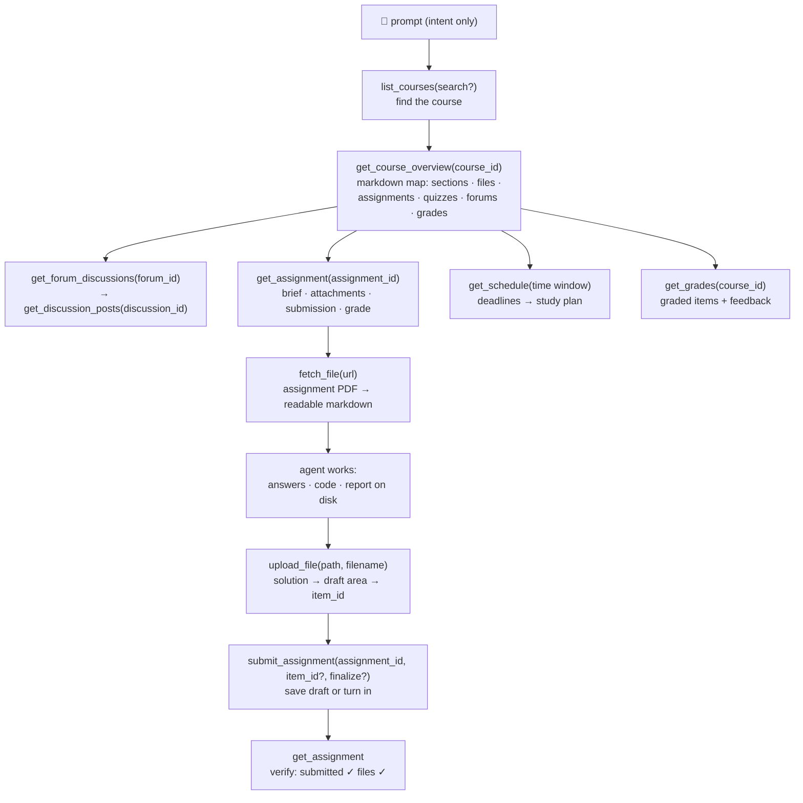

<p align="center">
  
</p>

# moodle-mcp

<p align="center">
  <a href="../README.md">English</a> | 
  <a href="README.zh-TW.md">繁體中文</a> | 
  <a href="README.zh-CN.md">简体中文</a> | 
  <b>日本語</b> | 
  <a href="README.es.md">Español</a> | 
  <a href="README.de.md">Deutsch</a> | 
  <a href="README.pt-BR.md">Português</a> | 
  <a href="README.fr.md">Français</a>
</p>

[](https://github.com/G36maid/moodle-mcp/actions/workflows/ci.yml)
[](https://codecov.io/gh/G36maid/moodle-mcp)
[](https://github.com/G36maid/moodle-mcp/releases/latest)
[](https://crates.io/crates/moodle-mcp)
[](../LICENSE)
[](https://www.rust-lang.org)
[](https://modelcontextprotocol.io)
[](https://github.com/G36maid/moodle-mcp/actions/workflows/release.yml)

LLM エージェントが**本物の Moodle LMS を操作**できるようにする [Model Context Protocol](https://modelcontextprotocol.io) サーバーです。コースの閲覧、課題 PDF の取得、コードの作成、ファイルのアップロードと提出まで、そのすべてを単一の静的バイナリで実現します。

公式 MCP SDK ([`rmcp`](https://crates.io/crates/rmcp)) をベースに Rust で構築されています。**Moodle 3.7 〜 5.x** の実環境で動作検証済みです。

## ✅ なぜ moodle-mcp なのか

汎用のチャットボットにはあなたの Moodle への入り口がないため、学習に関する作業はすべて手動のままです。*「今週の締め切りは何？」*と確認するだけのためにブラウザのタブを 5 つ開いたり、PDF を手作業でアップロードし直したり、フォーラムや成績を 1 ページずつコピー＆ペーストしたり。

moodle-mcp はエージェントをあなたのアカウントでサインインさせます。学生生活の一連の流れを 20 個の型付けツールがカバーし、エージェントが自らそれらを連携させて実行します。ブラウザを開く必要は一切ありません:

- **オールインワン** — ドキュメント変換、HTML → Markdown、認証 CLI、オプトインのエスケープハッチを 1 つのバイナリに搭載。プラグインも補助スクリプトも追加ランタイムも不要
- **エージェントネイティブ** — ツールは base64 ではなくローカルファイルパスを入出力に使用。すべての結果には次の呼び出しに必要な ID が埋め込まれ、エラーは平易な言葉で解決策を提示
- **デフォルトで安全** — 書き込みツールは実行前に確認を求め、提出はあなたが指示するまで下書きのまま。クイズの自動受験は意図的に非搭載
- **バージョン適応型** — Moodle 3.7 で検証し、4.x/5.x 向けに設計。バージョン間のレスポンス差分は自動的に吸収
- **単一の静的バイナリ** — 実行時依存なし

## 🚀 クイックスタート

モバイルアプリ用 Web サービスが許可されているサイトの **Moodle 3.7 〜 5.x** アカウントが必要です（多くのサイトで許可されています。[前提条件](../docs/src/getting-started.md#prerequisites) を参照）。

```bash
# 1. Install
cargo install moodle-mcp        # or grab a prebuilt binary — no Rust needed

# 2. Log in once — prints MOODLE_URL and MOODLE_TOKEN
moodle-mcp auth

# 3. Connect your client (Claude Code shown; Codex/OpenCode/pi below)
claude mcp add moodle \
  --env MOODLE_URL=https://moodle.example.com \
  --env MOODLE_TOKEN=your-token \
  -- /path/to/moodle-mcp

# 4. Open a chat and ask:
#    "What's due in the next two weeks? Plan my studying around it."
```

事前ビルド済みバイナリ、SSO ログイン、各クライアント向けの設定スニペット、環境変数の完全なリファレンス:[インストール](../docs/src/installation.md) · [はじめに](../docs/src/getting-started.md) · [設定](../docs/src/configuration.md)

## 💬 エージェントにできること

以下はすべて追加設定なしで動作します。エージェントはツールの説明からツールを発見し、自ら連携させます:

| あなたが言うこと | エージェントが連携するツール |
|---|---|
| *「情報セキュリティの課題 1 を片付けて:課題の説明と添付 PDF を読み、問題を解いて、下書きとして提出して。」* | `get_assignment` (brief + attachments) → `fetch_file` (PDF → markdown, math included) → solves it → writes the answer file → `upload_file` → `submit_assignment` → `get_assignment` (verify submitted ✓) |
| *「今後の締め切りとコースの教材をもとに、今後 2 週間の完全な学習計画を立てて。」* | `get_schedule` (all deadlines) → `get_course_overview` per course → day-by-day plan balanced against due dates |
| *「今週のデータ通信で何があったのか見逃してしまった。お知らせフォーラムも含めてキャッチアップさせて。」* | `get_notifications` + `get_forum_discussions` → `get_discussion_posts` → synthesized weekly digest |
| *「ソフトウェア工学のクイズに備えたい。先生がそれについて何を投稿したか教えて。」* | `get_course_overview` (quiz entry) → `get_assignment` (requirements) → related forum threads |

## 🔄 エージェントの動作の仕組み

ツールはあなたが Moodle を操作するときの階層をそのまま反映しています。各レベルの出力には、次のレベルに必要な ID が埋め込まれています:


専用ツールがカバーしない操作はすべて、`call_ws_function` + `list_ws_functions` のエスケープハッチから利用できます。一般的なトークンで呼び出せる約 350 個の関数を完全にカバーします（20 + 2 = 22 個のツール。エスケープハッチはオプトイン方式で、`MOODLE_ENABLE_WS_FUNCTION=true` を設定すると有効になります）。

## 📚 ドキュメント

完全なドキュメントは [`docs/`](../docs/src/SUMMARY.md) にあります（mdBook — `mdbook serve docs` でローカルから閲覧できます）:

| ページ | 内容 |
|---|---|
| [はじめに](../docs/src/getting-started.md) | ゼロから最初のプロンプトまで。MCP の経験は前提としません |
| [インストール](../docs/src/installation.md) | 事前ビルド済みバイナリ、cargo、ソースからのビルド |
| [設定](../docs/src/configuration.md) | すべての環境変数。Claude Code、Codex、OpenCode、pi 向けの設定スニペット |
| [ツール](../docs/src/tools.md) | 22 ツールの完全なリファレンスとツール間の ID の流れ |
| [セキュリティと認証](../docs/src/security.md) | トークンのライフサイクル、転送と書き込みの安全性 |
| [変更履歴](../docs/src/changelog.md) | バージョンごとのリリースノート |
| [開発](../docs/src/development.md) | アーキテクチャ解説、テスト、リリース手順 |
| [moodle-mcp とは](../docs/src/about.md) | moodle-mcp、MCP、Moodle とは何か |

## 🧰 開発

```bash
cargo test                 # unit + wiremock integration + MCP protocol tests
cargo clippy --all-targets
cargo fmt -- --check
cargo build --release
```

プロジェクトのドキュメントは [`docs/`](../docs/src/SUMMARY.md) にあります。mdBook 形式で、Prettier により整形されています（詳細は `docs/README.md` を参照）。`mdbook serve docs` でプレビューできます。

ランディングページは [`site/`](../site/) にあります。Astro 7 + TypeScript で構築されています（`cd site && npm install && npm run dev` で開発、`npm run build` でビルド）。

## 🔐 セキュリティ

**HTTPS** を使用してください。トークンはすべてのリクエストに添付して送られます。ツールの出力やエラーに表示されることはなく、同一サイトの Moodle URL にのみ注入され、書き込みツールは実行前にあなたの確認を求めます。詳細:[セキュリティと認証](../docs/src/security.md)。

## 📄 ライセンス

MIT — 詳細は [LICENSE](../LICENSE) を参照してください。
