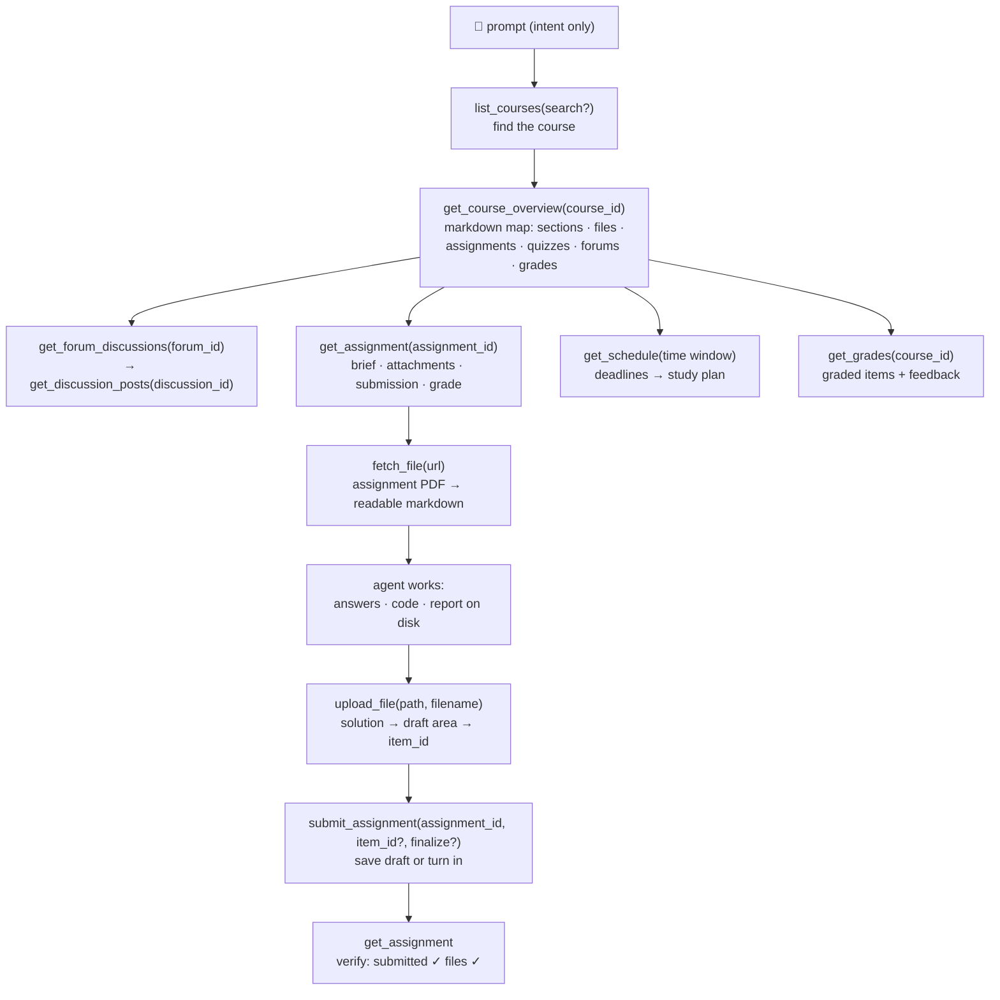

<p align="center">
  
</p>

# moodle-mcp

<p align="center">
  <a href="../README.md">English</a> | 
  <a href="README.zh-TW.md">繁體中文</a> | 
  <a href="README.zh-CN.md">简体中文</a> | 
  <a href="README.ja.md">日本語</a> | 
  <a href="README.es.md">Español</a> | 
  <a href="README.de.md">Deutsch</a> | 
  <b>Português</b> | 
  <a href="README.fr.md">Français</a>
</p>

[](https://github.com/G36maid/moodle-mcp/actions/workflows/ci.yml)
[](https://codecov.io/gh/G36maid/moodle-mcp)
[](https://github.com/G36maid/moodle-mcp/releases/latest)
[](https://crates.io/crates/moodle-mcp)
[](../LICENSE)
[](https://www.rust-lang.org)
[](https://modelcontextprotocol.io)
[](https://github.com/G36maid/moodle-mcp/actions/workflows/release.yml)

Um servidor [Model Context Protocol](https://modelcontextprotocol.io) que permite que agentes LLM **usem um Moodle LMS real** — ler cursos, buscar os PDFs das tarefas, escrever código, fazer upload e submeter — por meio de um único binário estático.

Construído em Rust sobre o SDK oficial do MCP ([`rmcp`](https://crates.io/crates/rmcp)). Validado na prática com o **Moodle 3.7 → 5.x**.

## ✅ Por que o moodle-mcp

Um chatbot genérico não tem como entrar no seu Moodle, então toda tarefa de estudo continua manual — cinco abas do navegador só para responder *"o que vence esta semana?"*, PDFs reenviados à mão, fóruns e notas copiados e colados uma página por vez.

O moodle-mcp autentica o agente como você. São 20 ferramentas tipadas cobrindo toda a jornada do estudante, e o agente as encadeia sozinho — sem nunca abrir um navegador:

- **Tudo incluso** — conversão de documentos, HTML → Markdown, uma CLI de autenticação e uma rota de escape opcional, tudo em um binário só: sem plugins, sem scripts auxiliares, sem um segundo runtime
- **Nativo para agentes** — as ferramentas recebem e retornam caminhos de arquivos locais em vez de base64; todo resultado embute os IDs para a próxima chamada; os erros são em linguagem simples e sugerem a correção
- **Seguro por padrão** — as ferramentas de escrita pedem sua confirmação antes, os envios permanecem como rascunho até você dizer; resolver questionários é algo propositalmente não oferecido
- **Adaptável a versões** — verificado no Moodle 3.7 e projetado para o 4.x/5.x; as diferenças de resposta entre versões são absorvidas automaticamente
- **Um binário estático** — sem dependências de execução

## 🚀 Início rápido

Requer uma conta em um Moodle 3.7 → 5.x, em um site que permita o serviço web do aplicativo móvel (a maioria permite — veja os [pré-requisitos](../docs/src/getting-started.md#prerequisites)).

```bash
# 1. Install
cargo install moodle-mcp        # or grab a prebuilt binary — no Rust needed

# 2. Log in once — prints MOODLE_URL and MOODLE_TOKEN
moodle-mcp auth

# 3. Connect your client (Claude Code shown; Codex/OpenCode/pi below)
claude mcp add moodle \
  --env MOODLE_URL=https://moodle.example.com \
  --env MOODLE_TOKEN=your-token \
  -- /path/to/moodle-mcp

# 4. Open a chat and ask:
#    "What's due in the next two weeks? Plan my studying around it."
```

Binários pré-compilados, login via SSO, trechos de configuração para cada cliente e a referência completa de variáveis de ambiente:
[Instalação](../docs/src/installation.md) ·
[Primeiros passos](../docs/src/getting-started.md) ·
[Configuração](../docs/src/configuration.md)

## 💬 O que o agente pode fazer

Tudo isso funciona sem nenhuma configuração adicional — o agente descobre as ferramentas pelas descrições e as encadeia sozinho:

| Você diz | O agente encadeia |
|---|---|
| *"Termine meu trabalho 1 de Segurança da Informação: leia as instruções e o PDF em anexo, resolva os problemas e envie como rascunho."* | `get_assignment` (brief + attachments) → `fetch_file` (PDF → markdown, math included) → solves it → writes the answer file → `upload_file` → `submit_assignment` → `get_assignment` (verify submitted ✓) |
| *"Com base nos prazos futuros e no material das disciplinas, monte um plano de estudos completo para as próximas duas semanas."* | `get_schedule` (all deadlines) → `get_course_overview` per course → day-by-day plan balanced against due dates |
| *"Perdi o que aconteceu em Comunicação de Dados esta semana — me atualize, incluindo o fórum de avisos."* | `get_notifications` + `get_forum_discussions` → `get_discussion_posts` → synthesized weekly digest |
| *"Me prepare para o teste de Engenharia de Software: o que o professor postou a respeito?"* | `get_course_overview` (quiz entry) → `get_assignment` (requirements) → related forum threads |

## 🔄 Como o agente funciona

As ferramentas espelham a forma como você navega no Moodle — a saída de cada nível embute os IDs para o próximo:



Tudo o que as ferramentas dedicadas não cobrem está ao alcance da rota de escape `call_ws_function` + `list_ws_functions` — cobertura completa das ~350 funções que um token típico pode chamar (20 + 2 = 22 no total; a rota de escape é opcional, ativada via `MOODLE_ENABLE_WS_FUNCTION=true`).

## 📚 Documentação

A documentação completa vive em [`docs/`](../docs/src/SUMMARY.md) (mdBook —
`mdbook serve docs` para ler localmente):

| Página | Conteúdo |
|---|---|
| [Primeiros passos](../docs/src/getting-started.md) | do zero até o primeiro prompt; sem exigir experiência prévia com MCP |
| [Instalação](../docs/src/installation.md) | binários pré-compilados, cargo, do código-fonte |
| [Configuração](../docs/src/configuration.md) | todas as variáveis de ambiente; trechos de configuração para Claude Code, Codex, OpenCode e pi |
| [Ferramentas](../docs/src/tools.md) | a referência completa das 22 ferramentas e o fluxo de IDs entre elas |
| [Segurança e autenticação](../docs/src/security.md) | ciclo de vida do token, transporte e segurança nas operações de escrita |
| [Changelog](../docs/src/changelog.md) | notas de versão, versão por versão |
| [Desenvolvimento](../docs/src/development.md) | tour pela arquitetura, testes e processo de release |
| [Sobre](../docs/src/about.md) | o que são o moodle-mcp, o MCP e o Moodle |

## 🧰 Desenvolvimento

```bash
cargo test                 # unit + wiremock integration + MCP protocol tests
cargo clippy --all-targets
cargo fmt -- --check
cargo build --release
```

A documentação do projeto vive em [`docs/`](../docs/src/SUMMARY.md) — mdBook,
formatado com Prettier (veja `docs/README.md`); visualize com
`mdbook serve docs`.

A landing page vive em [`site/`](../site/) — Astro 7 + TypeScript
(`cd site && npm install && npm run dev`, build com `npm run build`).

## 🔐 Segurança

Use **HTTPS** — o token trafega em cada requisição. Ele nunca aparece na saída das ferramentas nem nas mensagens de erro, é injetado apenas em URLs do Moodle do mesmo site, e as ferramentas de escrita pedem sua confirmação antes de agir. Detalhes completos:
[Segurança e autenticação](../docs/src/security.md).

## 📄 Licença

MIT — consulte [LICENSE](../LICENSE).
