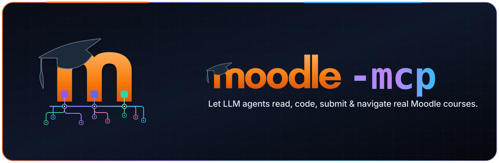
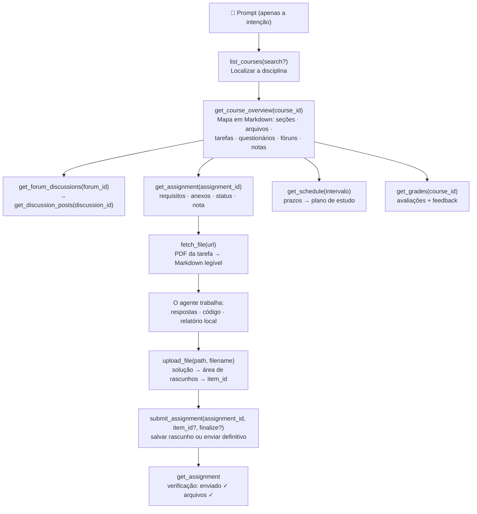

<p align="center">
  
</p>

# moodle-mcp

<p align="center">
  <a href="../README.md">English</a> | 
  <a href="README.zh-TW.md">繁體中文</a> | 
  <a href="README.zh-CN.md">简体中文</a> | 
  <a href="README.ja.md">日本語</a> | 
  <a href="README.es.md">Español</a> | 
  <a href="README.de.md">Deutsch</a> | 
  <b>Português</b> | 
  <a href="README.fr.md">Français</a>
</p>

[](https://github.com/G36maid/moodle-mcp/actions/workflows/ci.yml)
[](https://codecov.io/gh/G36maid/moodle-mcp)
[](https://github.com/G36maid/moodle-mcp/releases/latest)
[](../LICENSE)
[](https://www.rust-lang.org)
[](https://modelcontextprotocol.io)
[](https://github.com/G36maid/moodle-mcp/actions/workflows/release.yml)

Um servidor [Model Context Protocol (MCP)](https://modelcontextprotocol.io) que permite que agentes LLM **utilizem um Moodle LMS real** — consultar cursos, extrair PDFs de tarefas, escrever código, enviar arquivos e submeter tarefas — tudo através de um único binário estático.

Construído em Rust com o SDK oficial de MCP ([`rmcp`](https://crates.io/crates/rmcp)). Validado em produção com **Moodle 3.7 → 5.x**.

---

## ❌ Sem o moodle-mcp

Um chatbot convencional não tem acesso ao seu Moodle, então cada tarefa acadêmica precisa ser feita manualmente:

- ❌ Cinco abas do navegador abertas só para saber: *“o que vence esta semana?”*
- ❌ Baixar PDFs de tarefas manualmente e arrastá-los para a janela do chat
- ❌ Copiar e colar tópicos de fóruns e notas página por página
- ❌ Perguntas sobre os *seus* cursos respondidas na base do palpite — o modelo não consegue checar nada

## ✅ Com o moodle-mcp

O agente faz login como você. 22 ferramentas tipadas cobrem toda a jornada do estudante como um humano real — desde uma consulta rápida de prazos até o auxílio completo em submissões, sem abrir o navegador:

```txt
Quais tarefas vencem nas próximas duas semanas? Organize meu plano de estudos com base nisso.
```

```txt
Termine meu trabalho 1 de Segurança da Informação: leia as instruções e o PDF em anexo, resolva os problemas e envie como rascunho.
```

```txt
Perdi o conteúdo de Comunicação de Dados desta semana — faça um resumo, incluindo o fórum de avisos.
```

O agente encadeia as ferramentas sozinho: mapa do curso → instruções da tarefa → PDF → Markdown → resolução → upload de arquivo → envio de rascunho → verificação.
Confira fluxos completos em [Exemplos de prompts](#-exemplos-de-prompts) e [Como o agente funciona](#-como-o-agente-funciona).

## ✨ Recursos principais

- **Tudo incluso (Batteries included)** — Conversão de documentos (anydoc), HTML → Markdown (htmd), CLI de tokens e rota de escape genérica integrados: sem plugins, sem scripts auxiliares, sem ambientes adicionais.
- **Nativo para agentes (Agent-native)** — Ferramentas aceitam e retornam **caminhos de arquivos locais** em vez de base64; respostas incluem os IDs para a próxima chamada; padrões fornecem dicas ("pass course_ids to filter"); mensagens de erro são claras e sugerem correções.
- **22 ferramentas focadas na experiência humana** — Cada uma reflete uma ação real no Moodle: cursos, visão geral, tarefas, envios, fóruns, arquivos (obter/converter/baixar/enviar), notas, cronograma, mensagens, tentativas de questionários — sem despejar cegamente as ~350 APIs brutas; com escape genérico (`call_ws_function` + `list_functions`) para tudo o mais.
- **Mapa completo do curso em uma chamada** — `get_course_overview` combina cinco endpoints do Moodle em um único documento Markdown com todos os IDs e links de arquivos.
- **PDF → Markdown** — Instruções de tarefas viram requisitos legíveis com [anydoc](https://crates.io/crates/anydoc); descrições em HTML mantêm suas tabelas via [htmd](https://crates.io/crates/htmd).
- **Adaptável a versões** — Verificado no Moodle 3.7 e projetado para 4.x/5.x; compensa diferenças de funções, paginação e estruturas de resposta automaticamente.
- **Seguro por padrão** — Operações de escrita exigem confirmação explícita; rascunhos são priorizados em relação a envios definitivos; realização automática de testes é intencionalmente **não** suportada.
- **Binário estático único** — Sem dependências de execução externas.

## 📋 Requisitos

- Um site **Moodle 3.7 → 5.x** no qual você possua uma conta de usuário
- Serviços Web ativados no site: **protocolo REST** e serviço **`moodle_mobile_app`** habilitado para sua conta (mesma configuração exigida pelo app móvel oficial do Moodle)
- **HTTPS** altamente recomendado — o token trafega em cada requisição (veja [Notas de segurança](#-notas-de-segurança))
- Qualquer cliente com suporte a MCP — Claude Code, Codex, OpenCode, pi ou qualquer cliente via stdio
- Rust 1.88+ apenas se compilar do código-fonte (binários pré-compilados não necessitam de nada)

## 📦 Instalação

### Baixar binário pré-compilado

Não é necessário instalar Rust — baixe o arquivo para a sua plataforma na [versão mais recente](https://github.com/G36maid/moodle-mcp/releases/latest):

| Plataforma | Arquivo |
|---|---|
| Linux x86_64 | `moodle-mcp-<version>-x86_64-unknown-linux-gnu.tar.gz` |
| Linux arm64 | `moodle-mcp-<version>-aarch64-unknown-linux-gnu.tar.gz` |
| macOS Apple Silicon | `moodle-mcp-<version>-aarch64-apple-darwin.tar.gz` |
| macOS Intel | `moodle-mcp-<version>-x86_64-apple-darwin.tar.gz` |
| Windows x64 | `moodle-mcp-<version>-x86_64-pc-windows-msvc.zip` |

```bash
tar xzf moodle-mcp-*-aarch64-apple-darwin.tar.gz
sudo mv moodle-mcp-*/moodle-mcp /usr/local/bin/   # ou qualquer diretório no PATH
```

### Ou compilar do código-fonte

```bash
git clone https://github.com/G36maid/moodle-mcp
cd moodle-mcp
cargo build --release
# Binário gerado: target/release/moodle-mcp (~15 MB, estático)
```

### Obter um token

Utilize a CLI integrada (mesmo binário):

```bash
moodle-mcp token --url https://moodle.example.com --username seu_usuario
# Password: (senha oculta)
# → export MOODLE_URL='https://moodle.example.com' MOODLE_TOKEN='…'
```

Com login institucional via SSO (sem senha direta), abra a página de chaves de segurança no navegador:

```bash
moodle-mcp token --url https://moodle.example.com --open
```

Se a requisição de token falhar, a instituição não habilitou os [Requisitos](#-requisitos) — solicite ao administrador ativar os serviços web.

### Conectar a um cliente

Todos os clientes iniciam o mesmo servidor stdio: execute `/path/to/moodle-mcp` com `MOODLE_URL` e `MOODLE_TOKEN` nas variáveis de ambiente. No Claude Code, configure com um único comando:

```bash
claude mcp add moodle \
  --env MOODLE_URL=https://moodle.example.com \
  --env MOODLE_TOKEN=seu-token \
  -- /path/to/moodle-mcp
```

Configurações para outros clientes:

<details open>
<summary><b>Claude Code</b> — <code>.mcp.json</code> (projeto) ou <code>~/.claude.json</code> (global)</summary>

```json
{
  "mcpServers": {
    "moodle": {
      "command": "/path/to/moodle-mcp",
      "env": {
        "MOODLE_URL": "https://moodle.example.com",
        "MOODLE_TOKEN": "seu-token"
      }
    }
  }
}
```

</details>

<details>
<summary><b>Codex</b> — <code>~/.codex/config.toml</code> (global)</summary>

```toml
[mcp_servers.moodle]
command = "/path/to/moodle-mcp"
env = { "MOODLE_URL" = "https://moodle.example.com", "MOODLE_TOKEN" = "seu-token" }
```

</details>

<details>
<summary><b>OpenCode</b> — <code>opencode.json</code> (projeto) ou <code>~/.config/opencode/opencode.json</code> (global)</summary>

```json
{
  "mcp": {
    "moodle": {
      "type": "local",
      "command": ["/path/to/moodle-mcp"],
      "environment": {
        "MOODLE_URL": "https://moodle.example.com",
        "MOODLE_TOKEN": "seu-token"
      }
    }
  }
}
```

</details>

<details>
<summary><b>pi</b> — <code>.pi/mcp.json</code> (projeto) ou <code>~/.pi/agent/mcp.json</code> (global)</summary>

```json
{
  "mcpServers": {
    "moodle": {
      "command": "/path/to/moodle-mcp",
      "env": {
        "MOODLE_URL": "https://moodle.example.com",
        "MOODLE_TOKEN": "seu-token"
      }
    }
  }
}
```

</details>

| Variável de ambiente | Obrigatória | Padrão | Descrição |
|---|:---:|---|---|
| `MOODLE_URL` | ✔ | — | URL base do site, sem barra final |
| `MOODLE_TOKEN` | ✔ | — | Token de serviço web |
| `MOODLE_TIMEOUT_SECS` | — | `60` | Timeout por requisição em segundos |
| `RUST_LOG` | — | `info` | Nível de log (logs vão para stderr; stdout é o canal MCP) |

## 💬 Exemplos de prompts

Todos funcionam diretamente sem configurações extras — o agente interpreta as ferramentas pelas descrições e as conecta de forma autônoma:

### Totalmente automatizado (um comando, jornada completa)

| Você diz | O agente encadeia |
|---|---|
| *“Termine meu trabalho 1 de Segurança da Informação: leia as instruções e o PDF em anexo, resolva os problemas e envie como rascunho.”* | `get_assignment` (instruções e anexos) → `fetch_file` (PDF para Markdown com fórmulas) → resolução → gravação do arquivo de solução → `upload_file` → `submit_assignment` → `get_assignment` (verificar envio ✓) |
| *“Com base nos prazos futuros e no material das disciplinas, monte um cronograma de estudos para as próximas duas semanas.”* | `get_schedule` (todos os prazos) → `get_course_overview` por curso (materiais e leituras) → planejamento diário balanceado |
| *“Perdi o conteúdo de Comunicação de Dados desta semana — me atualize, incluindo o fórum de avisos.”* | `get_notifications` + `get_forum_discussions` → `get_discussion_posts` → resumo semanal consolidado |
| *“Me prepare para o teste de Engenharia de Software: o que o professor postou a respeito?”* | `get_course_overview` (item do questionário) → `get_assignment` (requisitos) → tópicos relevantes do fórum |

### Consultas rápidas

| Você diz | O agente encadeia |
|---|---|
| *“Quais tarefas vencem nas próximas duas semanas?”* | `get_schedule` → linha do tempo unificada de prazos, fechamento de testes e eventos |
| *“Qual o tema do Trabalho 1? Leia as instruções.”* | `get_assignment` → `fetch_file` converte o PDF anexo em Markdown |
| *“Como me saí nos laboratórios de Comunicação de Dados?”* | `list_courses` → `get_grades(course_id)` → notas, comentários e ponderações |
| *“Em quais disciplinas já tenho notas lançadas?”* | `get_grades()` → resumo geral entre cursos |
| *“Resuma todos os comunicados do fórum de Comunicação de Dados.”* | `get_course_overview` → `get_forum_discussions` → `get_discussion_posts` |
| *“Envie minha solucao.pdf para o Quiz 1 e salve como rascunho.”* | `upload_file` → `submit_assignment(item_id, finalize=false)` |
| *“O que está programado para a disciplina de Engenharia de Software?”* | `get_course_overview` → tópicos, arquivos, fóruns |
| *“Posso enviar uma mensagem ao professor pedindo extensão de prazo?”* | `get_user` / `get_conversations` → redige rascunho → confirmação do usuário → `send_message` |

## 🔄 Como o agente funciona

As ferramentas espelham a navegação humana no Moodle — a saída de cada nível embute os IDs para o próximo passo. Toda ação parte da lista e do mapa do curso:



Casos especiais não cobertos pelas 20 ferramentas dedicadas podem ser acessados via escape genérico `call_ws_function` + `list_functions`, cobrindo todas as ~350 funções do token (20 + 2 = 22 ferramentas no total).

## 🛠 Referência de ferramentas

RW indica a permissão: 📖 apenas leitura · ✍️ escrita. Ferramentas de escrita atuam em nome do titular do token; o servidor orienta o agente a solicitar confirmação prévia, e os envios vão para sua área privada de rascunhos.

### Identidade e cursos
| Ferramenta | Assinatura | RW | Finalidade |
|---|---|:-:|---|
| `whoami` | `()` | 📖 | Identidade do titular do token e dados do site/versão |
| `list_courses` | `(search?)` | 📖 | Cursos matriculados com filtro opcional por nome |
| `get_course_overview` | `(course_id)` | 📖 | Mapa completo da disciplina em Markdown |

### Tarefas
| Ferramenta | Assinatura | RW | Finalidade |
|---|---|:-:|---|
| `get_assignment` | `(assignment_id)` | 📖 | Documento completo: prazos, status, descrição, anexos, envio, notas e feedback |
| `submit_assignment` | `(assignment_id, text?, item_id?, finalize?)` | ✍️ | Única escrita de tarefa: texto online e/ou arquivos de rascunho |

### Fóruns
| Ferramenta | Assinatura | RW | Finalidade |
|---|---|:-:|---|
| `get_forum_discussions` | `(forum_id)` | 📖 | Lista de tópicos com prévia da postagem inicial |
| `get_discussion_posts` | `(discussion_id)` | 📖 | Tópico completo em Markdown com links de anexos |
| `create_forum_discussion` | `(forum_id, subject, message)` | ✍️ | Iniciar um novo tópico |
| `reply_to_discussion` | `(post_id, subject, message)` | ✍️ | Responder a uma postagem |

### Arquivos
| Ferramenta | Assinatura | RW | Finalidade |
|---|---|:-:|---|
| `fetch_file` | `(url)` | 📖 | Converter PDF/DOCX/PPTX/XLSX/ODT/RTF/EPUB/CSV em Markdown (limite de 100k caracteres) |
| `download_file` | `(url, save_to)` | 📖 | Download binário bruto para caminho local (apenas metadados) |
| `upload_file` | `(path, item_id?)` | ✍️ | Fazer upload de arquivo local para a área de rascunho |

### Notas, cronograma e mensagens
| Ferramenta | Assinatura | RW | Finalidade |
|---|---|:-:|---|
| `get_grades` | `(course_id?)` | 📖 | Resumo de todas as disciplinas ou notas detalhadas de uma matéria |
| `get_schedule` | `(time_from?, time_to?, course_ids?)` | 📖 | Linha do tempo unificada (padrão: próximos 30 dias) |
| `get_notifications` | `(read?, limit?)` | 📖 | Notificações recentes |
| `get_conversations` | `(limit?)` | 📖 | Lista de conversas diretas com IDs de membros |
| `send_message` | `(user_id, text)` | ✍️ | Enviar mensagem privada |
| `get_quiz_attempts` | `(quiz_id)` | 📖 | Histórico de tentativas de questionários (apenas leitura) |
| `get_user` / `search_users` | `(field, value)` / `(search?, limit?)` | 📖 | Consulta de perfil / busca de usuários |

### Rota de escape genérica
| Ferramenta | Assinatura | RW | Finalidade |
|---|---|:-:|---|
| `call_ws_function` | `(wsfunction, params?)` | 📖/✍️ | Chamar qualquer função ativa do Web Service (formatação PHP bracket automática) |
| `list_functions` | `(query?)` | 📖 | Pesquisar funções disponíveis por palavra-chave |

## 🔐 Notas de segurança

- Sempre utilize **HTTPS** — o token é transmitido em cada requisição.
- O token é uma credencial confidencial: nunca faça commit e nunca o envie para hosts que não sejam o seu Moodle (o servidor injeta o token apenas em URLs `pluginfile.php` do mesmo domínio e bloqueia redirecionamentos externos).
- O token nunca aparece em saídas ou mensagens de erro: qualquer ocorrência de `token=…` é ofuscada como `token=[REDACTED]`.
- Limites de transferência: extração em linha até 100 MB, downloads em streaming até 500 MB e uploads até 100 MB. Downloads são gravados diretamente em disco (nunca retidos integralmente na memória RAM) com controle por timeout de leitura.
- Ferramentas de escrita atuam em nome do **titular do token**. O servidor instrui o agente a pedir confirmação antes de submeter ou enviar.
- A resolução automática de questionários está **desabilitada por design**.

## 🧰 Desenvolvimento e testes

```bash
cargo test                 # 39 testes: unitários + integração wiremock + protocolo MCP
cargo clippy --all-targets
cargo fmt -- --check
cargo build --release
```

Fluxo de identificadores entre ferramentas:

| ID | Produzido por | Consumido por |
|---|---|---|
| `course_id` | `list_courses` / `get_course_overview` | `overview` / `grades` / `schedule` / `assignments` |
| `forum_id` | `get_course_overview` | `get_forum_discussions` / `create_forum_discussion` |
| `discussion_id` | `get_forum_discussions` | `get_discussion_posts` |
| `post_id` | `get_discussion_posts` | `reply_to_discussion` |
| `assignment_id` | `get_course_overview` / `get_assignment` | `get_assignment` / `submit_assignment` |
| `item_id` (rascunho) | `upload_file` | `submit_assignment` |
| `user_id` | `conversations members` / `notifications` / `get_user` | `send_message` / `get_user` |

## 📄 Licença

MIT — consulte [LICENSE](../LICENSE).
