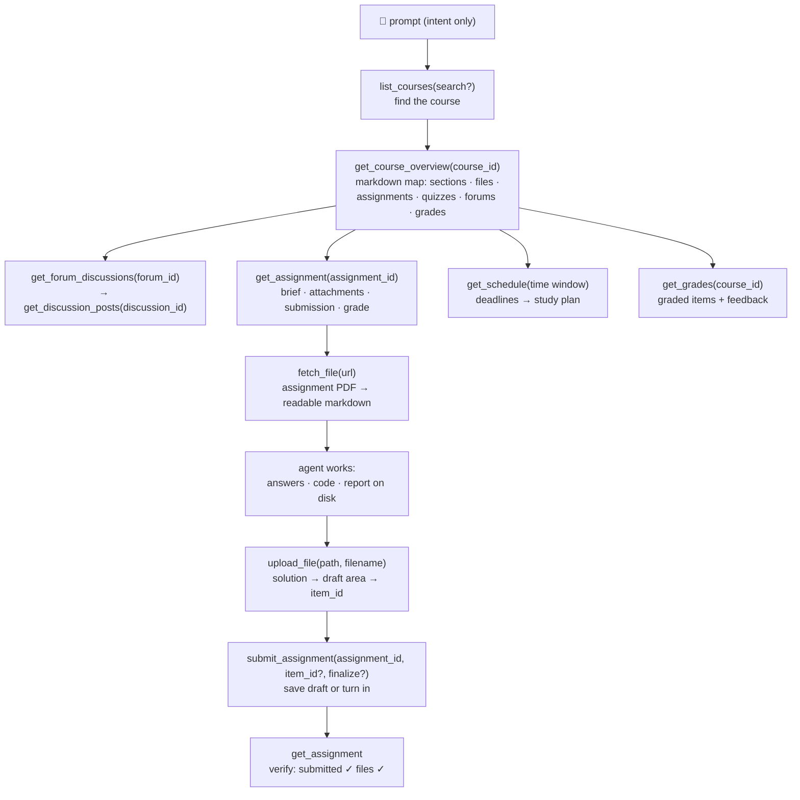

<p align="center">
  
</p>

# moodle-mcp

<p align="center">
  <a href="../README.md">English</a> | 
  <a href="README.zh-TW.md">繁體中文</a> | 
  <b>简体中文</b> | 
  <a href="README.ja.md">日本語</a> | 
  <a href="README.es.md">Español</a> | 
  <a href="README.de.md">Deutsch</a> | 
  <a href="README.pt-BR.md">Português</a> | 
  <a href="README.fr.md">Français</a>
</p>

[](https://github.com/G36maid/moodle-mcp/actions/workflows/ci.yml)
[](https://codecov.io/gh/G36maid/moodle-mcp)
[](https://github.com/G36maid/moodle-mcp/releases/latest)
[](https://crates.io/crates/moodle-mcp)
[](../LICENSE)
[](https://www.rust-lang.org)
[](https://modelcontextprotocol.io)
[](https://github.com/G36maid/moodle-mcp/actions/workflows/release.yml)

一个 [Model Context Protocol](https://modelcontextprotocol.io) 服务器，让 LLM 智能体能**操作真实的 Moodle LMS** — 阅读课程、获取作业 PDF、编写代码、上传并提交作业 — 全部通过单个静态二进制文件完成。

使用 Rust 基于官方 MCP SDK ([`rmcp`](https://crates.io/crates/rmcp)) 构建。已在 Moodle 3.7、4.5 与 5.2 上完成实测验证;面向 **3.7 → 5.x** 设计。

## ✅ 为什么需要 moodle-mcp

普通聊天机器人无法访问你的 Moodle，每个学习任务都只能手动完成 — 开五个浏览器标签页只为回答“这周有什么要截止？”、手动重新上传 PDF、讨论区和成绩一页一页复制粘贴。

moodle-mcp 让智能体以你的身份登录。20 个类型化工具覆盖完整的学生旅程，智能体会自行串联这些工具 — 全程无需打开浏览器：

- **开箱即用（Batteries included）** — 文档转换、HTML → Markdown、auth 命令行工具和可选用的兜底调用，全部集成在一个二进制文件中：无需插件、无需辅助脚本、无需二次运行时
- **智能体原生设计（Agent-native）** — 工具接收并返回本地文件路径而非 base64；每个结果都内嵌下一次调用所需的 ID；报错信息通俗易懂并给出修复建议
- **默认安全** — 写入类工具会先征得你的同意，提交内容在你确认前始终保持草稿；刻意不提供代考测验功能
- **版本自适应** — 经 Moodle 3.7 实测验证，面向 4.x/5.x 设计；版本间的响应差异会被自动抹平
- **单一静态二进制文件** — 零运行时依赖

## 🚀 快速开始

需要一个 Moodle 3.7 → 5.x 站点上允许移动应用 Web Service 的账号（多数站点均已允许 — 详见[前置条件](https://moodle.ntnu.cc/docs/getting-started.html#prerequisites)）。

```bash
# 1. Install
cargo install moodle-mcp        # or grab a prebuilt binary — no Rust needed

# 2. Log in once — prints MOODLE_URL and MOODLE_TOKEN
moodle-mcp auth

# 3. Connect your client (Claude Code shown; Codex/OpenCode/pi below)
claude mcp add moodle \
  --env MOODLE_URL=https://moodle.example.com \
  --env MOODLE_TOKEN=your-token \
  -- /path/to/moodle-mcp

# 4. Open a chat and ask:
#    "What's due in the next two weeks? Plan my studying around it."
```

或把这段贴进你的 agent,让它代办每一步(它会在自己的终端开启 `moodle-mcp auth`——学校账号密码在终端里输入,而不是贴进对话):

```text
Set up moodle-mcp (github.com/G36maid/moodle-mcp): read docs/src/installation.md
and docs/src/configuration.md from the repo's main branch first. Then install
the binary for my platform, run `moodle-mcp auth` in the terminal so I can
type my school credentials when it prompts, and register the server in your
own MCP config using the snippet for your harness. Never store or repeat my
credentials; ask before anything global.
```

预编译二进制文件、SSO 登录、各客户端的配置片段，以及完整的环境变量参考：[安装](https://moodle.ntnu.cc/docs/installation.html) · [快速入门](https://moodle.ntnu.cc/docs/getting-started.html) · [配置](https://moodle.ntnu.cc/docs/configuration.html)

## 💬 智能体能做什么

以下指令无需任何额外设置即可使用 — 智能体会从工具描述中自行发现工具并串联调用：

| 用户指令 | 智能体自动调用的工具链 |
|---|---|
| *“帮我完成信息安全 HW1：阅读作业要求和附件 PDF，解出题目，并提交草稿。”* | `get_assignment` (brief + attachments) → `fetch_file` (PDF → markdown, math included) → solves it → writes the answer file → `upload_file` → `submit_assignment` → `get_assignment` (verify submitted ✓) |
| *“根据接下来的截止日期和课程资料，为我制定未来两周的完整复习计划。”* | `get_schedule` (all deadlines) → `get_course_overview` per course → day-by-day plan balanced against due dates |
| *“我错过了这周数据通信课程的进度 — 帮我补上进度，包括公告讨论区。”* | `get_notifications` + `get_forum_discussions` → `get_discussion_posts` → synthesized weekly digest |
| *“帮我备考软件工程测验：老师在上面发布了哪些相关内容？”* | `get_course_overview` (quiz entry) → `get_assignment` (requirements) → related forum threads |

## 🔄 智能体如何工作

工具的组织方式还原了你在 Moodle 中的浏览路径 — 每一层的输出都内嵌下一层所需的 ID：



专用工具未覆盖的操作，都能通过 `call_ws_function` + `list_ws_functions` 兜底调用实现 — 覆盖典型 Token 可调用的全部约 350 个函数（20 + 2 = 共 22 个工具；兜底调用需通过 `MOODLE_ENABLE_WS_FUNCTION=true` 自行开启）。

## 📚 文档

完整文档位于 [`docs/`](https://moodle.ntnu.cc/docs/)（mdBook — 本机运行 `mdbook serve docs` 即可阅读）：

| 页面 | 内容 |
|---|---|
| [快速入门](https://moodle.ntnu.cc/docs/getting-started.html) | 从零到第一个提示词；无需 MCP 经验 |
| [安装](https://moodle.ntnu.cc/docs/installation.html) | 预编译二进制文件、cargo、从源码构建 |
| [配置](https://moodle.ntnu.cc/docs/configuration.html) | 每个环境变量；Claude Code、Codex、OpenCode 和 pi 的配置片段 |
| [工具](https://moodle.ntnu.cc/docs/tools.html) | 完整的 22 个工具参考，以及工具之间的 ID 流转关系 |
| [安全与认证](https://moodle.ntnu.cc/docs/security.html) | Token 生命周期、传输与写入安全 |
| [更新日志](https://moodle.ntnu.cc/docs/changelog.html) | 逐版本发布说明 |
| [开发](https://moodle.ntnu.cc/docs/development.html) | 架构导览、测试、发布流程 |
| [关于](https://moodle.ntnu.cc/docs/about.html) | moodle-mcp、MCP 和 Moodle 分别是什么 |

## 🧰 开发

```bash
cargo test                 # unit + wiremock integration + MCP protocol tests
cargo clippy --all-targets
cargo fmt -- --check
cargo build --release
```

项目文档位于 [`docs/`](https://moodle.ntnu.cc/docs/) — mdBook 格式，使用 Prettier 排版（见 `docs/README.md`）；可用 `mdbook serve docs` 预览。

项目官网位于 [`site/`](../site/) — Astro 7 + TypeScript（`cd site && npm install && npm run dev`，使用 `npm run build` 构建）。

## 🔐 安全

请始终使用 **HTTPS** — Token 会随每个请求传输。它绝不会出现在工具输出或错误信息中，也只会被注入同站点的 Moodle 链接，且写入类工具会在执行前先征得你的确认。完整细节请见[安全与认证](https://moodle.ntnu.cc/docs/security.html)。

## 📄 许可证

MIT — 详见 [LICENSE](../LICENSE)。
