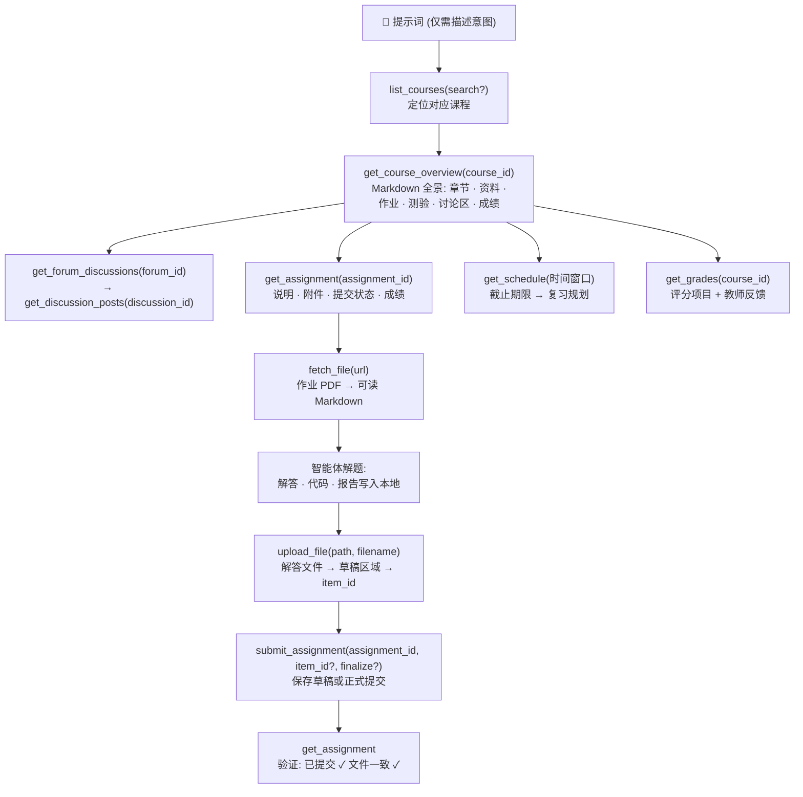

<p align="center">
  
</p>

# moodle-mcp

<p align="center">
  <a href="../README.md">English</a> | 
  <a href="README.zh-TW.md">繁體中文</a> | 
  <b>简体中文</b> | 
  <a href="README.ja.md">日本語</a> | 
  <a href="README.es.md">Español</a> | 
  <a href="README.de.md">Deutsch</a> | 
  <a href="README.pt-BR.md">Português</a> | 
  <a href="README.fr.md">Français</a>
</p>

[](https://github.com/G36maid/moodle-mcp/actions/workflows/ci.yml)
[](https://codecov.io/gh/G36maid/moodle-mcp)
[](https://github.com/G36maid/moodle-mcp/releases/latest)
[](../LICENSE)
[](https://www.rust-lang.org)
[](https://modelcontextprotocol.io)
[](https://github.com/G36maid/moodle-mcp/actions/workflows/release.yml)

一个 [Model Context Protocol (MCP)](https://modelcontextprotocol.io) 服务器，让 LLM 智能体能直接**操作真实的 Moodle LMS** — 阅读课程、提取作业 PDF、编写代码、上传并提交作业 — 全部通过单个静态二进制文件完成。

基于官方 Rust MCP SDK ([`rmcp`](https://crates.io/crates/rmcp)) 构建。已在 **Moodle 3.7 → 5.x** 上完成真实环境验证。

---

## ❌ 没有 moodle-mcp 时

普通聊天机器人无法访问你的 Moodle，因此所有学习任务都必须手动处理：

- ❌ 仅仅为了确认“这周有哪些截止日期？”，就得开 5 个浏览器标签页
- ❌ 手动下载作业 PDF，再拖拽上传到对话窗口
- ❌ 一页一页手动复制粘贴讨论区帖子和成绩

## ✅ 使用 moodle-mcp 后

智能体能直接以你的身份登录。22 个类型化工具覆盖完整的学生操作流程，就像真人操作一样 — 从快速查看截止时间到全自动作业辅助，完全无需打开浏览器：

```txt
接下来两周有什么作业截止？请帮我规划这段时间的复习计划。
```

```txt
帮我完成信息安全 HW1：阅读作业要求和附件 PDF，解出题目，并提交草稿。
```

```txt
我错过了这周数据通信课程的进度 — 帮我整理摘要。
```

智能体自行组合工具调用链：课程地图 → 作业要求 → PDF 解析 → Markdown → 解题解答 → 上传文件 → 提交草稿 → 回读验证。
完整使用场景请参见 [Prompt 示例](#-prompt-示例) 和 [智能体工作原理](#-智能体工作原理)。

## ✨ 特性亮点

- **开箱即用（Batteries included）** — 内置文档转换（anydoc）、HTML → Markdown（htmd）、Token 命令行工具及通用兜底调用：无需插件、无需辅助脚本、无需二次运行时。
- **智能体原生设计（Agent-native）** — 工具参数和返回值均使用**本地文件路径**而非 base64；查询结果直接内嵌下一个工具所需的 ID；默认参数自带提示（例如 "pass course_ids to filter"）；报错信息通俗易懂并提供排查建议。
- **22 个专属工具，贴合人类直觉** — 每个工具均精准映射在 Moodle 上的实际操作步骤：课程、课程全貌、作业、提交、讨论区、文件（获取/转换/下载/上传）、成绩、日程、私信、测验记录 — 而非机械化 1:1 照搬 350+ 个原始 Web Service API；通用兜底调用（`call_ws_function` + `list_functions`）可覆盖其余全部接口。
- **单次调用获取课程全貌** — `get_course_overview` 将 5 个 Moodle 端点融合成单份 Markdown 文档，内嵌所有活动 ID 和文件链接。
- **PDF → Markdown** — 通过 [anydoc](https://crates.io/crates/anydoc) 将作业要求解析为易读的文本；通过 [htmd](https://crates.io/crates/htmd) 保留 HTML 描述中的表格排版。
- **版本自适应** — 经 Moodle 3.7 验证并面向 4.x/5.x 架构设计；自动抹平版本间差异（函数名、分页机制、响应结构）。
- **默认安全** — 写入操作强制要求二次确认；优先保存草稿而非直接不可逆提交；刻意**不提供**在线代考功能。
- **单静态二进制文件** — 零运行时依赖。

## 📋 环境要求

- 一个你拥有账号的 **Moodle 3.7 → 5.x** 站点
- 站点端已开启 Web Services：启用 **REST 协议** 且你的账号获批使用 **`moodle_mobile_app`** 服务 — 这与官方 Moodle 移动端 App 使用完全相同的配置，多数站点已默认开启
- 强烈建议使用 **HTTPS** — Token 随每次请求明文传输（详见 [安全说明](#-安全说明)）
- 任何支持 MCP 的客户端 — Claude Code、Codex、OpenCode、pi，或任何通过 stdio 交互的 MCP 客户端
- 仅在从源码构建时需要 Rust 1.88+（使用预编译二进制文件无需任何工具链）

## 📦 安装指南

### 下载预编译二进制文件

无需安装 Rust — 直接从 [最新 Release](https://github.com/G36maid/moodle-mcp/releases/latest) 下载对应平台的压缩包：

| 平台 | 压缩包 |
|---|---|
| Linux x86_64 | `moodle-mcp-<version>-x86_64-unknown-linux-gnu.tar.gz` |
| Linux arm64 | `moodle-mcp-<version>-aarch64-unknown-linux-gnu.tar.gz` |
| macOS Apple Silicon | `moodle-mcp-<version>-aarch64-apple-darwin.tar.gz` |
| macOS Intel | `moodle-mcp-<version>-x86_64-apple-darwin.tar.gz` |
| Windows x64 | `moodle-mcp-<version>-x86_64-pc-windows-msvc.zip` |

```bash
tar xzf moodle-mcp-*-aarch64-apple-darwin.tar.gz
sudo mv moodle-mcp-*/moodle-mcp /usr/local/bin/   # 或 PATH 包含的任意目录
```

### 或从源码编译

```bash
git clone https://github.com/G36maid/moodle-mcp
cd moodle-mcp
cargo build --release
# 二进制文件位置: target/release/moodle-mcp (~15 MB, 静态链接)
```

### 获取 Token

使用内置 CLI 命令（同一二进制文件）：

```bash
moodle-mcp auth
# Moodle URL (e.g. https://moodle.example.com): https://moodle.example.com
# Username: yourname
# Password: ********   （输入时以 * 遮蔽）
# → export MOODLE_URL='https://moodle.example.com' MOODLE_TOKEN='…'
```

通过参数（`--url`、`--username`、`--password`）传入的值会跳过对应的提示，因此脚本也能以非交互方式运行。

若学校使用 SSO 单点登录（无账号密码），可在浏览器中直接打开安全密钥页面：

```bash
moodle-mcp auth --url https://moodle.example.com --open
```

若获取 Token 失败，表明站点缺少 [环境要求](#-环境要求) 中的权限 — 请联系管理员开启 Web Services。

### 接入客户端

所有客户端均通过同一个 stdio 进程通信：在环境变量中设置 `MOODLE_URL` 和 `MOODLE_TOKEN` 并运行 `/path/to/moodle-mcp`。Claude Code 可通过单条命令直接完成配置：

```bash
claude mcp add moodle \
  --env MOODLE_URL=https://moodle.example.com \
  --env MOODLE_TOKEN=your-token \
  -- /path/to/moodle-mcp
```

其他客户端配置方式：

<details open>
<summary><b>Claude Code</b> — <code>.mcp.json</code> (项目级) 或 <code>~/.claude.json</code> (全局)</summary>

```json
{
  "mcpServers": {
    "moodle": {
      "command": "/path/to/moodle-mcp",
      "env": {
        "MOODLE_URL": "https://moodle.example.com",
        "MOODLE_TOKEN": "your-token"
      }
    }
  }
}
```

</details>

<details>
<summary><b>Codex</b> — <code>~/.codex/config.toml</code> (全局)</summary>

```toml
[mcp_servers.moodle]
command = "/path/to/moodle-mcp"
env = { "MOODLE_URL" = "https://moodle.example.com", "MOODLE_TOKEN" = "your-token" }
```

</details>

<details>
<summary><b>OpenCode</b> — <code>opencode.json</code> (项目级) 或 <code>~/.config/opencode/opencode.json</code> (全局)</summary>

```json
{
  "mcp": {
    "moodle": {
      "type": "local",
      "command": ["/path/to/moodle-mcp"],
      "environment": {
        "MOODLE_URL": "https://moodle.example.com",
        "MOODLE_TOKEN": "your-token"
      }
    }
  }
}
```

</details>

<details>
<summary><b>pi</b> — <code>.pi/mcp.json</code> (项目级) 或 <code>~/.pi/agent/mcp.json</code> (全局)</summary>

```json
{
  "mcpServers": {
    "moodle": {
      "command": "/path/to/moodle-mcp",
      "env": {
        "MOODLE_URL": "https://moodle.example.com",
        "MOODLE_TOKEN": "your-token"
      }
    }
  }
}
```

</details>

| 环境变量 | 必填 | 默认值 | 说明 |
|---|:---:|---|---|
| `MOODLE_URL` | ✔ | — | 站点基础 URL，末尾不加斜杠 |
| `MOODLE_TOKEN` | ✔ | — | Web Service Token |
| `MOODLE_TIMEOUT_SECS` | — | `60` | 单次请求超时秒数 |
| `RUST_LOG` | — | `info` | 日志过滤级别（日志输出到 stderr；stdout 专用于 MCP 交互） |

## 💬 Prompt 示例

以下指令无需任何前置步骤直接可用 — 智能体会自行阅读工具文档并串联调用链：

### 全自动流程（单个提示词完成全流程）

| 用户指令 | 智能体自动调用的工具链 |
|---|---|
| *“帮我完成信息安全 HW1：阅读作业要求与附件 PDF，解出题目，并提交草稿。”* | `get_assignment`（说明与附件）→ `fetch_file`（PDF 转 Markdown，含公式）→ 执行解题 → 生成解答文档 → `upload_file` → `submit_assignment` → `get_assignment`（验证提交状态 ✓） |
| *“根据接下来的截止日期和课程资料，为我制定未来两周的完整复习计划。”* | `get_schedule`（所有截止时间）→ 分课程调用 `get_course_overview`（材料与阅读清单）→ 结合截止日平衡每日计划 |
| *“我错过了这周数据通信课程的进度 — 帮我整理摘要，包括公告讨论区。”* | `get_notifications` + `get_forum_discussions` → `get_discussion_posts` → 提炼周报摘要 |
| *“帮我备考软件工程测验：老师在上面发布了哪些注意事项？”* | `get_course_overview`（测验条目）→ `get_assignment`（要求）→ 关联讨论区帖子 |

### 快速查询

| 用户指令 | 智能体自动调用的工具链 |
|---|---|
| *“接下来两周有哪些作业截止？”* | `get_schedule` → 合并展示截止日期、测验关闭时间与日程事件 |
| *“HW1 作业要求是什么？读一下说明。”* | `get_assignment` → `fetch_file` 将附件 PDF 转换为 Markdown |
| *“我数据通信实验的成绩如何？”* | `list_courses` → `get_grades(course_id)` → 查看得分条目、评语与权重 |
| *“我有哪些课程已经有打分记录了？”* | `get_grades()` → 跨课程汇总 |
| *“总结数据通信讨论区中的所有公告。”* | `get_course_overview` → `get_forum_discussions` → `get_discussion_posts` |
| *“上传我的 Quiz1 solution.pdf 并保存为草稿。”* | `upload_file` → `submit_assignment(item_id, finalize=false)` |
| *“软件工程课程接下来有什么安排？”* | `get_course_overview` → 章节、资料、讨论区 |
| *“我可以发私信向老师申请延期吗？”* | `get_user` / `get_conversations` → 起草草稿 → 用户确认 → `send_message` |

## 🔄 智能体工作原理

工具的组织方式完整还原了人类使用 Moodle 的路径 — 每一层级的输出都包含下一层所需的 ID。所有操作从课程列表与课程全貌开始，智能体由此层层向下钻取或独立执行复杂工作流：



基础模块可自由组合为高级工作流 — 例如复习计划由 `get_schedule`（截止时间）加上每门课的 `get_course_overview`（教材）组成；每周摘要由 `get_notifications` 加上讨论区读取链组合而成。

20 个专用工具未覆盖的边缘功能，均可通过 `call_ws_function` + `list_functions` 兜底接口直接调用 — 完整覆盖当前 Token 权限下的约 350 个 API 函数（20 + 2 = 共 22 个工具）。

## 🛠 工具速查

读写权限（RW）标明调用对 Moodle 的影响：📖 只读 · ✍️ 写入。写入工具代表 Token 持有人执行操作；服务端提示词要求智能体在调用前向你确认，且上传文件默认进入私人草稿区，绝不会误提交给教师。

### 身份与课程
| 工具 | 签名 | RW | 功能说明 |
|---|---|:-:|---|
| `whoami` | `()` | 📖 | Token 持有人身份及站点/版本信息 |
| `list_courses` | `(search?)` | 📖 | 已选课程列表；支持名称过滤 |
| `get_course_overview` | `(course_id)` | 📖 | 完整课程 Markdown 全景地图 |

### 作业
| 工具 | 签名 | RW | 功能说明 |
|---|---|:-:|---|
| `get_assignment` | `(assignment_id)` | 📖 | 完整文档：截止时间、状态、说明、附件、提交记录、评分与反馈 |
| `submit_assignment` | `(assignment_id, text?, item_id?, finalize?)` | ✍️ | 唯一的作业写入操作：在线文本或草稿文件，支持选择是否定稿 |

### 讨论区
| 工具 | 签名 | RW | 功能说明 |
|---|---|:-:|---|
| `get_forum_discussions` | `(forum_id)` | 📖 | 帖子列表及首篇主帖预览 |
| `get_discussion_posts` | `(discussion_id)` | 📖 | 完整讨论串内容，转换为 Markdown 并包含附件 |
| `create_forum_discussion` | `(forum_id, subject, message)` | ✍️ | 发布新主题帖 |
| `reply_to_discussion` | `(post_id, subject, message)` | ✍️ | 回复帖子（回复主帖等同于回复整个主题） |

### 文件操作
| 工具 | 签名 | RW | 功能说明 |
|---|---|:-:|---|
| `fetch_file` | `(url)` | 📖 | 将 PDF/DOCX/PPTX/XLSX/ODT/RTF/EPUB/CSV 转为 Markdown（anydoc）；限制 10 万字符 |
| `download_file` | `(url, save_to)` | 📖 | 下载原始文件保存至本地路径（仅支持元数据下载） |
| `upload_file` | `(path, item_id?)` | ✍️ | 本地文件上传至草稿区域 |

### 成绩、日程、私信
| 工具 | 签名 | RW | 功能说明 |
|---|---|:-:|---|
| `get_grades` | `(course_id?)` | 📖 | 跨课程成绩汇总，或单门课程的所有成绩项 |
| `get_schedule` | `(time_from?, time_to?, course_ids?)` | 📖 | 合并的时间线（默认：未来 30 天） |
| `get_notifications` | `(read?, limit?)` | 📖 | 最新系统通知 |
| `get_conversations` | `(limit?)` | 📖 | 对话列表及成员 ID |
| `send_message` | `(user_id, text)` | ✍️ | 发送站内私信 |
| `get_quiz_attempts` | `(quiz_id)` | 📖 | 测验作答历史记录（只读） |
| `get_user` / `search_users` | `(field, value)` / `(search?, limit?)` | 📖 | 用户资料查询 / 搜索用户 |

### 通用兜底调用
| 工具 | 签名 | RW | 功能说明 |
|---|---|:-:|---|
| `call_ws_function` | `(wsfunction, params?)` | 📖/✍️ | 调用任何已开启的 Web Service 函数（自动处理 PHP 数组格式） |
| `list_functions` | `(query?)` | 📖 | 按关键词搜索可调用的 API 函数 |

## 🔐 安全说明

- 请始终使用 **HTTPS** — Token 随每次 HTTP 请求传输。
- Token 属于敏感凭据：切勿提交到版本控制中，切勿发送给 Moodle 以外的主机（服务端仅会将 Token 注入同站点的 `pluginfile.php` 链接，并会拦截离开 Moodle 域名的重定向）。
- Token 绝不会出现在工具输出或报错信息中：任何出现在错误信息里的 `token=…` 都会被脱敏替换为 `token=[REDACTED]`。
- 传输流量受到严格限制：行内解析上限 100 MB、流式下载上限 500 MB、文件上传上限 100 MB。下载操作直接流式写入磁盘（绝不会在内存中完整缓冲），并采用读取超时（而非总请求超时）机制，确保大文件下载成功的同时能及时掐断僵死连接。
- 写入工具代表 **Token 持有人** 进行操作。服务端提示词会引导智能体在提交或发送前先征得你的同意。
- 故意**不提供**在线代考功能。

## 🧰 开发与测试

```bash
cargo test                 # 39 个测试：单元测试 + wiremock 集成测试 + MCP 协议测试
cargo clippy --all-targets
cargo fmt -- --check
cargo build --release
```

工具间的 ID 流转关系：

| ID 类型 | 生产者工具 | 消费者工具 |
|---|---|---|
| `course_id` | `list_courses` / `get_course_overview` | `overview` / `grades` / `schedule` / `assignments` |
| `forum_id` | `get_course_overview` | `get_forum_discussions` / `create_forum_discussion` |
| `discussion_id` | `get_forum_discussions` | `get_discussion_posts` |
| `post_id` | `get_discussion_posts` | `reply_to_discussion` |
| `assignment_id` | `get_course_overview` / `get_assignment` | `get_assignment` / `submit_assignment` |
| `item_id` (草稿) | `upload_file` | `submit_assignment` |
| `user_id` | `conversations members` / `notifications` / `get_user` | `send_message` / `get_user` |

## 📄 开源许可证

MIT — 详见 [LICENSE](../LICENSE)。
