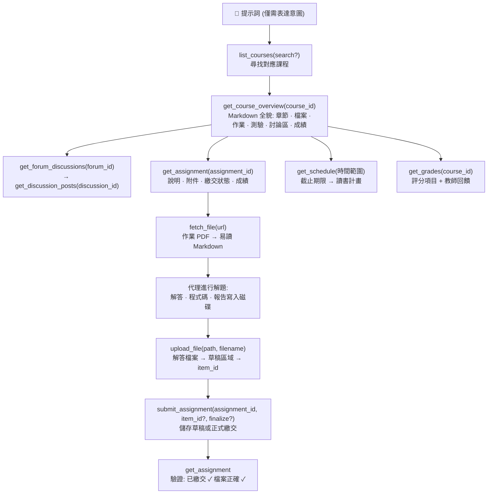

<p align="center">
  
</p>

# moodle-mcp

<p align="center">
  <a href="../README.md">English</a> | 
  <b>繁體中文</b> | 
  <a href="README.zh-CN.md">简体中文</a> | 
  <a href="README.ja.md">日本語</a> | 
  <a href="README.es.md">Español</a> | 
  <a href="README.de.md">Deutsch</a> | 
  <a href="README.pt-BR.md">Português</a> | 
  <a href="README.fr.md">Français</a>
</p>

[](https://github.com/G36maid/moodle-mcp/actions/workflows/ci.yml)
[](https://codecov.io/gh/G36maid/moodle-mcp)
[](https://github.com/G36maid/moodle-mcp/releases/latest)
[](https://crates.io/crates/moodle-mcp)
[](../LICENSE)
[](https://www.rust-lang.org)
[](https://modelcontextprotocol.io)
[](https://github.com/G36maid/moodle-mcp/actions/workflows/release.yml)

一個 [Model Context Protocol (MCP)](https://modelcontextprotocol.io) 伺服器，讓 LLM 代理能直接**操作真實的 Moodle LMS** — 閱讀課程、取得作業 PDF、撰寫程式碼、上傳並繳交作業 — 全部透過單一獨立的靜態二進位執行檔完成。

基於官方 Rust MCP SDK ([`rmcp`](https://crates.io/crates/rmcp)) 建置。已在 **Moodle 3.7 → 5.x** 上完成實際驗證。

---

## ❌ 沒有 moodle-mcp 時

一般的聊天機器人無法存取你的 Moodle，因此每個學習任務都必須手動進行：

- ❌ 只是為了知道「這週有什麼截止日期？」，就得開五個瀏覽器分頁
- ❌ 手動下載作業 PDF，再拖曳上傳到對話視窗
- ❌ 一頁一頁手動複製貼上討論區討論串與成績

## ✅ 使用 moodle-mcp 後

AI 代理能直接以你的身分登入。22 個具備型別定義的工具涵蓋完整的學生操作旅程，就像真人操作一樣 — 從快速確認截止時間到全自動作業輔助，完全不需要打開瀏覽器：

```txt
接下來兩週有什麼作業截止？請幫我規劃這段期間的讀書計畫。
```

```txt
幫我完成資訊安全 HW1：閱讀作業說明與附件 PDF，解出題目，並繳交草稿。
```

```txt
我錯過了這週資料通訊課程的進度 — 幫我整理摘要更新。
```

AI 代理會自行串接所需的工具鏈：課程架構 → 作業說明 → PDF 解析 → Markdown → 解題解答 → 上傳檔案 → 繳交草稿 → 回讀驗證。
完整操作情境請參閱 [提示詞範例](#-提示詞範例) 與 [代理工作原理](#-代理工作原理)。

## ✨ 特色亮點

- **開箱即用（Batteries included）** — 內建文件轉換（anydoc）、HTML → Markdown（htmd）、Token 命令列工具與通用備援呼叫：無需外掛插件、無需輔助腳本、無需第二個執行環境。
- **代理原生設計（Agent-native）** — 工具參數與回傳均使用**本機檔案路徑**而非 base64；查詢結果直接內嵌下一個工具所需的 ID；預設值自帶提示（例如 "pass course_ids to filter"）；錯誤訊息淺顯易懂並指引解決方向。
- **22 個專屬工具，符合人類直覺** — 每個工具都精準對應在 Moodle 上的實際操作步驟：課程、課程全貌、作業、繳交、討論區、檔案（取得/轉換/下載/上傳）、成績、時程表、私訊、測驗紀錄 — 而非生硬地 1:1 照搬 350+ 個原始 Web Service API；通用備援呼叫（`call_ws_function` + `list_functions`）則可涵蓋其餘所有功能。
- **單次呼叫獲取課程全貌** — `get_course_overview` 將五個 Moodle 端點整合成單一份 Markdown 文件，並內嵌所有活動 ID 與檔案連結。
- **PDF → Markdown** — 透過 [anydoc](https://crates.io/crates/anydoc) 將作業說明轉換為易讀的需求文字；透過 [htmd](https://crates.io/crates/htmd) 保留 HTML 說明中的表格結構。
- **版本自適應** — 經 Moodle 3.7 實測驗證，專為 4.x/5.x 架構設計；能自動相容不同版本的差異（函數名稱、分頁方式、回傳結構）。
- **預設安全** — 寫入操作強制要求確認；優先儲存為草稿而非直接繳交定稿；刻意**不提供**自動代考測驗功能。
- **單一靜態二進位檔案** — 無任何執行時期相依性。

## 📋 需求條件

- 一個你有帳號的 **Moodle 3.7 → 5.x** 站點
- 站點端已啟用 Web Services：允許 **REST 協定** 且你的帳號獲准使用 **`moodle_mobile_app`** 服務 — 這與官方 Moodle 手機 App 使用相同設定，因此絕大多數站點早已支援
- 強烈建議使用 **HTTPS** — 權杖會隨每次請求傳輸（詳見 [安全性說明](#-安全性說明)）
- 任何支援 MCP 的客戶端 — Claude Code、Codex、OpenCode、pi，或任何透過 stdio 通訊的 MCP 客戶端
- 僅在使用 `cargo install` 或從原始碼編譯時需要 Rust 1.88+（預編譯執行檔則完全不需要）

## 📦 安裝方式

### 下載預編譯執行檔

無需安裝 Rust 工具鏈 — 直接從 [最新 Release](https://github.com/G36maid/moodle-mcp/releases/latest) 下載適合你作業系統的壓縮檔：

| 平台 | 壓縮檔 |
|---|---|
| Linux x86_64 | `moodle-mcp-<version>-x86_64-unknown-linux-gnu.tar.gz` |
| Linux arm64 | `moodle-mcp-<version>-aarch64-unknown-linux-gnu.tar.gz` |
| macOS Apple Silicon | `moodle-mcp-<version>-aarch64-apple-darwin.tar.gz` |
| macOS Intel | `moodle-mcp-<version>-x86_64-apple-darwin.tar.gz` |
| Windows x64 | `moodle-mcp-<version>-x86_64-pc-windows-msvc.zip` |

```bash
tar xzf moodle-mcp-*-aarch64-apple-darwin.tar.gz
sudo mv moodle-mcp-*/moodle-mcp /usr/local/bin/   # 或任何在 PATH 內的目錄
```

### 或使用 cargo 安裝

```bash
cargo install moodle-mcp   # 需要 Rust 1.88+
```

### 或從原始碼編譯

```bash
git clone https://github.com/G36maid/moodle-mcp
cd moodle-mcp
cargo build --release
# 執行檔位於: target/release/moodle-mcp (~15 MB, 靜態連結)
```

### 取得權杖 (Token)

使用內建的 CLI 工具（相同執行檔）：

```bash
moodle-mcp auth
# Moodle URL (e.g. https://moodle.example.com): https://moodle.example.com
# Username: yourname
# Password: ********   （輸入時以 * 遮蔽）
# → export MOODLE_URL='https://moodle.example.com' MOODLE_TOKEN='…'
```

以參數（`--url`、`--username`、`--password`）傳入的值會跳過對應的提示，因此腳本也能以非互動方式運行。

若學校使用 SSO 單一登入（無純文字密碼），改在瀏覽器中開啟安全性金鑰頁面：

```bash
moodle-mcp auth --url https://moodle.example.com --open
```

若權杖取得失敗，表示站點缺少 [需求條件](#-需求條件) 中的設定 — 請洽詢學校管理員啟用 Web Services。

### 連接客戶端

所有客戶端均透過相同的 stdio 伺服器通訊：在環境變數中設定 `MOODLE_URL` 與 `MOODLE_TOKEN` 並啟動 `/path/to/moodle-mcp`。Claude Code 也可以透過單行指令直接設定：

```bash
claude mcp add moodle \
  --env MOODLE_URL=https://moodle.example.com \
  --env MOODLE_TOKEN=your-token \
  -- /path/to/moodle-mcp
```

其他客戶端設定方式：

<details open>
<summary><b>Claude Code</b> — <code>.mcp.json</code> (專案) 或 <code>~/.claude.json</code> (全域)</summary>

```json
{
  "mcpServers": {
    "moodle": {
      "command": "/path/to/moodle-mcp",
      "env": {
        "MOODLE_URL": "https://moodle.example.com",
        "MOODLE_TOKEN": "your-token"
      }
    }
  }
}
```

</details>

<details>
<summary><b>Codex</b> — <code>~/.codex/config.toml</code> (全域)</summary>

```toml
[mcp_servers.moodle]
command = "/path/to/moodle-mcp"
env = { "MOODLE_URL" = "https://moodle.example.com", "MOODLE_TOKEN" = "your-token" }
```

</details>

<details>
<summary><b>OpenCode</b> — <code>opencode.json</code> (專案) 或 <code>~/.config/opencode/opencode.json</code> (全域)</summary>

```json
{
  "mcp": {
    "moodle": {
      "type": "local",
      "command": ["/path/to/moodle-mcp"],
      "environment": {
        "MOODLE_URL": "https://moodle.example.com",
        "MOODLE_TOKEN": "your-token"
      }
    }
  }
}
```

</details>

<details>
<summary><b>pi</b> — <code>.pi/mcp.json</code> (專案) 或 <code>~/.pi/agent/mcp.json</code> (全域)</summary>

```json
{
  "mcpServers": {
    "moodle": {
      "command": "/path/to/moodle-mcp",
      "env": {
        "MOODLE_URL": "https://moodle.example.com",
        "MOODLE_TOKEN": "your-token"
      }
    }
  }
}
```

</details>

| 環境變數 | 必填 | 預設值 | 說明 |
|---|:---:|---|---|
| `MOODLE_URL` | ✔ | — | 站點根網址，末端不加斜線 |
| `MOODLE_TOKEN` | ✔ | — | Web Service 存取權杖 |
| `MOODLE_TIMEOUT_SECS` | — | `60` | 單次請求逾時秒數 |
| `RUST_LOG` | — | `info` | 日誌過濾等級（日誌輸出至 stderr；stdout 為 MCP 通訊串流） |

## 💬 提示詞範例

以下指令均可直接執行，無需額外設定 — AI 代理會自行閱讀工具描述並串接呼叫鏈：

### 全自動任務（單一提示詞完成完整流程）

| 你的指令 | 代理串接的工具鏈 |
|---|---|
| *「幫我完成資訊安全 HW1：閱讀作業說明與附件 PDF，解出題目，並繳交草稿。」* | `get_assignment`（說明與附件）→ `fetch_file`（PDF 轉 Markdown，包含數學式）→ 進行解題 → 產生解答檔案 → `upload_file` → `submit_assignment` → `get_assignment`（驗證繳交狀態 ✓） |
| *「根據接下來的截止日期與課程教材，為我制定未來兩週的完整讀書計畫。」* | `get_schedule`（所有截止時程）→ 針對各科呼叫 `get_course_overview`（教材與閱讀清單）→ 結合期限平衡規劃每日行程 |
| *「我錯過了這週資料通訊課程的進度 — 幫我整理摘要，包含公告討論區。」* | `get_notifications` + `get_forum_discussions` → `get_discussion_posts` → 彙整週摘要精華 |
| *「幫我準備軟體工程的測驗：老師在上面發布了什麼注意事項？」* | `get_course_overview`（測驗項目）→ `get_assignment`（規定）→ 相關討論串 |

### 快速查詢

| 你的指令 | 代理串接的工具鏈 |
|---|---|
| *「接下來兩週有什麼作業截止？」* | `get_schedule` → 合併截止日、測驗結束時間與行事曆活動 |
| *「HW1 作業要求是什麼？請讀取說明。」* | `get_assignment` → `fetch_file` 將附件 PDF 轉為 Markdown |
| *「我資料通訊實驗的成績如何？」* | `list_courses` → `get_grades(course_id)` → 評分項目、回饋與權重 |
| *「我的哪些課程已經有打分數的項目？」* | `get_grades()` → 跨課程成績總覽 |
| *「整理資料通訊討論區的所有公告。」* | `get_course_overview` → `get_forum_discussions` → `get_discussion_posts` |
| *「上傳我的 Quiz1 solution.pdf 並儲存為草稿。」* | `upload_file` → `submit_assignment(item_id, finalize=false)` |
| *「軟體工程課程接下來有什麼排程？」* | `get_course_overview` → 單元章節、檔案、討論區 |
| *「我可以發訊息給老師請求延長期限嗎？」* | `get_user` / `get_conversations` → 起草草稿 → 使用者確認 → `send_message` |

## 🔄 代理工作原理

工具的設計完整鏡射人類操作 Moodle 的思維 — 每層工具的輸出都包含下一層所需的 ID。所有流程均始於課程列表與課程架構，代理自此向下深入或獨立執行完整工作流程：



基本元件可靈活組合成更宏大的工作流程 — 例如讀書計畫由 `get_schedule`（截止時程）加上各課程的 `get_course_overview`（教材）組成；每週摘要由 `get_notifications` 加上討論區讀取鏈組合而成。

20 個專屬工具未涵蓋的邊緣需求，皆可透過 `call_ws_function` + `list_functions` 備援呼叫達成 — 完整涵蓋該 Token 所能呼叫的 ~350 個 API 函數（20 + 2 = 共 22 個工具）。

## 🛠 工具列表

讀寫狀態（RW）代表呼叫對 Moodle 產生的影響：📖 唯讀 · ✍️ 寫入。寫入工具代表權杖擁有者執行動作；伺服器指令要求代理在執行前必須先向你確認，且檔案上傳會進入你的私人草稿區，而非直接送交給老師。

### 身分與課程
| 工具 | 簽章 | RW | 用途 |
|---|---|:-:|---|
| `whoami` | `()` | 📖 | 權杖擁有者身分與站點/版本資訊 |
| `list_courses` | `(search?)` | 📖 | 已選課程清單；可選名稱關鍵字篩選 |
| `get_course_overview` | `(course_id)` | 📖 | 完整單一課程 Markdown 全貌地圖 |

### 作業
| 工具 | 簽章 | RW | 用途 |
|---|---|:-:|---|
| `get_assignment` | `(assignment_id)` | 📖 | 完整文件：時限、狀態、說明、附件、繳交紀錄、成績與評語 |
| `submit_assignment` | `(assignment_id, text?, item_id?, finalize?)` | ✍️ | 唯一的作業寫入工具：線上文字與/或草稿檔案，可選是否定稿 |

### 討論區
| 工具 | 簽章 | RW | 用途 |
|---|---|:-:|---|
| `get_forum_discussions` | `(forum_id)` | 📖 | 討論串列表及首篇貼文預覽 |
| `get_discussion_posts` | `(discussion_id)` | 📖 | 完整討論串內容，已轉換為 Markdown 並含附件 |
| `create_forum_discussion` | `(forum_id, subject, message)` | ✍️ | 發起新討論串 |
| `reply_to_discussion` | `(post_id, subject, message)` | ✍️ | 回覆貼文（回覆首篇 = 回覆該討論串） |

### 檔案
| 工具 | 簽章 | RW | 用途 |
|---|---|:-:|---|
| `fetch_file` | `(url)` | 📖 | 將 PDF/DOCX/PPTX/XLSX/ODT/RTF/EPUB/CSV 轉為 Markdown（anydoc）；上限 10 萬字 |
| `download_file` | `(url, save_to)` | 📖 | 將原始位元組儲存至本機路徑（僅限中繼資料） |
| `upload_file` | `(path, item_id?)` | ✍️ | 將本機檔案上傳至使用者草稿區域 |

### 成績、排程、通訊
| 工具 | 簽章 | RW | 用途 |
|---|---|:-:|---|
| `get_grades` | `(course_id?)` | 📖 | 跨課程總評摘要，或單一課程的所有成績項目 |
| `get_schedule` | `(time_from?, time_to?, course_ids?)` | 📖 | 合併的時間軸（預設：未來 30 天） |
| `get_notifications` | `(read?, limit?)` | 📖 | 近期系統通知 |
| `get_conversations` | `(limit?)` | 📖 | 私訊對話列表及成員 ID |
| `send_message` | `(user_id, text)` | ✍️ | 發送個人私訊 |
| `get_quiz_attempts` | `(quiz_id)` | 📖 | 測驗作答歷史紀錄（唯讀） |
| `get_user` / `search_users` | `(field, value)` / `(search?, limit?)` | 📖 | 個人資料查詢 / 搜尋使用者 |

### 通用備援呼叫
| 工具 | 簽章 | RW | 用途 |
|---|---|:-:|---|
| `call_ws_function` | `(wsfunction, params?)` | 📖/✍️ | 呼叫任何已啟用的 Web Service 函數（自動處理 PHP 陣列格式） |
| `list_functions` | `(query?)` | 📖 | 依關鍵字搜尋可呼叫的 API 函數 |

## 🔐 安全性說明

- 請一律使用 **HTTPS** — 權杖會隨每次 HTTP 請求傳輸。
- 權杖屬於敏感憑證：切勿提交到版本控制中，切勿發送至 Moodle 以外的主機（伺服器僅會將權杖注入同站點的 `pluginfile.php` 網址，並會攔截離開 Moodle 網域的重新導向）。
- 權杖絕不會出現在工具輸出或錯誤訊息中：任何出現在錯誤訊息中的 `token=…` 都會被遮蔽為 `token=[REDACTED]`。
- 傳輸流量受到嚴格限制：行內提取上限 100 MB、串流下載上限 500 MB、檔案上傳上限 100 MB。下載操作會串流寫入磁碟（絕不在記憶體中完整緩衝），並由讀取逾時（而非總時長逾時）監控，確保大檔案傳輸順畅的同時中斷卡死的連線。
- 寫入工具代表**權杖擁有者**操作。伺服器系統提示會指示代理在繳交或發送前必須先向使用者確認。
- 系統刻意**不支援**自動參與線上測驗。

## 🧰 開發與測試

```bash
cargo test                 # 39 個測試：單元測試 + wiremock 整合測試 + MCP 協定測試
cargo clippy --all-targets
cargo fmt -- --check
cargo build --release
```

工具間的 ID 傳遞關係：

| ID 類型 | 產生工具 | 消耗工具 |
|---|---|---|
| `course_id` | `list_courses` / `get_course_overview` | `overview` / `grades` / `schedule` / `assignments` |
| `forum_id` | `get_course_overview` | `get_forum_discussions` / `create_forum_discussion` |
| `discussion_id` | `get_forum_discussions` | `get_discussion_posts` |
| `post_id` | `get_discussion_posts` | `reply_to_discussion` |
| `assignment_id` | `get_course_overview` / `get_assignment` | `get_assignment` / `submit_assignment` |
| `item_id` (草稿) | `upload_file` | `submit_assignment` |
| `user_id` | `conversations members` / `notifications` / `get_user` | `send_message` / `get_user` |

## 📄 授權條款

MIT — 詳見 [LICENSE](../LICENSE)。
