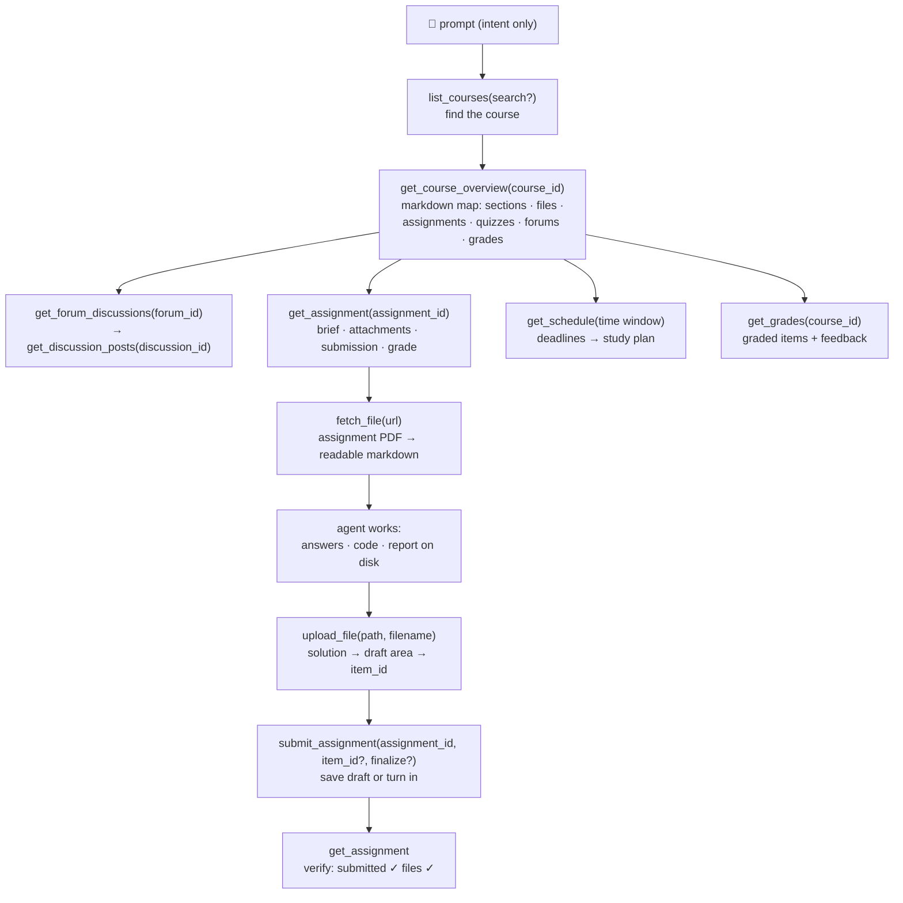

<p align="center">
  
</p>

# moodle-mcp

<p align="center">
  <a href="../README.md">English</a> | 
  <b>繁體中文</b> | 
  <a href="README.zh-CN.md">简体中文</a> | 
  <a href="README.ja.md">日本語</a> | 
  <a href="README.es.md">Español</a> | 
  <a href="README.de.md">Deutsch</a> | 
  <a href="README.pt-BR.md">Português</a> | 
  <a href="README.fr.md">Français</a>
</p>

[](https://github.com/G36maid/moodle-mcp/actions/workflows/ci.yml)
[](https://codecov.io/gh/G36maid/moodle-mcp)
[](https://github.com/G36maid/moodle-mcp/releases/latest)
[](https://crates.io/crates/moodle-mcp)
[](../LICENSE)
[](https://www.rust-lang.org)
[](https://modelcontextprotocol.io)
[](https://github.com/G36maid/moodle-mcp/actions/workflows/release.yml)

一個 [Model Context Protocol](https://modelcontextprotocol.io) 伺服器，讓 LLM 代理能**操作真實的 Moodle LMS** — 閱讀課程、取得作業 PDF、撰寫程式碼、上傳並繳交作業 — 全部透過單一靜態二進位檔完成。

以 Rust 基於官方 MCP SDK ([`rmcp`](https://crates.io/crates/rmcp)) 建置。已在 Moodle 3.7、4.5 與 5.2 上完成實際驗證;面向 **3.7 → 5.x** 設計。

## ✅ 為什麼需要 moodle-mcp

一般的聊天機器人無法存取你的 Moodle，每個學習任務都只能手動完成 — 開五個瀏覽器分頁只為了回答「這週有什麼要截止？」、手動重新上傳 PDF、討論區與成績一頁一頁複製貼上。

moodle-mcp 讓代理以你的身分登入。20 個具型別的工具涵蓋完整的學生旅程，代理會自行串接這些工具 — 全程不必打開瀏覽器：

- **開箱即用（Batteries included）** — 文件轉換、HTML → Markdown、auth 命令列工具與可選用的備援呼叫，全部裝進一個執行檔：無需外掛、無需輔助腳本、無需第二個執行環境
- **代理原生設計（Agent-native）** — 工具接收並回傳本機檔案路徑而非 base64；每次結果都內嵌下一次呼叫所需的 ID；錯誤訊息淺顯易懂並指引解決方向
- **預設安全** — 寫入類工具會先徵得你同意，繳交內容在你點頭前都保持草稿；刻意不提供代考測驗功能
- **版本自適應** — 經 Moodle 3.7 實測驗證，為 4.x/5.x 而設計；版本間的回應差異會自動被吸收
- **單一靜態二進位檔** — 無任何執行時期相依性

## 🚀 快速開始

需要一個 Moodle 3.7 → 5.x 站點上允許使用手機 App Web Service 的帳號（多數站點皆允許 — 詳見[先決條件](https://moodle.ntnu.cc/docs/getting-started.html#prerequisites)）。

```bash
# 1. Install
cargo install moodle-mcp        # or grab a prebuilt binary — no Rust needed

# 2. Log in once — prints MOODLE_URL and MOODLE_TOKEN
moodle-mcp auth

# 3. Connect your client (Claude Code shown; Codex/OpenCode/pi below)
claude mcp add moodle \
  --env MOODLE_URL=https://moodle.example.com \
  --env MOODLE_TOKEN=your-token \
  -- /path/to/moodle-mcp

# 4. Open a chat and ask:
#    "What's due in the next two weeks? Plan my studying around it."
```

或把這段貼進你的 agent,讓它代做每一步(它會在自己的終端機開啟 `moodle-mcp auth`——學校帳密在終端機裡輸入,不是貼進對話):

```text
Set up moodle-mcp (github.com/G36maid/moodle-mcp): read docs/src/installation.md
and docs/src/configuration.md from the repo's main branch first. Then install
the binary for my platform, run `moodle-mcp auth` in the terminal so I can
type my school credentials when it prompts, and register the server in your
own MCP config using the snippet for your harness. Never store or repeat my
credentials; ask before anything global.
```

預編譯執行檔、SSO 登入、各客戶端的設定範例，以及完整的環境變數參考：[安裝](https://moodle.ntnu.cc/docs/installation.html) · [快速入門](https://moodle.ntnu.cc/docs/getting-started.html) · [設定](https://moodle.ntnu.cc/docs/configuration.html)

## 💬 代理能做什麼

以下指令皆無需額外設定即可使用 — 代理會從工具描述中自行發現工具並串接呼叫：

| 你的指令 | 代理串接的工具鏈 |
|---|---|
| *「幫我完成資訊安全 HW1：閱讀作業說明與附件 PDF，解出題目，並繳交草稿。」* | `get_assignment` (brief + attachments) → `fetch_file` (PDF → markdown, math included) → solves it → writes the answer file → `upload_file` → `submit_assignment` → `get_assignment` (verify submitted ✓) |
| *「根據接下來的截止日期與課程教材，為我制定未來兩週的完整讀書計畫。」* | `get_schedule` (all deadlines) → `get_course_overview` per course → day-by-day plan balanced against due dates |
| *「我錯過了這週資料通訊課程的進度 — 幫我補上進度，包含公告討論區。」* | `get_notifications` + `get_forum_discussions` → `get_discussion_posts` → synthesized weekly digest |
| *「幫我準備軟體工程的測驗：老師在上面發布了什麼相關事項？」* | `get_course_overview` (quiz entry) → `get_assignment` (requirements) → related forum threads |

## 🔄 代理如何運作

工具的設計鏡射你在 Moodle 中的操作路徑 — 每一層的輸出都內嵌下一層所需的 ID：



專屬工具未涵蓋的操作，都能透過 `call_ws_function` + `list_ws_functions` 備援呼叫達成 — 涵蓋一般權杖所能呼叫的全部約 350 個函數（20 + 2 = 共 22 個工具；備援呼叫需透過 `MOODLE_ENABLE_WS_FUNCTION=true` 自行開啟）。

## 📚 說明文件

完整說明文件位於 [`docs/`](https://moodle.ntnu.cc/docs/)（mdBook — 在本機執行 `mdbook serve docs` 即可閱讀）：

| 頁面 | 內容 |
|---|---|
| [快速入門](https://moodle.ntnu.cc/docs/getting-started.html) | 從零到第一個提示詞；不需要 MCP 經驗 |
| [安裝](https://moodle.ntnu.cc/docs/installation.html) | 預編譯執行檔、cargo、從原始碼建置 |
| [設定](https://moodle.ntnu.cc/docs/configuration.html) | 每個環境變數；Claude Code、Codex、OpenCode 與 pi 的設定範例 |
| [工具](https://moodle.ntnu.cc/docs/tools.html) | 完整的 22 個工具參考，以及工具之間的 ID 傳遞關係 |
| [安全性與驗證](https://moodle.ntnu.cc/docs/security.html) | 權杖生命週期、傳輸與寫入安全 |
| [更新日誌](https://moodle.ntnu.cc/docs/changelog.html) | 逐版本發行說明 |
| [開發](https://moodle.ntnu.cc/docs/development.html) | 架構導覽、測試、發佈流程 |
| [關於](https://moodle.ntnu.cc/docs/about.html) | moodle-mcp、MCP 與 Moodle 分別是什麼 |

## 🧰 開發

```bash
cargo test                 # unit + wiremock integration + MCP protocol tests
cargo clippy --all-targets
cargo fmt -- --check
cargo build --release
```

專案說明文件位於 [`docs/`](https://moodle.ntnu.cc/docs/) — mdBook 格式，以 Prettier 排版（見 `docs/README.md`）；可用 `mdbook serve docs` 預覽。

專案首頁位於 [`site/`](../site/) — Astro 7 + TypeScript（`cd site && npm install && npm run dev`，以 `npm run build` 建置）。

## 🔐 安全性

請一律使用 **HTTPS** — 權杖會隨每個請求傳輸。它絕不會出現在工具輸出或錯誤訊息中，也只會被注入同站點的 Moodle 網址，且寫入類工具會在執行前先徵得你同意。完整細節請見[安全性與驗證](https://moodle.ntnu.cc/docs/security.html)。

## 📄 授權條款

MIT — 詳見 [LICENSE](../LICENSE)。
